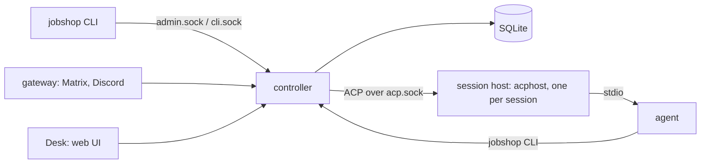

# jobshop

> Agents: start at [llm/README.md](llm/README.md).

Jobshop runs pools of coding agents (any ACP agent, for example
`jcode acp`) against a ticket store. Agents claim tickets, do the work in
their own git worktree and sandbox, and close them. Workflows chain steps
across pools, and humans are pulled in only where needed. Jobshop
develops itself this way: issues on this repo are planned, implemented,
reviewed, merged and deployed by Jobshop pools.

## Goals

- A small core you own: SQLite, one controller, one binary.
- Behavior defined in packs you write, not in the core.
- Agents sandboxed and scoped, never holding long-lived keys.
- Sessions survive controller restarts and deploys.
- Humans see what waits on them (attention, Desk, chat) and can step in
  anywhere.

## How it works



- [**Tickets**](docs/data-model.md): one graph of work items with blocking edges, claims and comments.
- [**Pools and sessions**](docs/running.md#concepts): a pool runs agent sessions, each in its own worktree and sandbox.
- [**Workflows and runs**](docs/packs.md#the-parts): a run is one ticket per step, each step in a pool, with retries and escalation.
- [**Triggers**](docs/notes/26-triggers.md): create tickets or start runs from counts, cron, shell checks or stall signals.
- [**Packs**](docs/packs.md): directories of pools, prompts, triggers and workflows you write.
- [**Gateways and Desk**](docs/notes/202-desk.md): chat (Matrix, Discord) and a web UI over the admin socket.

## Example flows

Shipped in [`packs/`](packs/):

- **Issue to deployed change** ([`packs/github`](packs/github/README.md) `pr-work`):
  an issue starts a run. `implement` opens a PR, `review-merge` reviews and
  merges it, and a post-merge step checks the deploy. Failed steps retry,
  then escalate to a human.
- **Stalled work** (`stall-check`): unclaimed tickets, silent sessions and
  green PRs nobody merged each start a diagnose run that fixes what it can.
- **Red master** (`ci-repair`): a failing master SHA starts one repair run,
  keyed by the SHA.
- **Linear intake** ([`packs/github`](packs/github/README.md#linear-instance)):
  an eligible Linear issue starts a run, and comments flow back to the
  ticket.
- **Learning from past work** ([`packs/selfdev`](packs/selfdev/README.md)
  `curate`/`evaluate`): agents record corrections and failures, and a
  curator turns them into learnings later sessions recall.

Planned: **escalation to a human or another agent** (#547). Also possible
with the same primitives: a nightly dependency-bump cron, or a monitoring
webhook ([generic ingest](docs/ingest.md#generic-endpoints)) that files a
triage ticket into an on-call pool.

## Quick start

```
nix build .#jobshop
jobshop init ./root          # writes root/jobshop.yaml
```

Point `root/jobshop.yaml` at one pack:

```yaml
default_project: js
projects: {js: {}}
agents:
  jcode: {command: jcode, args: [acp]}
packs:
  - path: packs/main
    vars: {checkout: /srv/widget, agent: jcode}
```

```
cd root && jobshop serve
jobshop run start change --var task="add a --verbose flag" --key verbose
jobshop desk                 # web UI on 127.0.0.1:7480
```

The rest is in [docs/running.md](docs/running.md).

## Docs

| Doc | What |
| --- | --- |
| [docs/packs.md](docs/packs.md) | Writing a pack, and the example packs |
| [docs/running.md](docs/running.md) | Concepts, running a root, config and secrets |
| [docs/isolation.md](docs/isolation.md) | Sandbox, sockets, credentials, hooks, limits |
| [docs/ingest.md](docs/ingest.md) | Webhooks and generic ingest |
| [docs/nixos.md](docs/nixos.md) | NixOS module |
| [docs/desk-plugins.md](docs/desk-plugins.md) | Writing a Desk plugin, with `examples/desk-plugins/csv-table` |
| [docs/plan.md](docs/plan.md) | Design, phases and the dated decision log |
| [docs/layout.md](docs/layout.md) | Packages, dependencies, build and deployment |
| [docs/data-model.md](docs/data-model.md) | Tables and queries |
| [docs/notes/](docs/notes/) | Behavior as built, one note per change |
| [docs/verify/](docs/verify/) | Runbook checks against a live host |
| [`target` issues](https://github.com/elee1766/jobshop/issues?q=is%3Aopen+label%3Atarget) | Progress |

## Develop

`go build ./... && go vet ./... && go test ./... && golangci-lint run ./...`.
Contributor rules for people and agents (sqlc, Desk `dist`, Nix
`vendorHash`) are in [AGENTS.md](AGENTS.md); PR titles are conventional
commits ([CONTRIBUTING.md](CONTRIBUTING.md)).

## License

AGPL-3.0 ([LICENSE](LICENSE)); `packs/` and `examples/` are Apache-2.0, so
packs and plugins built from them can use any license.
