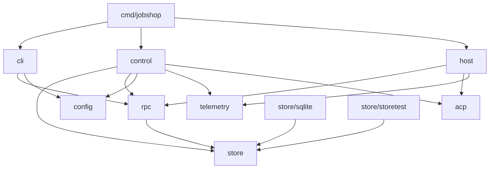

# Jobshop: repo layout and build (draft)

Status: draft for discussion. Companion to `plan.md`.

## Principles

- One binary, `jobshop`, with subcommands. The controller, session host,
  CLI and (later) gateway are the same executable, so the host can be
  spawned from `/proc/self/exe` and there is one thing to build, pin and
  roll back.
- `internal/` for everything. Nothing is a public Go API until something
  outside this repo needs it.
- Packages follow the architecture boundaries in `plan.md`: store, control
  (controller), session host, rpc (sockets), config, telemetry. Packages
  import downward only; `cmd/` wires them together.
- No role names in Go. Agents, pools and prompts live in config.
- Plain `go` for development and CI. Nix builds the deployable package and
  the NixOS module.

## Tree

```
jobshop/
├── cmd/jobshop/              main: subcommand dispatch only
├── internal/
│   ├── store/                Store interface, Ticket/Edge/Comment types, errors,
│   │   │                     engine kinds and their typed field structs
│   │   ├── storetest/        conformance suite every backend runs
│   │   └── sqlite/           modernc.org/sqlite backend
│   │       └── migrations/   *.sql, embedded, applied in order
│   ├── rpc/                  JSON-RPC method names, request/response types,
│   │                         client and server helpers over go.lsp.dev/jsonrpc2
│   ├── control/              controller: tick loop, claims release, lease sweep,
│   │                         session supervision, admin and CLI socket handlers
│   ├── host/                 session host: spawn agent, ACP proxy, journal,
│   │                         replay, backpressure, leak guards
│   ├── acp/                  ACP framing and the few message types the host and
│   │                         controller parse (wraps the chosen ACP SDK)
│   ├── config/               YAML loading, validation, defaults
│   ├── telemetry/            OTel providers, slog bridge, Prometheus exporter,
│   │                         conversation export
│   ├── cli/                  CLI subcommands (ticket, claim, assign, session, ...)
│   └── ids/                  ticket id generation (per-project prefix)
├── docs/                     plan.md, data-model.md, layout.md
├── examples/                 sample jobshop.yaml, agent prompts
├── nix/
│   ├── package.nix           buildGo127Module derivation
│   └── module.nix            NixOS module: user, slice, service
├── flake.nix
├── flake.lock
├── go.mod
├── go.sum
└── .github/workflows/ci.yml
```

Dependency direction (an arrow means "may import"):



`host` never imports `store` or `control`: it has no ticket or policy logic
(plan section 8.3), which keeps it small and rarely changing.

Subcommands:

| Command | Runs |
|---|---|
| `jobshop serve` | controller (long-running) |
| `jobshop session-host <id>` | session host, spawned by the controller only |
| `jobshop ticket ...`, `claim`, `assign`, `comment`, ... | CLI over a socket |
| `jobshop session list/attach/reap` | CLI over the admin socket |
| `jobshop migrate` | apply store migrations (also done on `serve` start) |

## Build

**Development and CI: plain Go.**

```
go build ./...
go vet ./...
golangci-lint run
go test -race ./...
```

CI runs those on GitHub Actions, plus `nix build` to catch packaging
breakage. No Makefile unless a real need appears.

**Deployment: Nix flake.**

- Inputs: `nixpkgs` pinned to `nixos-26.05`, the same channel gasserver
  runs. It ships `buildGo127Module` (Go 1.27.3), matching `go.mod`.
- `packages.x86_64-linux.jobshop`: `buildGo127Module`, `subPackages =
  [ "cmd/jobshop" ]`, `CGO_ENABLED = 0` (pure-Go SQLite), version and
  commit via `-ldflags -X`, `vendorHash` pinned. Tests run in CI, not in
  the Nix build (`doCheck = false`), same as Gas City's flake.
- `nixosModules.jobshop`: the deployment unit (below).
- `devShells.default`: go, gopls, golangci-lint, sqlite.

## Deployment on gasserver (decided 2026-11-01)

gasserver is an isolated OVH machine; Jobshop runs there next to Gas City
as its own user, not as `agent`.

- **User `jobshop`**: own home, own data dir (`/var/lib/jobshop` or
  `~jobshop/data`), own GitHub identity (`cog` credentials via sops).
- **Resource limit via its own slice**: `jobshop.slice` with
  `AllowedCPUs` pinned to 6 cores and `MemoryMax = 8G` (plus a lower
  `MemoryHigh`), `TasksMax`, and oomd pressure kill, mirroring how
  `modules/resources.nix` caps `user-1001.slice` for `agent`.
  `AllowedCPUs` gives a hard 6-core cap; `CPUQuota=600%` is the
  alternative if pinning to specific cores is undesirable.
- **Network**: same egress policy as `agent` (public internet and
  loopback; no private, CGNAT/tailnet or link-local ranges), copied from
  `modules/agent/default.nix`.
- **Service**: `jobshop.service` runs `jobshop serve` as `jobshop` in
  `jobshop.slice`, with `KillMode=process` so restarting the controller
  does not kill session hosts (they are children of the controller but
  must outlive it, plan section 8.2). Session hosts started with `setsid`
  stay in the service's cgroup, so they inherit the slice limits.
- **Binary pinning**: the NixOS module points at a specific `jobshop`
  store path. Promote = bump the flake input on gasserver and switch;
  rollback = previous generation. This replaces the symlink scheme in
  plan section 7.
- **Where the module lives**: `nixosModules.jobshop` in this repo, imported
  by `gasserver.nix` as a flake input. Host-specific values (core list,
  secrets) stay in `gasserver.nix`.

Open questions:
- `KillMode=process` leaves hosts running on `systemctl stop`, which is the
  point, but also on a deliberate full shutdown. Add a `jobshop session
  reap --all` ExecStop variant for explicit full stops?
- Which 6 cores: a fixed range (e.g. 42-47) so Jobshop never competes with
  Gas City's hottest cores, or CPUQuota and let the scheduler place it?
- Hot restart vs Nix switch: switching to a new store path restarts
  `jobshop.service`; hosts keep running the old store path until their
  sessions end. Keep old generations until no host references them (GC
  roots per running host).
