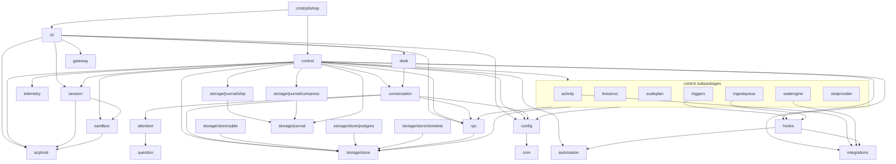

# Jobshop: repo layout and build

Companion to `plan.md`.

## Principles

- One binary, `jobshop`, with subcommands. The controller, session host,
  CLI and (later) gateway are the same executable, so the host can be
  spawned from `/proc/self/exe` and there is one thing to build, pin and
  roll back.
- `pkg/` for all packages (decided 2026-11-01). Importable, but no API
  stability promise until something outside this repo depends on it.
- Packages follow the architecture boundaries in `plan.md`: store, control
  (controller), session host, rpc (sockets), config, telemetry. Packages
  import downward only; `cmd/` wires them together.
- No role names in Go. Agents, pools and prompts live in config.
- Plain `go` for development and CI. Nix builds the deployable package and
  the NixOS module.

## Tree

```
jobshop/
├── cmd/jobshop/              thin entry point: cli.Main(os.Args, control.Run); the one
│                             place the CLI and the controller meet (JOB-174)
├── pkg/
│   ├── domain/               shared types and invariants, standard library only: Ticket,
│   │                         Edge, Comment, kinds and their typed fields, waits,
│   │                         learnings, resources and slots, inbox items, guard
│   │                         decisions, question options (JOB-166)
│   ├── storage/              namespace, no universal Storage interface (JOB-173)
│   │   ├── store/            Store interface, its filters and update shapes, collections,
│   │   │   │                 the tracing wrapper. Types live in domain
│   │   │   ├── storerules/   I/O-free rules both backends apply alike (JOB-40)
│   │   │   ├── storetest/    conformance suite every backend runs
│   │   │   ├── storemigrate/ SQLite to Postgres copy (#632)
│   │   │   ├── writekey/     idempotency keys for tracker writes (#280)
│   │   │   ├── sqlite/       modernc.org/sqlite backend (JOB-42)
│   │   │   │   ├── migrations/ goose *.sql files, embedded
│   │   │   │   └── sqldb/    hand-written SQL
│   │   │   └── postgres/     Postgres backend (JOB-41)
│   │   │       ├── migrations/ goose *.sql files, embedded
│   │   │       └── pgdb/     hand-written SQL
│   │   └── journal/          journal rows, the VictoriaLogs client, paging, search and
│   │       │                 recall summaries (#530, JOB-140)
│   │       ├── ship/         journal shipping to VictoriaLogs (JOB-119)
│   │       ├── compress/     closed-session journal compression (JOB-89)
│   │       ├── vltest/       a real VictoriaLogs for tests
│   │       └── journalvl/    tests only: shipping and search against a real VictoriaLogs
│   ├── control/              controller: tick loop, claims release, lease sweep,
│   │   │                     session supervision, admin and CLI socket handlers.
│   │   │                     Wiring and coordination; subsystem engines live in
│   │   │                     the packages below, which never import it
│   │   │                     (docs/notes/JOB-155-control-audit.md)
│   │   ├── activity/         activity feed cache, poller and readers (JOB-149)
│   │   ├── linearsvc/        Linear sweeps, intake, webhook, asks, outage backoff (JOB-142)
│   │   ├── scaleplan/        pool scaling decisions, pure (JOB-155)
│   │   ├── stepexec/         command, http and script step attempts: templating, run dir
│   │   │                     placement, one attempt to a Result (JOB-157); the controller
│   │   │                     keeps claims, leases, the step record and escalation
│   │   ├── ingestqueue/      spool drain, inbox notifier, worker heartbeats,
│   │   │                     admission hook runner, ingest work loop (JOB-141)
│   │   ├── slotprovider/     resource slot provider calls, demand, idle release,
│   │   │                     slot env and prompt (JOB-158)
│   │   ├── triggers/         trigger and scan evaluation, event routing, off-tick
│   │   │                     checks (JOB-145); the controller still fires
│   │   ├── waitengine/       wait evaluation and wake planning, no writes (JOB-144)
│   │   ├── threads/          thread subscriptions: discovery, comment sources,
│   │   │                     poll plan, reply filters, message text; delivery
│   │   │                     stays in control (JOB-156)
│   │   └── controltest/      starts a controller for tests outside the package (JOB-47)
│   ├── conversation/         managed-chat rules (desk, escalation, attention), escalation chat
│   │   │                     policy, message envelope and addressing, attachment limits and
│   │   │                     prompt blocks. Never imports control (JOB-171)
│   │   ├── attention/        attention projection and item choices (JOB-147)
│   │   └── question/         question ticket content and options (JOB-147)
│   ├── hooks/                durable hook and callback invocations, audit, replay,
│   │                         transports (JOB-148 audit: the host adapter is in control)
│   ├── execution/            what runs a process or a script (JOB-167); never imports
│   │   │                     control, and command paths reach only automation and sandbox
│   │   ├── session/          session host start, adopt, stop and liveness, background job
│   │   │                     scan, shell probe, mapped homes, slot allocation, host
│   │   │                     connect, ACP client and traffic, and spec.json on acphost
│   │   │                     (an older conv_export field is ignored, #530)
│   │   ├── sandbox/          process isolation and resource mechanics: sandbox spec, mapped
│   │   │                     user, ACLs and mount checks, cgroups and the delegated
│   │   │                     setup, one isolated command run. No session lifecycle;
│   │   │                     hook, step and Desk commands use it as sessions do
│   │   └── automation/       trusted Starlark hook engine; api/ is the shared
│   │                         contract, command/ github/ http/ jev/ linear/ tickets/
│   │                         are the bounded host capabilities
│   ├── integrations/         provider clients and credentials (JOB-169); no shared
│   │   │                     tracker interface, github and linear never import each other
│   │   ├── apicall/          token source and per-call options Linear and GitHub share
│   │   ├── github/           GitHub REST client and read-only observation of
│   │   │                     PRs, checks, reviews and threads (JOB-143)
│   │   ├── linear/           Linear GraphQL client (#201)
│   │   ├── identity/         credentials for configured identities: App tokens,
│   │   │                     Linear client_credentials (#200), the host's gh token
│   │   └── internal/transport/  token renewal on 401 and the body limit both clients use
│   ├── browse/               read-only Linear and GitHub browse service behind
│   │                         browse.*: scope, cache, rate-limit blocking (JOB-163)
│   ├── ingest/               webhook spool and inbox types (#318)
│   ├── knowledge/            learnings (#264) and memory edits (#274, #592) on store
│   │   │                     collections, the curator gate's metrics and verdict, and
│   │   │                     the record, measure, settle, write and restore mechanics
│   │   │                     (JOB-170). Control decides who and when
│   │   └── memory/           memory directory: files, skills, bounded rendering, scope
│   │                         targets and file writes (#266). Imports nothing of the
│   │                         module, so it works without the database
│   ├── config/               YAML loading, validation, defaults; tmpl/ renders
│   │                         config templates
│   ├── packcue/              local CUE package evaluation for packs
│   ├── transport/            external entry points, independent adapters (JOB-174).
│   │   │                     No orchestration policy: they carry requests to the
│   │   │                     controller's admin API and render the answers
│   │   ├── rpc/              JSON-RPC method names, request/response types,
│   │   │   │                 client over the acp-go-sdk connection
│   │   │   └── rpcschema/    JSON schema and TypeScript for Desk (#542);
│   │   │                     cmd/deskgen writes packages/jobshop-client/rpc.d.ts
│   │   ├── cli/              CLI subcommands (ticket, claim, assign, session, ...).
│   │   │                     Does not import control: cmd/jobshop passes it the
│   │   │                     controller to run for `serve`
│   │   ├── desk/             Jobshop Desk HTTP server over the admin API;
│   │   │                     dist/ is the built UI, embedded
│   │   └── gateway/          A2A gateway: escalation chats to another agent (#547)
│   ├── support/              separate cross-cutting primitives. No umbrella API,
│   │   │                     no shared container (JOB-174)
│   │   ├── telemetry/        OTel providers, slog bridge, Prometheus exporter
│   │   ├── logctx/           log attributes carried in a context (JOB-49); telemetry
│   │   │                     reads them, control and cli set them
│   │   ├── clock/            time source the controller reads, fake in tests (#362)
│   │   └── redact/           secret redaction for journal reads, shipping
│   │                         and command step output (betterleaks, env values)
│   ├── cron/                 5-field cron parser for triggers (no dependency)
│   ├── ids/                  ticket ids: per-project prefix + sonyflake base32
│   └── tooling/              development and verification tools, not linked into
│       │                     the controller
│       ├── archcheck/        import-graph boundary check and the package ownership
│       │                     table (JOB-165); cmd/archcheck runs it in CI
│       ├── runbook/          docs/verify runbook parser and runner (#635); the CLI's
│       │                     `runbook run` is its one caller, so it stays a package
│       └── flaky/            `go test -json` flake classifier; cmd/ci-flaky (#510)
├── docs/                     plan.md, data-model.md, layout.md
├── ui/                       Desk UI source (React, Vite); builds into pkg/transport/desk/dist
├── examples/                 sample jobshop.yaml, agent prompts
├── nix/
│   ├── package.nix           go2nix build, buildGo127Module fallback
│   └── module.nix            NixOS module: user, slice, service
├── flake.nix
├── flake.lock
├── go.mod
├── go.sum
└── .github/workflows/ci.yml
```

Dependency direction (an arrow means "may import"):



`acphost` never imports jobshop: it has no ticket or policy logic
(plan section 8.3), which keeps it small and rarely changing.

The arrows above are a sketch. The enforced rules and the current-to-target
ownership of every package are in `pkg/tooling/archcheck` and
`docs/notes/JOB-165-package-boundaries.md`. `go run
./pkg/tooling/archcheck/cmd/archcheck -inventory` prints the live graph.

The session host is the external module `github.com/elee1766/acphost`
(issue #256, 2026-11-04), extracted from the old `pkg/host` so other
projects can run ACP agents under a detachable host. It has no ticket or
policy logic (plan section 8.3). Conversation export over OTLP was
removed by #530; journal shipping to VictoriaLogs reads the journal
files in the controller instead, so the host needs no exporter. Default
method and GC root prefixes (`_jobshop/`, `jobshop-host-`) stay, so hosts
started by older builds are adopted.

Subcommands:

| Command | Runs |
|---|---|
| `jobshop serve` | controller (long-running); re-execs itself as each session host (acphost.StartDetached, #904) |
| `jobshop ticket ...`, `claim`, `assign`, `comment`, ... | CLI over a socket |
| `jobshop session list/attach/reap` | CLI over the admin socket |
| `jobshop migrate` | apply store migrations (also done on `serve` start) |

## Dependencies (decided 2026-11-01)

| Need | Module | Version at decision |
|---|---|---|
| SQLite | `modernc.org/sqlite` | v1.61.1 |
| Migrations | `github.com/pressly/goose/v3` (embedded `*.sql`) | v3.29.0 |
| JSON-RPC (sockets) and ACP | `github.com/coder/acp-go-sdk` (its `Connection` for the CLI/admin sockets; its types and agent/client sides for ACP) | v0.13.5 |
| CLI | `github.com/alecthomas/kong` | v1.16.1 |
| YAML config | `github.com/goccy/go-yaml` | v1.19.2 |
| IDs | `github.com/sony/sonyflake/v2`, Crockford base32 | v2.2.0 |
| Tracing, logs, metrics | `go.opentelemetry.io/otel` + sdk, OTLP HTTP exporters | v1.47.0 |
| Prometheus | `go.opentelemetry.io/otel/exporters/prometheus` | v0.69.0 |
| slog to OTel | `go.opentelemetry.io/contrib/bridges/otelslog` | v0.21.0 |
| Tests | `github.com/stretchr/testify` | v1.12.1 |
| Typed SQL (build-time codegen) | `github.com/sqlc-dev/sqlc` | v1.31.1 |
| Dynamic SQL (store collections) | `github.com/nullism/bqb` (2026-11-05, #579): small, MIT, no dependencies; builds the collection queries sqlc cannot express (filters from a spec), with `?` (SQLite) or `$n` (Postgres) placeholders, so we write no SQL builder of our own | v1.7.4 |
| Linux syscalls | `golang.org/x/sys/unix` | v0.49.0 |
| `/proc` parsing (PID start time) | `github.com/prometheus/procfs` | v0.23.0 |
| Goroutine groups | `golang.org/x/sync/errgroup` | v0.24.0 |
| Secret redaction | `github.com/betterleaks/betterleaks/v2` (`scan`, `config`) (2026-11-05, #578): gitleaks' successor, about twice the rules, 9 modules instead of 63, no viper global state. Pinned to an rc until v2.0.0 is out | v2.0.0-rc.7 |
| Desk UI (build-time only, `ui/`) | React, TypeScript, Vite, Jotai, Wouter, Tailwind, Base UI, Oxlint/Oxfmt, Playwright (2026-11-09, JOB-150), replacing Svelte 5 (2026-11-03, #202): output is built into `pkg/transport/desk/dist` and embedded, so the Go module gains no dependency. Versions are exact in `ui/package.json`; ownership and conventions in `docs/notes/JOB-150-desk-react-port.md` | react 19.3.1, vite 8.3.5, jotai 3.0.1, wouter 3.13.0, tailwindcss 4.3.5 |
| Lint (tool, not a module) | golangci-lint, run by CI (`golangci-lint-action`). Not packaged in the flake (2026-11-05): hosts put it on agents' PATH through `services.jobshop.path` | v2.15.0 |

Uses:
- **sqlc**: queries live as plain `.sql` files in `pkg/store/sqlite/queries/`
  and sqlc generates typed Go into `pkg/store/sqlstore/sqlcdb`, the
  shared core's query interface (#404). Superseded: no sqlc (#579), and
  each engine has its own store and queries (JOB-41, JOB-42). It is a build-time tool, run
  via `go tool sqlc` (Go 1.24+ `tool` directive in `go.mod`), so the
  version is pinned and nothing extra lands in the binary. Generated code
  is committed; CI checks it is up to date (`sqlc diff`). goose
  migrations are the schema source sqlc reads. Supports Postgres for the
  later backend.
- **x/sys/unix**: setsid, `Pdeathsig`, `PR_SET_CHILD_SUBREAPER`,
  `SO_PEERCRED` on sockets, flock for the controller lock.
- **procfs**: PID start time so leak reaping never kills a reused PID.
  Already an indirect dependency of the Prometheus exporter.
- **Prometheus exporter** (added 2026-11-01, issue #14): brings
  `github.com/prometheus/client_golang` for its registry and `promhttp`
  handler. `pkg/support/telemetry` uses a private registry per controller rather
  than the global one, so tests and restarts do not collide.
- **OTLP HTTP exporters and otelslog** (added 2026-11-01, issue #15):
  `otlptracehttp`, `otlploghttp` (v0.23.0) and `sdk/log` for
  `telemetry.otlp_endpoint`; the bridge sends controller logs with trace
  ids. They pull in `grpc-gateway` and `otlp` protos (types only, HTTP
  transport). Only imported by `pkg/support/telemetry`.
- **errgroup**: controller and host goroutine lifetimes and shutdown.
- **betterleaks**: its scanner and default rules, plus jobshop's
  built-ins and the host's `redact` rules, redact secrets in text
  leaving the controller and refuse `jobshop gh`/`linear` writes
  holding one; launch-env secret values are masked by exact match.
  Replaced gitleaks (2026-11-05, #578). Only imported by `pkg/support/redact`.

Standard library by choice (decided 2026-11-01):
- `log/slog` for logging, `net/http` for `/metrics`, `text/tabwriter`
  for CLI tables, `encoding/base32` for IDs.
- `encoding/json/v2` for JSON (available in Go 1.27 without an
  experiment flag; verified 2026-11-01).
- `testing/synctest` for time-dependent tests (leases, ticks); no fake
  clock library.
- Small local helpers for retry/backoff.
- `os/exec` running `git`; no go-git. Agents use `gh`; the controller does
  not call GitHub.
- Host journal is hand-rolled (sequence-numbered append file plus index),
  so fsync and backpressure stay under our control.
- Kind field validation is `Validate()` methods on the Go structs; no
  validation-tag library.
- Config reload is explicit (`jobshop reload`); no file watcher.

Notes:
- JSON-RPC library (decided 2026-11-01, replacing `go.lsp.dev/jsonrpc2`):
  `coder/acp-go-sdk` for both ACP and the CLI/admin sockets. Its
  `Connection` is a general NDJSON JSON-RPC peer (method name plus raw
  params in, `*RequestError` out) with a normal per-request context, and
  it has no dependencies outside the standard library. Pre-1.0, so pin
  the version and read the changelog on upgrades. `go.lsp.dev/jsonrpc2`
  v1.0.1 was dropped: its server helper hardcodes LSP header framing, and
  its pooled per-request context panics (`cannot create context from nil
  parent`) when anything, such as `database/sql`'s `Rows.awaitDone`,
  calls `Done()` after the handler returns. Unfixed on its main branch as
  of 2026-11-01.
- Ticket IDs (decided 2026-11-01): `<project prefix>-<13 chars>`, e.g.
  `js-0031w02j0r012`. A Sonyflake 63-bit ID, big-endian, encoded in
  lowercase Crockford base32 (no `i l o u`). Fixed width, so IDs sort by
  creation time as strings. Settings: 1 ms time unit, 47 time bits
  (about 4,400 years from a 2026-01-01 epoch), 12 sequence bits (4,096
  IDs per ms), 4 machine-id bits fixed to 1. Only the controller
  generates IDs and the controller lock guarantees one writer, so the
  machine id never needs to vary. Chosen over xid (20 chars) for length;
  uniqueness is the same for a single writer.
- Cron (decided 2026-11-01, issue #26): `pkg/cron` is a small 5-field
  parser (about 150 lines), not `robfig/cron/v3`. Triggers need only
  `Parse` and `Next`. The controller tick does the scheduling, so the
  library's scheduler, seconds field and descriptors would be unused.
  Supported: `*`, numbers, ranges, lists, steps, day of week 0-7, and the
  Vixie rule that restricted day-of-month and day-of-week match if either
  does. Names (`MON`) and macros (`@daily`) are not supported.
- New direct dependencies need a reason recorded here.

## Build

**Development: build the frontend, then Go.**

```
npm --prefix ui ci
npm --prefix ui run build
go build ./...
go vet ./...
golangci-lint run
go test -race ./...
```

Desk assets are generated into ignored `pkg/transport/desk/dist` before Go embeds them.
CI shares the frontend build with its Go checks. Nix builds it separately in a
cached derivation. No Makefile unless a real need appears.

**Deployment: Nix flake.**

- Inputs: `nixpkgs` pinned to `nixos-26.05`, the same channel gasserver
  runs. It ships `buildGo127Module` (Go 1.27.3), matching `go.mod`.
- `packages.x86_64-linux.jobshop`: go2nix (per-package derivations, see
  `docs/notes/go2nix.md`) when its plugin is loaded, else
  `buildGo127Module`; `cmd/jobshop`, `CGO_ENABLED = 0` (pure-Go SQLite), version and
  commit via `-ldflags -X`, `vendorHash` pinned. Tests run in CI, not in
  the Nix build (`doCheck = false`), same as Gas City's flake.
- `nixosModules.jobshop`: the deployment unit (below).
- `devShells.default`: go, gopls, sqlite.

## Root directory (decided 2026-11-01)

A Jobshop deployment is one directory, the root. The server and CLI find
it from `--root` / `JOBSHOP_ROOT`, else the nearest ancestor of the cwd
that contains `jobshop.yaml` (like git and `.git`). Every path derives
from the root; there are no separate config, data or socket path flags.

```
<root>/
├── jobshop.yaml          config; marks the directory as a root
├── jobshop.db            SQLite store (+ -wal, -shm)
├── controller.lock       flock held by the running controller
├── admin.sock            admin socket, 0700 dir keeps it private
└── sessions/<id>/        spec.json, host.{lock,pid,log}, acp.sock, cli.sock,
                          journal.ndjson, exit.json, work/ (git worktree)
```

Copying or backing up the directory moves the whole deployment, and
several roots can run side by side for testing. The NixOS module uses
`dataDir` as the root and links the generated config into it as
`jobshop.yaml`. With `services.jobshop.configFile` the user owns
`jobshop.yaml` instead and includes the module's
`jobshop.module.yaml`; `jobshop-config.path` checks and reloads edits
(#531, `docs/notes/531-module-config-file.md`). Agents get `JOBSHOP_SOCKET` (their session socket), not
the root.

## Deployment on gasserver (decided 2026-11-01)

gasserver is an isolated OVH machine; Jobshop runs there next to Gas City
as its own user, not as `agent`.

- **User `jobshop`**: own home, root directory `/var/lib/jobshop`. GitHub
  access is the elee-agent App through agent-credd tokens (plan.md
  section 6).
- **Resource limit via its own slice** (decided 2026-11-01): `jobshop.slice`
  with `CPUQuota = 600%` (six cores' worth, placed by the scheduler) and
  `MemoryMax = 8G` (plus a lower `MemoryHigh`), `TasksMax`, and oomd
  pressure kill, mirroring how `modules/resources.nix` caps
  `user-1001.slice` for `agent`.
- **Network**: same egress policy as `agent` (public internet and
  loopback; no private, CGNAT/tailnet or link-local ranges), copied from
  `modules/agent/default.nix`.
- **Service**: `jobshop.service` runs `jobshop serve` as `jobshop` in
  `jobshop.slice`, with `KillMode=process` so restarting the controller
  does not kill session hosts (they are children of the controller but
  must outlive it, plan section 8.2). Session hosts started with `setsid`
  stay in the service's cgroup, so they inherit the slice limits.
- **Binary pinning**: the NixOS module points at a specific `jobshop`
  store path. Promote = bump the flake input on gasserver and switch;
  rollback = previous generation. This replaces the symlink scheme in
  `docs/plan.md`.
- **Where the module lives**: `nixosModules.jobshop` in this repo, imported
  by `gasserver.nix` as a flake input. Host-specific values (limits,
  secrets) stay in `gasserver.nix`.
- **Workspaces** (2026-11-02, #92): each repo the agents work on is
  `services.jobshop.workspaces.<name>`; a second repo needs only host
  values:

  ```nix
  services.jobshop.workspaces = {
    jobshop = {
      url = "https://github.com/elee1766/jobshop.git";
      livePacks = [ "packs/selfdev" ];
      livePackVars = { repo = "/var/lib/jobshop/workspaces/jobshop"; };
      followInstalled = true; # live packs follow the installed binary
    };
    other = {
      url = "https://github.com/elee1766/other.git";
      livePacks = [ "packs/github" ];
    };
  };
  ```

  The old `services.jobshop.workspace` still works and means
  `workspaces.default`.
- **Restart vs full stop** (decided 2026-11-01): `systemctl restart` and a
  Nix switch restart only the controller; hosts keep running and are
  re-adopted. A full stop cleans up session hosts too. systemd's ExecStop
  cannot tell a restart from a stop, so full stop is an explicit command,
  `jobshop shutdown`, which asks the controller over the admin socket to
  end every session (stop agents, flush journals, release claims, reap
  hosts) and then exit. The NixOS module wires it to system shutdown.
- **Old builds** (decided 2026-11-01): a host keeps running the store path
  it started from. Each running host registers a Nix GC root for its
  binary (under `/nix/var/nix/gcroots/per-user/jobshop/`), removed when
  the host exits, so garbage collection never deletes a build a live
  session uses.
