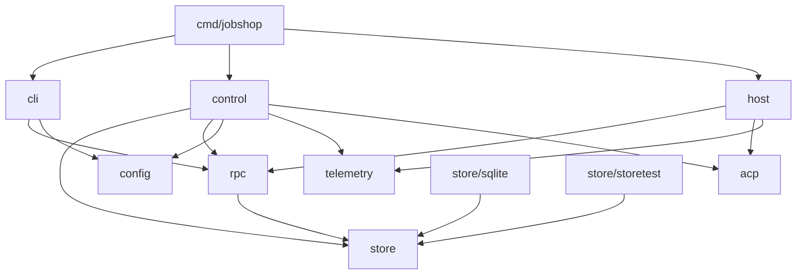

# Jobshop: repo layout and build (draft)

Status: draft for discussion. Companion to `plan.md`.

## Principles

- One binary, `jobshop`, with subcommands. The controller, session host,
  CLI and (later) gateway are the same executable, so the host can be
  spawned from `/proc/self/exe` and there is one thing to build, pin and
  roll back.
- `pkg/` for all packages (decided 2026-11-01). Importable, but no API
  stability promise until something outside this repo depends on it.
- Packages follow the architecture boundaries in `plan.md`: store, control
  (controller), session host, rpc (sockets), config, telemetry. Packages
  import downward only; `cmd/` wires them together.
- No role names in Go. Agents, pools and prompts live in config.
- Plain `go` for development and CI. Nix builds the deployable package and
  the NixOS module.

## Tree

```
jobshop/
├── cmd/jobshop/              main: subcommand dispatch only
├── pkg/
│   ├── store/                Store interface, Ticket/Edge/Comment types, errors,
│   │   │                     engine kinds and their typed field structs
│   │   ├── storetest/        conformance suite every backend runs
│   │   └── sqlite/           modernc.org/sqlite backend
│   │       └── migrations/   goose *.sql files, embedded
│   ├── rpc/                  JSON-RPC method names, request/response types,
│   │                         client and server helpers over go.lsp.dev/jsonrpc2
│   ├── control/              controller: tick loop, claims release, lease sweep,
│   │                         session supervision, admin and CLI socket handlers
│   ├── host/                 session host: spawn agent, ACP proxy, journal,
│   │                         replay, backpressure, leak guards
│   ├── acp/                  ACP framing and the few message types the host and
│   │                         controller parse (wraps the chosen ACP SDK)
│   ├── config/               YAML loading, validation, defaults
│   ├── telemetry/            OTel providers, slog bridge, Prometheus exporter,
│   │                         conversation export
│   ├── cli/                  CLI subcommands (ticket, claim, assign, session, ...)
│   └── ids/                  ticket ids: per-project prefix + sonyflake base32
├── docs/                     plan.md, data-model.md, layout.md
├── examples/                 sample jobshop.yaml, agent prompts
├── nix/
│   ├── package.nix           buildGo127Module derivation
│   └── module.nix            NixOS module: user, slice, service
├── flake.nix
├── flake.lock
├── go.mod
├── go.sum
└── .github/workflows/ci.yml
```

Dependency direction (an arrow means "may import"):



`host` never imports `store` or `control`: it has no ticket or policy logic
(plan section 8.3), which keeps it small and rarely changing.

Subcommands:

| Command | Runs |
|---|---|
| `jobshop serve` | controller (long-running) |
| `jobshop session-host <id>` | session host, spawned by the controller only |
| `jobshop ticket ...`, `claim`, `assign`, `comment`, ... | CLI over a socket |
| `jobshop session list/attach/reap` | CLI over the admin socket |
| `jobshop migrate` | apply store migrations (also done on `serve` start) |

## Dependencies (decided 2026-11-01)

| Need | Module | Version at decision |
|---|---|---|
| SQLite | `modernc.org/sqlite` | v1.61.1 |
| Migrations | `github.com/pressly/goose/v3` (embedded `*.sql`) | v3.29.0 |
| JSON-RPC (sockets, ACP framing) | `go.lsp.dev/jsonrpc2` | v1.0.1 |
| ACP | own `pkg/acp`, message types only, over jsonrpc2 | |
| CLI | `github.com/alecthomas/kong` | v1.16.1 |
| YAML config | `github.com/goccy/go-yaml` | v1.19.2 |
| IDs | `github.com/sony/sonyflake/v2`, Crockford base32 | v2.2.0 |
| Tracing, logs, metrics | `go.opentelemetry.io/otel` + sdk, OTLP HTTP exporters | v1.47.0 |
| Prometheus | `go.opentelemetry.io/otel/exporters/prometheus` | v0.69.0 |
| slog to OTel | `go.opentelemetry.io/contrib/bridges/otelslog` | v0.21.0 |
| Tests | `github.com/stretchr/testify` | v1.12.1 |

Notes:
- `coder/acp-go-sdk` was considered for ACP and not used: it is pre-1.0
  and brings its own JSON-RPC. Types can be copied from it as needed.
- Ticket IDs (decided 2026-11-01): `<project prefix>-<13 chars>`, e.g.
  `js-0031w02j0r012`. A Sonyflake 63-bit ID, big-endian, encoded in
  lowercase Crockford base32 (no `i l o u`). Fixed width, so IDs sort by
  creation time as strings. Settings: 1 ms time unit, 47 time bits
  (about 4,400 years from a 2026-01-01 epoch), 12 sequence bits (4,096
  IDs per ms), 4 machine-id bits fixed to 1. Only the controller
  generates IDs and the controller lock guarantees one writer, so the
  machine id never needs to vary. Chosen over xid (20 chars) for length;
  uniqueness is the same for a single writer.
- New direct dependencies need a reason recorded here.

## Build

**Development and CI: plain Go.**

```
go build ./...
go vet ./...
golangci-lint run
go test -race ./...
```

CI runs those on GitHub Actions, plus `nix build` to catch packaging
breakage. No Makefile unless a real need appears.

**Deployment: Nix flake.**

- Inputs: `nixpkgs` pinned to `nixos-26.05`, the same channel gasserver
  runs. It ships `buildGo127Module` (Go 1.27.3), matching `go.mod`.
- `packages.x86_64-linux.jobshop`: `buildGo127Module`, `subPackages =
  [ "cmd/jobshop" ]`, `CGO_ENABLED = 0` (pure-Go SQLite), version and
  commit via `-ldflags -X`, `vendorHash` pinned. Tests run in CI, not in
  the Nix build (`doCheck = false`), same as Gas City's flake.
- `nixosModules.jobshop`: the deployment unit (below).
- `devShells.default`: go, gopls, golangci-lint, sqlite.

## Deployment on gasserver (decided 2026-11-01)

gasserver is an isolated OVH machine; Jobshop runs there next to Gas City
as its own user, not as `agent`.

- **User `jobshop`**: own home, own data dir (`/var/lib/jobshop` or
  `~jobshop/data`), own GitHub identity (`cog` credentials via sops).
- **Resource limit via its own slice** (decided 2026-11-01): `jobshop.slice`
  with `CPUQuota = 600%` (six cores' worth, placed by the scheduler) and
  `MemoryMax = 8G` (plus a lower `MemoryHigh`), `TasksMax`, and oomd
  pressure kill, mirroring how `modules/resources.nix` caps
  `user-1001.slice` for `agent`.
- **Network**: same egress policy as `agent` (public internet and
  loopback; no private, CGNAT/tailnet or link-local ranges), copied from
  `modules/agent/default.nix`.
- **Service**: `jobshop.service` runs `jobshop serve` as `jobshop` in
  `jobshop.slice`, with `KillMode=process` so restarting the controller
  does not kill session hosts (they are children of the controller but
  must outlive it, plan section 8.2). Session hosts started with `setsid`
  stay in the service's cgroup, so they inherit the slice limits.
- **Binary pinning**: the NixOS module points at a specific `jobshop`
  store path. Promote = bump the flake input on gasserver and switch;
  rollback = previous generation. This replaces the symlink scheme in
  plan section 7.
- **Where the module lives**: `nixosModules.jobshop` in this repo, imported
  by `gasserver.nix` as a flake input. Host-specific values (limits,
  secrets) stay in `gasserver.nix`.
- **Restart vs full stop** (decided 2026-11-01): `systemctl restart` and a
  Nix switch restart only the controller; hosts keep running and are
  re-adopted. A full stop cleans up session hosts too. systemd's ExecStop
  cannot tell a restart from a stop, so full stop is an explicit command,
  `jobshop shutdown`, which asks the controller over the admin socket to
  end every session (stop agents, flush journals, release claims, reap
  hosts) and then exit. The NixOS module wires it to system shutdown.
- **Old builds** (decided 2026-11-01): a host keeps running the store path
  it started from. Each running host registers a Nix GC root for its
  binary (under `/nix/var/nix/gcroots/per-user/jobshop/`), removed when
  the host exits, so garbage collection never deletes a build a live
  session uses.
