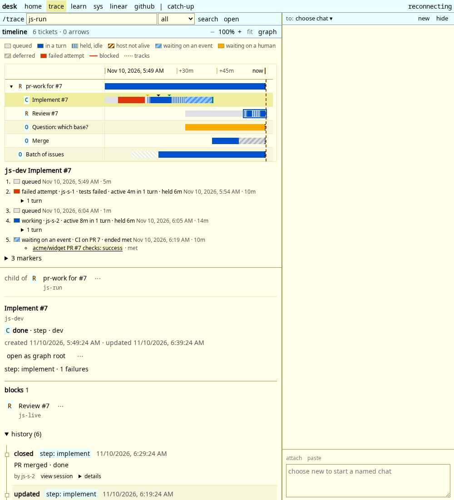
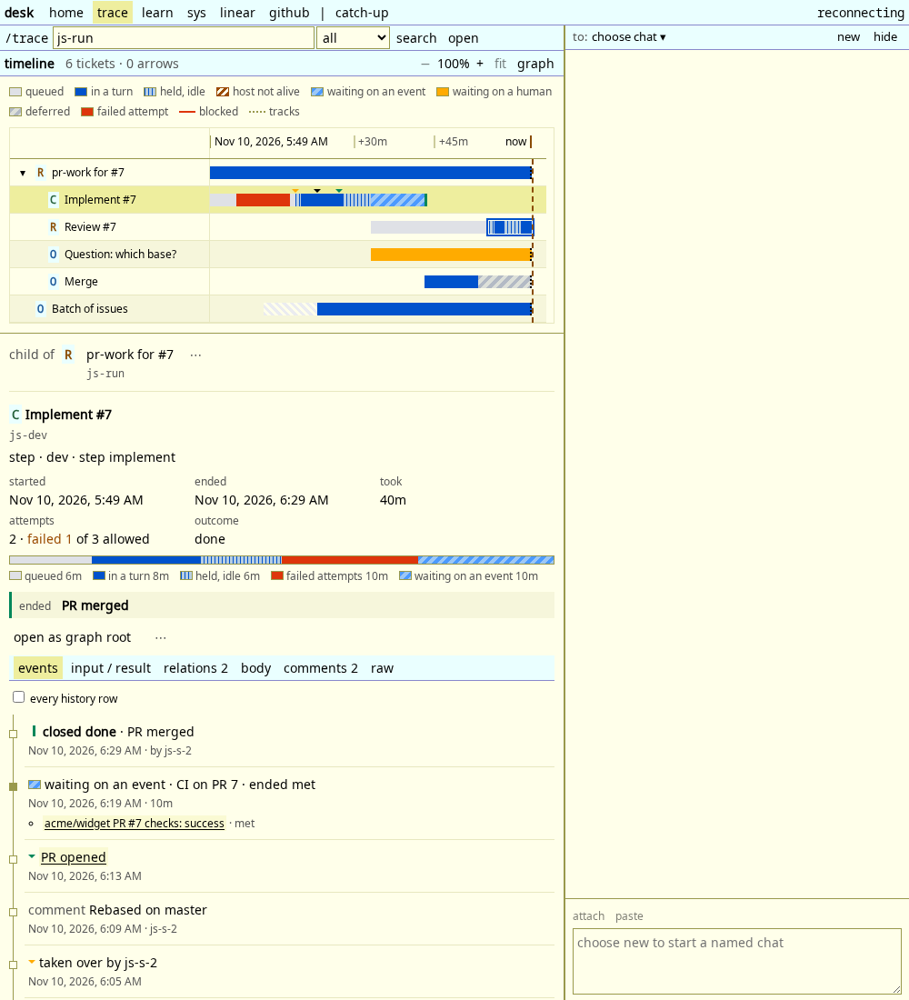
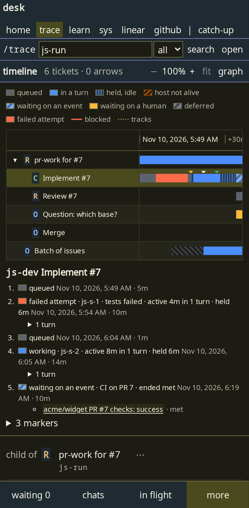
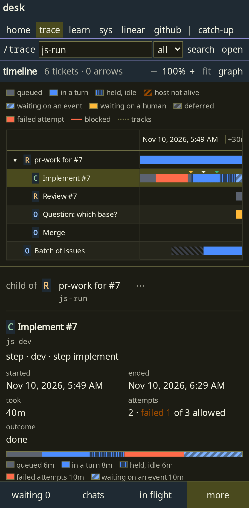
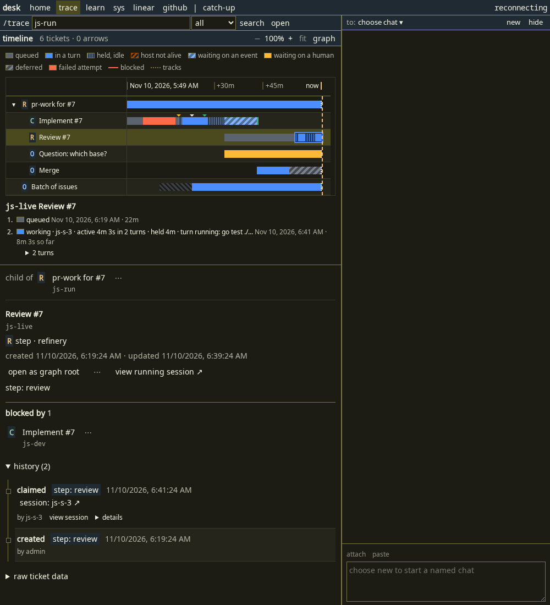
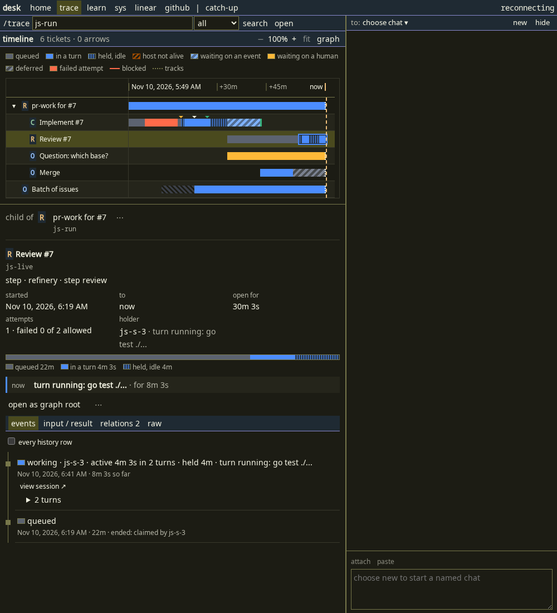
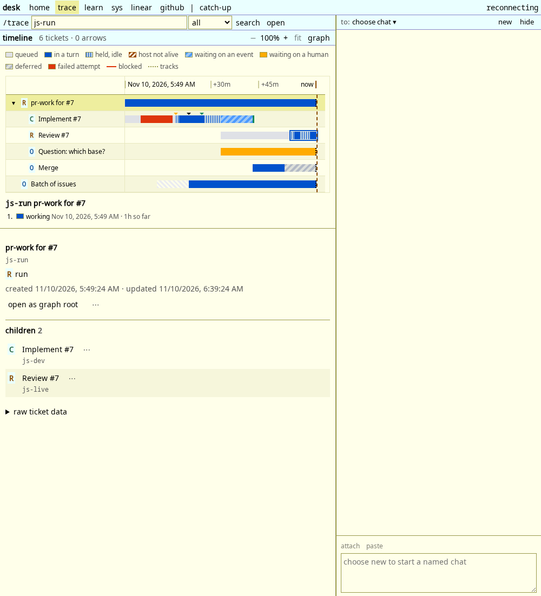
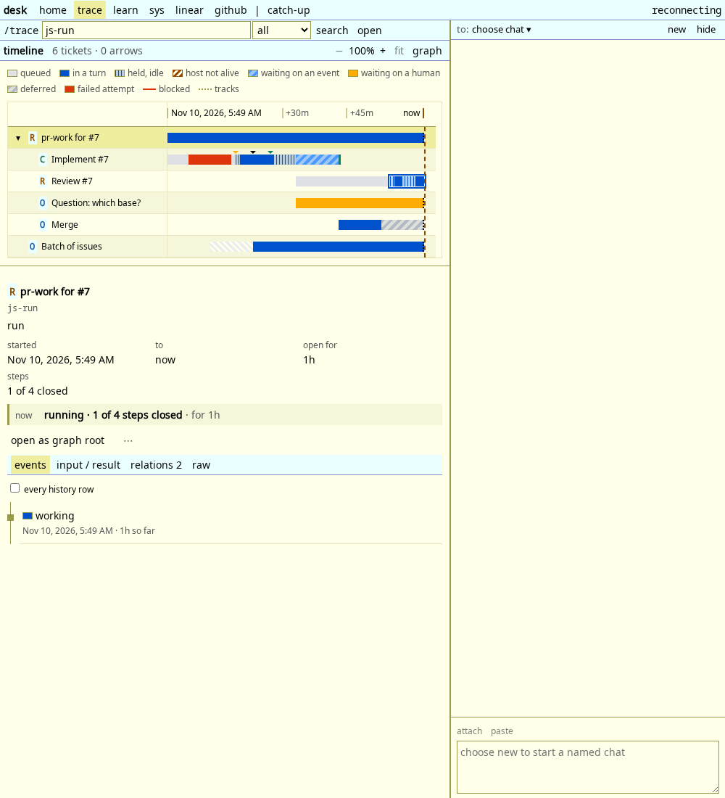

# Trace detail pane (JOB-185)

2026-11-10.

The pane under the trace timeline and the graph (`TicketDetails`) used to
describe the selected ticket twice: `RowDetail` under the chart, then a header,
every history row, the whole body, every comment and raw JSON. It now answers
what happened and what is happening first, with the detail behind tabs. One
component serves both layouts.

Before and after, the same mocked trace (`ui/e2e/trace-detail-shots.mjs`):

| | before | after |
| --- | --- | --- |
| retried step, 1000 px, light |  |  |
| retried step, 390 px, dark |  |  |
| step in a turn, 1000 px, dark |  |  |
| run, 1000 px, light |  |  |

## What the pane shows

- Header: status letter, title, id, then kind, pool, step and labels on one line.
- Facts (`lib/detail.ts`, `summarize`), each only when it applies: started,
  ended or `to now`, `took` or `open for`, attempts, steps closed (run or
  batch), outcome, holder with its live state, and the PR, issue and Linear
  links. Attempts are the claims taken (working and retry spans that have a
  session): `2 · failed 1 of 3 allowed`. The limit is the step's own
  `fields.retries`. A script or command step has no session, so it has no
  attempts and no holder.
- Time by state: a bar and a legend from the timeline segments. A claim with
  turn rows (JOB-184) splits into `in a turn` and `held, idle`. A claim with
  none is plain `working`, never idle. A run or batch is working for its whole
  life, so it has no split.
- Now (`nowOf`): an open ticket says what it is doing from its open span: the
  session and its running tool, each wait condition with its state and link,
  the human question (with a button to its body), `deferred until <time>`, or
  queued for a pool. A run says `n of m steps closed`. A closed ticket shows the
  reason on its close row, else `closed <resolution>`.
- Partial history: a row marked `partial`, or a ticket that is not on the
  timeline at all, says so in a note. Time by state and attempts are left out
  for the second case. Nothing is estimated.

## Tabs

`?tab=` keeps the tab (`events` is the default and has no value in the URL).
A tab with nothing to show is not listed (`input / result` for a plain task,
`body`, `comments`). A tab not in the list opens `events`. Arrow keys, Home and
End move between tabs.

- `events`: one entry per span (claim, wait, human hold, queue, deferral) with
  how it ended and why, taken from the history row written at its end, then PR
  markers, comments and the close in place by time, newest first. A PR comment
  shows once, as its marker. Turns are a disclosure under their claim. The
  `every history row` toggle lists the raw rows instead, as before.
- `input / result`: key and value rows (`ioOf`). A run: workflow, key, vars and
  inputs, then state, resolution and the automation output. A step: step, run,
  type, needs, script, inputs, then resolution, result, outcome, failures,
  retries, command, structured output and output. A batch: key, issues, order,
  state. Values over 140 characters or with a newline sit behind their first
  line.
- `relations N`: parent, children, blocked by, blocks, waits for and waited on
  by, each ticket with its status letter and how long it took (or has been
  open).
- `body`, `comments N`, `raw` (fields and meta as JSON).

## Chart and layouts

- `RowDetail` is gone. Choosing a bar sets `segmentChoiceAtom`, resets the tab
  to `events` and selects the ticket: the pane scrolls to that entry and
  highlights it.
- The stream now always asks for the timeline (`LiveOwner`), also in the graph
  layout, so the graph's pane has the same summary. No server change: the
  timeline was already in the trace snapshot. The timeline reads the same
  history once per snapshot, so the graph view now pays that cost too.
- The history list is a plain list without its own disclosure.
- A live snapshot does not touch the tab (it is the URL) or the page scroll.

## Tests

`ui/src/lib/detail.test.ts` (derivations), `ui/e2e/trace-detail.spec.js`
(mocked stream, both projects): facts, time by state, attempts, the grouped
events of a retried step, keyboard tabs, the URL, relations, a turn in
progress, a human hold, a deferred script step, a batch with partial history, a
run, the chart choosing an entry, the graph layout, tab overflow at 390, 700
and 1000 px, and a live update keeping tab and scroll. The older specs that
opened the removed disclosures (`live`, `title-links`, `trace-session`,
`timeline`) use the tabs now.
