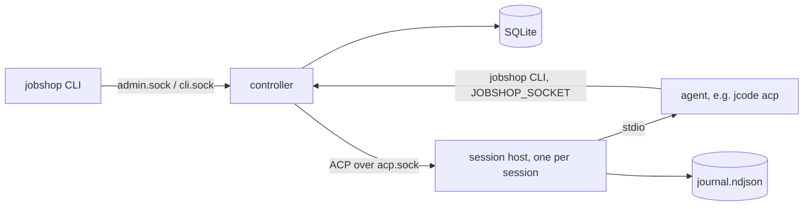

# Jobshop plan

How Jobshop is built, where it stands, and what comes next. Decisions are
dated. Where this file and the code disagree, the code wins; fix this file.
Companions: `docs/data-model.md` (tables and queries), `docs/layout.md`
(repo, build, deployment).

## 1. What and why

Jobshop is multi-agent orchestration on a SQLite ticket store: pools of ACP
agents claim tickets, work them, and close them, supervised by one
controller. It replaces our use of [Gas City](https://github.com/gastownhall/gascity).

Gas City worked, but its store is `bd` on Dolt (too slow and heavy for us),
our SQLite fork covers only part of the `bd` CLI that prompts call, about a
fifth of its Go references Dolt, and we use a small part of it. Jobshop is a
smaller system we own: the store interface lives here, everything is built
on it, SQLite first, Postgres later.

Approach: build from scratch and dogfood. Gas City is a reference for
design and edge cases, not a compatibility target. Since 2026-11-01 Jobshop
runs the agents that develop Jobshop.

## 2. Where we are

| Phase | Scope | State |
|---|---|---|
| 0 | Repo, CI, lint, data model | done |
| 1 | Store, controller sockets, CLI | done 2026-11-01 |
| 2 | Sessions, session host, self-hosting | done 2026-11-01 |
| 3 | Hardening, visibility, self-development loop | in progress, target issue #36 |
| 4 | Workflows and runs | not started |
| 5 | Batches, change subscriptions, API | not started |

Phase 3 is driven by the target issue (#36): a checklist the planner pool
works toward. Items built so far are listed in section 4.

## 3. How it works



**Tickets.** One generic graph: tickets with an engine-defined `kind`
(`task`, `session`, `message`), typed `fields` per kind, and a free-form
`meta` for pack data the engine never reads. Edges `blocks` and `waits_for`
gate readiness; `tracks` is informational; parent-child is `parent_id`.
Claims are atomic with a lease and a fence. Ready means open, unblocked and
not deferred. Details: `docs/data-model.md`.

**Controller** (`jobshop serve`). The only writer. Serves `admin.sock` for
humans and tooling, and a per-session `cli.sock` that fixes the caller's
project and holder. On each supervisor tick it fires triggers, heartbeats
claims held by driven sessions, sweeps expired leases, and starts sessions
for pools with ready work beyond their idle sessions, up to `max_sessions`.

**Session host** (`jobshop session-host`). One detached process per session
(setsid, no tmux or systemd). It runs the agent on stdio, proxies ACP to
the controller, journals every frame, caches `initialize`, holds agent
requests while no controller is connected, and survives controller
restarts. A restarted controller adopts live hosts and respawns dead ones
with `session/load`.

**Driver loop** (per session, in the controller). Deliver queued messages,
`claim --next`, prompt the ticket, check the session no longer holds it
(else one reminder turn, then release with a 10 minute defer). Two such
turns in a row end the session `stuck` so a fresh host replaces it
(2026-11-01: jcode hosts whose bash tool broke kept claiming and dropping
tickets for hours). Idle past
`idle_timeout` ends the session `idle`; more than 3 restarts in 10 minutes
ends it `crashed`; turns past `turn_timeout` get `session/cancel`.

**Agents and the CLI.** Agents call `jobshop` with `JOBSHOP_SOCKET` set, so
`jobshop close` closes their current ticket with no ids or flags. Exit
codes: 3 no work, 4 claim lost, 5 not found, 6 revision conflict, 1 other.

**Config.** `jobshop.yaml` holds projects, agents, pools, triggers and
packs. Packs are directories with `pack.yaml` (agents, pools, triggers) and
prompt files, filled from `vars`. `jobshop reload` or SIGHUP applies config
without a restart.

**Self-development** (`packs/selfdev`):
- Work specs are GitHub issues on elee1766/jobshop, filed by elee-agent. A
  ticket is a pointer ("Resolve elee1766/jobshop#N", `meta.github.issue`).
- `dev` pool: reads the issue, branches `issue-<n>`, builds and tests,
  opens a PR with `Closes #N`, waits for green CI, then hands the ticket to
  `refinery`. Out-of-scope findings become new issues.
- `refinery` pool (1 session): merges handed-off PRs one at a time with
  `--match-head-commit` on green CI and resolved review, checks master CI
  after, or routes findings back to `dev` on the same branch.
- `plan` pool (1 session): reads the `target` issue, ticks verified items,
  files the next issues and dev tickets with edges, files nothing while
  more than 6 issues are open, and sends scope changes to `needs-decision`.
- `replan` trigger: creates a plan ticket when `dev` has no ready work.

## 4. Built so far (phase 3)

Short list; behavior details are in `docs/notes/` (section 7).

- Drain and undrain (#12), quarantine of crash-looping tickets and pools
  (#13), env refresh after deploys (#11), rate-limit backoff (#10).
- Prometheus metrics (#14), OTel traces and slog bridge (#15).
- Messages with queued and interrupt delivery (#16), read-only attach (#17).
- Triggers: store counts, cron, dedup and cooldown (#26), check commands
  and the selfdev `master-red` trigger (#34).
- Packs and `packs/selfdev` (#27), refinery handoff (#28).
- Config reload (#38), `session restart` (#37), host backpressure (#39).
- Per-signal OTLP URLs and headers, nix telemetry options, Grafana
  dashboard (#44).
- Conversation export with redaction (#45).
- `session/load` fallback from the journal (#43).
- `session list --state --since` and the gasserver runbook (#52).
- Meta pack name validation and `meta_packs:` (#29).
- `jobshop config show` with per-entry sources (#32).
- `jobshop_turns_total` and its dashboard panel, `deploy/verify-telemetry.sh`
  (#55).
- `jobshop ticket trace` for closed-loop evidence (#53).
- `jobshop_sessions_ended_total` by resolution, its dashboard panel, and
  the runbook counting `stuck` as a failure (#71).
- Recent comments in ticket prompts, for routed-back tickets (#70).
- Run model design note for phase 4, section 6 (#83).
- Orphaned ticket report: WARN, `jobshop_tickets_orphaned` and
  `ticket list --orphaned` (#84).
- `workflows:` in pack config, validated at load (#88).
- Runs: `run` and `step` kinds, `jobshop run start/show/list/cancel/resume`,
  key dedup, run closes done with its last step (#89).
- Multiple workspaces in the NixOS module, `workspaces.<name>` (#92).
- Step retry limits, `needs_human`, escalation ticket and
  `jobshop_runs_needs_human` (#90).
- selfdev `pr-work` workflow: the planner starts one run per issue,
  replacing pointer tickets and the prompt-only refinery handoff (#93).
- `run:` triggers start a workflow run, keyed by `${check_output}` (#98).
- selfdev `blocker-check` workflow, started by the planner on blocked
  claims (#100).
- selfdev `master-red` starts a `ci-repair` run per failing SHA (#99).
- Live sessions refresh their host when the spawn env changes, not only
  on adoption (#106), and the refresh stops the agent's detached
  daemons too (#111).
- Generic `packs/github`; `packs/selfdev` is an instance through pack
  `extends:` and `defaults:` (#107).
- Refinery merge policy vars in `packs/github`: `merge_method`,
  `required_approver`, `required_checks` (#108).
- `drill` workflow in `packs/github` to exercise escalation on demand
  (#114).
- Lowering `max_sessions` by reload never starts a session over the new
  cap (#102).
- `ci_branch` pack var and a CI repair drill runbook (#117).
- Admin API `session.send` and `session.subscribe`, and `type: chat`
  pools started by key (#121).
- `packs/operator`: the operator chat pool and prompt (#124), included
  once per host since #248 (selfdev no longer extends it).
- Docs: one file per note in `docs/notes/` and per check in
  `docs/verify/`; refinery resolves docs-only conflicts (#131).
- The CI repair drill opens a draft PR so its branch gets CI (#132).
- Chat pool idle TTL (1h default, reset by messages), `attach: rw` and
  `session attach --rw` (#122).
- `jobshop gateway` with a Matrix adapter and
  `services.jobshop.gateway.<name>` (#123).
- `release --until` defers a ticket without counting a step failure
  (#139).
- Escalation threads: a gateway with `escalation_room` opens one thread
  per escalation ticket with an operator session ready (#125).
- Pool `admin` grants: operator sessions run `reload` and `session list`
  (#126).
- `run start --after <id>` creates outside blockers with the run; the
  planner uses it instead of `edge add` (#149).
- `when.stall` triggers and the `stall-check` workflow, replacing
  `blocker-check` (#143, `docs/notes/143-stall-check.md`).
- A permanent spawn error (missing repo or dir, agent not found)
  quarantines the pool at once with one escalation, until reload or
  `jobshop pool unquarantine` (#146).
- Batches designed: `docs/notes/148-batches.md` (#148). `batch start`
  with kind `batch` tickets and ordered cross-run edges in one
  transaction is built (#169, `docs/notes/169-batch-start.md`).
- Batch state derivation, close on last run, `batch show` and
  `batch list` (#170, `docs/notes/170-batch-state.md`).
- Planner prompt starts dependent issues with `batch start` and quotes
  `batch show` on the target (#171, `docs/notes/171-planner-batches.md`).
- `jobshop version --server` reports the controller's commit; the
  selfdev deploy check uses it (#180, `docs/notes/180-server-version.md`).
- Work references carry the repo: `meta.github = {repo, issue|pr}`,
  repo-scoped `issue_no_run`, startup backfill (#183,
  `docs/notes/183-github-repo-refs.md`, `docs/verify/github-repo-refs.md`).
- Admin `events.subscribe` change stream from ticket history, `jobshop
  events`; the gateway's escalation threads follow it instead of a 10s
  poll (#147).
- Session worktrees are locked against outside `git worktree remove`;
  controller removals WARN with session and caller (#154,
  `docs/notes/154-worktree-deletion.md`).
- `post-merge` steps run in a `deploy-check` pool, so a deploy wait no
  longer queues reviews in the refinery (#167,
  `docs/notes/167-deploy-check-pool.md`).
- Self-deploy rollback drill marker and a stubbed test of the deploy
  script (#155, `docs/notes/155-rollback-drill.md`).
- `jobshop report incidents` and a planner step that files issues from
  it (#156, `docs/notes/156-incident-report.md`).
- Gateway replies put a blank line between text before and after a tool
  call (#164, `docs/notes/164-chat-reply-separator.md`).
- Matrix gateway posts retry 429 and 5xx with backoff (#196,
  `docs/notes/196-matrix-retries.md`).
- `jobshop attention` lists what waits on a human; the gateway posts a
  digest only when it is not empty; planner attention rule (#185,
  `docs/notes/185-attention.md`, `docs/verify/attention.md`).
- Gateway Discord adapter, unit-tested only (#182,
  `docs/notes/182-gateway-discord.md`).
- A respawned session's first prompt carries a recovery note (#189,
  `docs/notes/189-recovery-note.md`).
- Human-started sessions get one slot over `max_sessions` per pool
  (#190, `docs/notes/190-human-slot.md`).
- Pack `prefix:` so packs/github can be included once per repo (#184,
  `docs/notes/184-pack-prefix.md`, `docs/verify/pack-prefix.md`).
- A NixOS switch that changes only jobshop.yaml reloads the controller
  (#210, `docs/notes/210-nix-yaml-reload.md`).
- NixOS `workspaces.<name>.livePackPrefix` (#213,
  `docs/notes/213-live-pack-prefix.md`).
- A live pack the installed binary cannot load keeps the controller on
  its last good config; the sync follows the installed package (#227,
  `docs/notes/227-pack-binary-skew.md`).
- Outbox design note: no outbox for gateway posts (#191,
  `docs/notes/191-outbox.md`).
- `jobshop desk`: read-only Svelte dashboard over the admin API (#202,
  `docs/notes/202-desk.md`, runbook `docs/verify/desk.md`).
- Gateway opens a new escalation thread when posts to the recorded root
  fail as not found (#197, `docs/notes/197-escalation-rethread.md`).
- Guardrail hooks on claim and `jobshop guard <action>` with allow, deny
  and ask-human (#188, `docs/notes/188-guardrail-hooks.md`).
- Prompt rules: operator guidance from `prompt_rules` config, matched per
  session and turn, and `jobshop session prompt` (#205,
  `docs/notes/205-prompt-rules.md`).
- Identities: several GitHub Apps and Linear tokens mapped to repos and
  teams, served by the controller (#200, `docs/notes/200-identities.md`).
- Linear as a tracker: `tracker: linear` workflows and `jobshop linear`
  (#201, `docs/notes/201-linear-tracker.md`).
- packs/github `tracker: linear`: plan, dev and pr-work prompts read and
  update Linear through `jobshop linear` (#232,
  `docs/notes/232-linear-pack-prompts.md`, runbook
  `docs/verify/linear-pack.md`).
- Desk chat: escalation panels, new `desk:<id>` operator sessions, rw
  attach (#203, `docs/notes/203-desk-chat.md`, runbook
  `docs/verify/desk-chat.md`).
- Subscriptions: tickets follow GitHub issue and PR threads in any repo;
  human comments reach the working session or resume the ticket (#187,
  `docs/notes/187-subscriptions.md`). Linear issues too (#233,
  `docs/notes/233-linear-subscriptions.md`).
- Self-deploy rewrites a stale `deployed` file from the running binary,
  with a WARN (#225, `docs/notes/225-deploy-state.md`).
- A turn that ends holding a ticket is released without a failure the
  first time (#241, `docs/notes/241-unclosed-turns.md`). The reminder
  says no background wake comes, and the stuck reason records the last
  turn's end (#301, `docs/notes/301-turn-end-stuck.md`).
- Structured worker reports and questions: `jobshop report <state>`,
  `--question`, `jobshop answer`, question threads in the gateway (#186,
  `docs/notes/186-worker-reports.md`).
- Stall `ready_unclaimed` ages a ticket from its last blocker's close
  too (#235, `docs/notes/235-stall-ready-since-unblock.md`).
- A session's task created with no pool goes to the session's pool (#244,
  `docs/notes/244-orphan-tickets.md`).
- Operator pack at host scope: one include, `config show` instances,
  grant across instances (#248, `docs/notes/248-host-operator.md`).
  gasserver includes it once at host level; runbook
  `docs/verify/host-operator.md` (#250).
- Resumed sessions keep PATH in jcode's `bash -lc` tool shell on NixOS
  (#253, `docs/notes/253-resume-shell-env.md`).
- Activity feed: recent GitHub and Linear activity for all worked repos
  and teams in Desk, the run drawer and `jobshop activity` (#255,
  `docs/notes/255-activity-feed.md`).
- Operator improvement sessions (`improve:<slug>` key, prompt rule
  `match.keys`, pack hooks, `send --key`) that never push master (#249,
  `docs/notes/249-improvement-sessions.md`).
- Self-deploy checks the host config against the new commit's packs
  before switching; pack `renamed_vars` (#261,
  `docs/notes/261-deploy-config-check.md`).
- Memory files and skills from a git directory via a prompt rule's
  `memory:`, `jobshop memory check` (#266,
  `docs/notes/266-memory-skills.md`).
- Learnings capture: `jobshop learn`, a `learnings` table, and
  controller-recorded failures, review findings, escalations, answers
  and stalls (#264, `docs/notes/264-learnings.md`).
- Learning nudge: an `after` prompt rule asking workers to `jobshop
  learn` a correction, failure or workaround before closing (#271,
  `docs/notes/271-nudge.md`).
- `jobshop recall`: FTS5 search over comments, session journals and
  learnings,
  with a pack prompt rule to use it on failures (#265,
  `docs/notes/265-recall.md`).
- Reverted pr-work PRs recorded as `correction` learnings from the
  activity feed (#272, `docs/notes/272-revert-learnings.md`).
- `kind: linear-app` identity minting client_credentials tokens, cached
  until 10m before expiry (#278, `docs/notes/278-linear-app.md`).
- Curator: `learn` pool, `curate` workflow and learnings trigger in
  selfdev, `jobshop learn update` (#273, `docs/notes/273-curator.md`).
- `jobshop linear context|list|search|catalog|eligible` read commands and
  the intake gate (#279, `docs/notes/279-linear-read.md`).
- `jobshop linear create|update|ask|relate` with `--key` idempotency
  (`write_keys` table) and `--dry-run` (#280,
  `docs/notes/280-linear-write.md`).
- `jobshop linear api`: raw GraphQL with the caller's `LINEAR_API_KEY`
  or the team identity; mutations ask the guard `linear-api-mutation`
  (#546, `docs/notes/546-linear-api.md`).
- Curator gate: `memory_edits` baselines, `edits` trigger condition,
  `evaluate` workflow, `jobshop learn evaluate|edits` (#274,
  `docs/notes/274-curator-gate.md`).
- Guardrail hook point `on: intake` on Linear issue text before run start
  and subscription delivery (#288, `docs/notes/288-intake-hook.md`).
- Linear intake: `linear_issue_no_run` stall signal, read from Linear
  by the controller, starts stall-check for team issues with no open
  run (#287, `docs/notes/287-linear-intake.md`).
- Pool scaling: min/max, desired target, `pool scale`, cordon to scale
  down, persisted scale and drain, host cap (#281,
  `docs/notes/281-pool-scaling.md`).
- Desk scale columns, Scale/Auto and Cordon/Uncordon buttons (#284,
  `docs/notes/284-desk-scale.md`).
- Linear planner: lists team issues by the intake vars, starts pr-work
  with the intake's `linear-<KEY>` key, files new work and out-of-scope
  findings with `linear create` and `relate` (#292,
  `docs/notes/292-linear-planner.md`).
- Linear end to end: README `Linear instance` section and
  `TestLinearEndToEnd` across intake, hook, run key and questions (#298,
  `docs/notes/298-linear-e2e.md`).
- Questions and escalations of Linear runs asked on the Linear issue,
  replies become answers, `Blocked` while waiting (#293,
  `docs/notes/293-linear-communication.md`).
- Linear webhook: signed `POST /linear/webhook` on
  `linear.webhook_listen` runs intake and replies early; polling stays
  (#300, `docs/notes/300-linear-webhook.md`).
- Model and effort per agent and pool, set through ACP
  `session/set_config_option` at session start and between turns after a
  reload, `session config` override (#304,
  `docs/notes/304-model-config.md`).
- Gateway re-reads rooms, senders, marker and escalation room from
  `config.show` every 30s, no restart (#307,
  `docs/notes/307-gateway-config-follow.md`).
- Bubblewrap sandbox per session from `sandbox:` config, mounts computed
  by the controller, `session sandbox`, NixOS `sandbox.enable` (#262,
  `docs/notes/262-sandbox.md`).
- Ingest inbox table and store API: put deduped by delivery id, lease
  claim, fenced state changes, `ingest.retention` prune; no writers yet
  (#321, `docs/notes/321-ingest-inbox.md`).
- Ingest spool and `jobshop ingest serve`: webhook endpoints, each with
  its own path, secret and GitHub repo allowlist, spooled into a
  separate SQLite database; the controller's Linear webhook shares the
  handler (#334, #339, `docs/notes/334-ingest-spool.md`).
- go2nix per-package Nix build with a buildGoModule fallback; CI on
  Ubicloud runners (`docs/notes/go2nix.md`).
- Ingest admission: mutating then validating hooks (command or signed
  url) on pending inbox items, `failure_policy`, `match`; on: intake
  hooks run for Linear items (#348, `docs/notes/348-ingest-admission.md`).
- Desk as a PWA with Web Push for new attention items, `desk --push`,
  on the plugin model: Attention and Chat are built-in plugins, a click
  on an attention item opens the chat that resolves it, `api.push`,
  `session.cancel` (#535, `docs/notes/535-desk-pwa.md`,
  `docs/notes/535-attention-chat.md`, `docs/verify/desk-pwa.md`).
- jcode built-in memory off for agents (`JCODE_MEMORY_ENABLED=0`),
  worthwhile entries imported as learnings (#320,
  `docs/notes/320-jcode-memory-off.md`).
- Unknown pool admin methods warn and are dropped instead of failing
  the load (#325, #328, `docs/notes/325-unknown-admin-method.md`).
- GitHub author allowlist: pack var `authors` and the `accepted` label
  gate `issue_no_run`; `subscriptions.authors` gates comments (#340,
  `docs/notes/340-author-allowlist.md`).
- Running as your own user: identity kind `github-token` (PAT, self
  login filtered) and `webhook_secret_file` on kind `linear` (#340,
  `docs/notes/340-user-tokens.md`).
- Ingest drain: spool to inbox in batches (delete after commit, bad rows
  to `spool_bad`), pollers write inbox rows deduped by natural key, GitHub
  App failed-delivery reconcile (#335, `docs/notes/335-ingest-drain.md`).
- NixOS module `ingest.enable`: `jobshop-ingest.service` for `ingest
  serve`; ingress is host config (#344, `docs/notes/344-ingest-unit.md`).
- Tests: `Options.Pass` supervisor pass hook, `time.Sleep` banned in
  tests (#359, `docs/notes/359-test-clock.md`).
- Controller clock: `Options.Clock` (`pkg/clock`, with a `Fake` for
  tests) drives every controller timer; `Options.Now` is gone (#362,
  `docs/notes/362-controller-clock.md`).
- `jobshop gh`: gh with the identity token, a guard check before
  writes and an activity record, replacing the module's shell wrapper
  (#349, `docs/notes/349-jobshop-gh.md`).
- TestStepFailureSources runs on the fake clock (#375,
  `docs/notes/375-step-failure-fake-clock.md`).
- NixOS module `sandbox.mise.tools`: host-installed mise tools shared
  read-only with sandboxes (#316, `docs/notes/316-sandbox-mise-shared.md`).
- Step `pool:` may name a run var, resolved and checked at run start, so
  a router can pick the pool per run (#384, `docs/notes/384-step-pool-var.md`).
- Pack-writing guide `docs/packs.md`, `jobshop docs` and an init hint
  (#352, `docs/notes/352-pack-docs.md`).
- Pack templates in Go `text/template` behind `template: go`; in-repo
  packs converted, `${}` still loads (#383, `docs/notes/383-go-templates.md`).
- `jobshop wait add|list|clear`: tickets park on a PR review, checks,
  PR state, a thread reply or a time (#381, `docs/notes/381-waits.md`).
- Write keys: remote key or hidden GitHub marker is the record, local
  rows pruned after 48h (#415, `docs/notes/415-write-key-cache.md`).
- Generic HMAC ingest endpoints with a payload map, and `jobshop ingest
  put` for local senders (#399, `docs/notes/399-generic-ingest.md`).
- `ingest.pollers`: GitHub repos without a webhook polled into the inbox
  with ETags and stored cursors (#341, `docs/notes/341-ingest-pollers.md`,
  check `docs/verify/ingest-pollers.md`).
- Resource slots: `resources:` (counted or keyed) and step
  `needs_resources`, enforced in the ready and claim queries (#400,
  `docs/notes/400-resource-slots.md`, check `docs/verify/resource-slots.md`).
- Resource waits are visible: `run show` position, `resource_wait` stall
  signal, attention entries (#408, `docs/notes/408-resource-waits.md`,
  check `docs/verify/resource-waits.md`).
- Provider-owned resource slots: `resource add|remove|unhealthy`, reset
  after each claim, demand and idle release (#407,
  `docs/notes/407-provider-slots.md`, check `docs/verify/provider-slots.md`).
- Store ticket queries are portable SQL: hot fields keys and meta
  lookups are plain columns and a `ticket_meta` table, lists are
  `sqlc.slice` (#405, `docs/notes/405-portable-sql.md`).
- Resource slot queries join `ticket_resources` instead of `json_each`
  (#426, `docs/notes/426-portable-resources.md`).
- Escalation chat: the controller opens one chat per escalation ticket
  from pack config; Desk shows it; the gateway mirrors (#379,
  `docs/notes/379-escalation-chat.md`, `docs/verify/escalation-chat.md`).
- Command and http workflow steps run by the controller, no session
  (#396, `docs/notes/396-command-http-steps.md`).
- Command steps run in their pool's sandbox; `worktree: true` gives a
  run one worktree, removed at run close (#419,
  `docs/notes/419-command-step-sandbox.md`,
  `docs/verify/command-step-sandbox.md`).
- `close -r rebase` reopens a step without counting a failure; the
  refinery uses it for a PR that only conflicts with master (#424,
  `docs/notes/424-rebase-no-failure.md`). The controller checks the PR's
  merge state first and counts a clean PR as failed (#511,
  `docs/notes/511-rebase-merge-state.md`).
- trigger.list evaluates triggers in parallel, so the Desk pools view
  no longer waits for every check in turn (#522,
  `docs/notes/522-trigger-list-parallel.md`).
- Per-pool isolation: `isolation.user` (mapped uid/gid),
  `isolation.limits` (delegated cgroup), `sandbox.network: pasta` with
  `deny`; sessions end `oom` at the memory limit (#388,
  `docs/notes/388-pool-isolation.md`, `docs/verify/isolation.md`).
- Workflow step graphs: `needs:` for parallel steps, `when:` for steps
  gated on an outcome set with `close --outcome` (#385,
  `docs/notes/385-step-needs-when.md`).
- Claims and lease sweeps are guarded single statements; ClaimNext
  retries lost races; the store suite also runs with deferred
  transactions on several connections (#406,
  `docs/notes/406-store-guarded-claims.md`).
- Store split: backend-neutral core `pkg/store/sqlstore` over sqlc's
  Querier; `pkg/store/sqlite` is a thin driver (#404,
  `docs/notes/404-store-core-split.md`).
- Postgres store backend `pkg/store/postgres` (pgx), passing the same
  conformance suite in CI; `store: {driver: postgres, dsn_file}` (#493,
  `docs/notes/493-postgres.md`).
- Tests: `Options.Hosts` runs session hosts in-process for
  controller-logic tests (#361, `docs/notes/361-inproc-hosts.md`).
- Admission releases a held inbox item back to pending once its
  needs-human ticket is closed (#353,
  `docs/notes/353-admission-release-held.md`).
- Secret settings take a path or `{type: file|command, ...}`; a command's
  stdout is the secret (#435, PR #366, `docs/notes/435-secret-commands.md`).
- Step `placement`: weighted pool options with `when` and `prefer_for`;
  the controller moves an unclaimed step to a free option (#409,
  `docs/notes/409-step-placement.md`, check `docs/verify/step-placement.md`).
- Ingest dispatch: pollers only write inbox rows; a dispatcher delivers
  admitted rows, so denied or held input never reaches a session (#442,
  `docs/notes/442-ingest-dispatch.md`, check `docs/verify/ingest-dispatch.md`).
- SQLite store prepares each query once and seeds new databases from a
  migrated template; pkg/control -race 138s to 63s (#433,
  `docs/notes/433-sqlite-stmt-cache.md`).
- Bound LIMITs are `CAST(? AS INTEGER)` so cached statements are not
  re-prepared; the schema template is kept as bytes. pkg/control -race
  82s to 61s wall (#433, `docs/notes/433-limit-reprepare.md`).
- Env refresh treats a zombie session daemon as stopped instead of
  waiting 5s for it (#433, `docs/notes/433-zombie-wait.md`).
- runRoot and the metrics and trace tests tick hourly and use passes;
  pkg/control -race 41s to 28s (#433, `docs/notes/433-remaining-fast-ticks.md`).
- pkg/control internal tests call `t.Parallel()`; -race 31s to 21s
  (#433, `docs/notes/433-parallel-internal-tests.md`).
- CI race tests turn checkptr off for modernc.org packages only;
  pkg/control -race 22s to 16s (#433, `docs/notes/433-modernc-checkptr.md`).
- In-process test hosts report agent exits (`control.HostExits`), so
  crash tests skip host spawns (#467, `docs/notes/467-inproc-host-exit.md`).
- Ingest split mode: `ingest.workers: external` moves admission to
  `jobshop ingest work` over the admin socket, with heartbeats,
  missing-worker and backlog attention and inbox gauges (#443,
  `docs/notes/443-ingest-workers.md`, check `docs/verify/ingest-workers.md`).
- Ingest end-to-end tests: webhook to session prompt through spool,
  drain, admission and dispatch (#453, `docs/notes/453-ingest-e2e-tests.md`).
- Ingest end-to-end runbook for gasserver: receiver to session, dedupe,
  gap fill, split mode (#444, check `docs/verify/ingest.md`).
- Planner proposes the next target (label `proposed`, var
  `propose_targets`), listed in attention as a decision (#488,
  `docs/notes/488-planner-proposals.md`).
- `TestNewUserPath` follows `docs/packs.md` end to end with the guide's
  own pack and config (#494, `docs/notes/494-new-user-path.md`).
- Stale ad-hoc tickets (no claimable pool, older than
  `attention.orphan_age`, default 72h) are listed in attention with a
  close hint; the github planner closes verified ones (#495,
  `docs/notes/495-stale-adhoc-tickets.md`).
- `jobshop handoff <ticket> --to <pool> --note`: re-pool, release, fence
  bump and note in one transaction; stall-check, refinery and dev
  prompts use it (#492, `docs/notes/492-handoff.md`).
- `pr_unmerged` skips PRs by the operator or `stall_pr_skip_authors`
  and PRs labeled `hold` (#509, `docs/notes/509-pr-unmerged-skip.md`).
- CI reruns failed tests 20 times, marks each flaky or broken and uploads
  the `failed-tests` artifact (#510, `docs/notes/510-ci-flaky-rerun.md`).
- Desk takes the user from a trusted proxy header and records writes as
  `desk:<user>` (#515, `docs/notes/515-desk-proxy-user.md`).
- Artifacts: `jobshop artifact deliver|list|show|ack`, attachments
  under `<root>/artifacts`, Desk Artifacts view, gateway
  `artifact_room` line (#508, `docs/notes/508-artifacts.md`,
  `docs/verify/artifacts.md`).
- Desk under a path prefix: `--base-path`, `X-Forwarded-Prefix` from a
  `--trusted-proxy`, relative build with a runtime `<base href>`,
  `services.jobshop.desk.basePath` (#516, `docs/notes/516-desk-base-path.md`).
- Learning kinds are config (`learnings.kinds`, globs, packs append);
  `when.learnings` filters by kinds, scope and source; selfdev's curate
  counts only its repo and pools (#524, `docs/notes/524-learning-kinds.md`).
- `session.journal`: paged, redacted journal reads for admin, the
  session itself or a `session-journal` grant in the project;
  `jobshop session journal`, Desk `/api/session/{id}/journal` (#529,
  `docs/notes/529-session-journal.md`).
- NixOS `services.jobshop.configFile`: a user-owned `jobshop.yaml` that
  includes the module's `jobshop.module.yaml` (new `include:` key),
  checked and reloaded on edit by `jobshop-config.path` (#531,
  `docs/notes/531-module-config-file.md`).
- Desk plugin host: plugin loader (built-in, pack `desk/`, root), slots,
  `api`, `POST /api/rpc/{method}` with a session-only policy; Deploys is
  the first built-in plugin (#517, `docs/notes/517-desk-plugins.md`,
  `docs/verify/desk-plugins.md`).
- NixOS `workspaces.<name>.config`: run from `jobshop.yaml` in a git
  checkout; each push is checked, reset to last good on failure and
  listed as attention `config-repo` (#532, `docs/notes/532-config-repo.md`).

## 5. What's next

**Phase 3** (remaining items on #36):
- Refinery dry run on real PRs, and one full planner cycle on gasserver
  (evidence: `deploy/verify-closed-loop.sh <plan ticket>`, #53, #76).
- Restart, env refresh and backoff verified on gasserver with no `crashed`
  or `stuck` sessions (runbook: `docs/gasserver-verify.md`, #52, #71).
  After the next self-deploy, `jobshop version` in a plan session must
  match `/var/lib/jobshop-deploy/deployed` (#106).
- gasserver scrapes `/metrics` and ships traces: wired and passing
  `deploy/verify-telemetry.sh` (#55); the turns panel ships with the
  next deploy.
- Done when every box on #36 is checked, master CI is green, and the pool
  runs 24h without a manual fix.

**Phase 4: workflows and runs** (target #82, started 2026-11-02). Port the
formula concepts we actually use (PR work, CI repair, blocker assessment),
create runs with graph apply, and build only the dispatcher features those
workflows need. Retry limits and one escalation path (`needs-human`) live
here. Decide scope from the workflows we run, not from Gas City. Phase 4
works on Jobshop itself only; no external repo is onboarded (decided
2026-11-02). The run model is designed (section 6, "Runs and
workflows", #83); next are its six follow-up issues listed there.
`workflows:` config (follow-up 3, first half, #88), runs (follow-up 1,
#89), failure counting with escalation (follow-up 2, #90) and the selfdev
`pr-work` workflow (follow-up 4, #93) and `run:` in triggers (follow-up 3,
second half, #98) are built. The pr-work box on #82 needs one issue
delivered through a run on gasserver. `blocker-check` (follow-up 6, #100)
is built; its box needs one run on gasserver (e.g. against #56) linked on
#82. `ci-repair` (follow-up 5, #99) is built; its box needs one red
master handled by a run on gasserver. The generic `github` pack (#107),
which `packs/selfdev` extends, and its merge policy vars (#108) are built
and stay, but are used only by selfdev. The retry limit and escalation
boxes get their live evidence from one `drill` run (#114,
`docs/verify/escalation-drill.md`) linked on #82. The CI repair box
gets one ci-repair drill run on a red throwaway branch (#117,
`docs/verify/ci-repair-drill.md`).
Stall detection (#143) is built: the `stall` trigger starts
`stall-check`, which replaces `blocker-check`; its box needs one
`docs/verify/stall-drill.md` run on gasserver linked on #82.

**Phase 5** (target #145, opened 2026-11-02 so the pool has real work
while #36 and #82 wait out their 24h windows). Reliability fixes from
the 2026-11-02 incidents (spawn errors quarantine at once, worktree
deletions, a self-deploy rollback drill, a planner that files issues
from the last day's warnings), an admin-socket change stream that
replaces gateway polling (#147, built; runbook
`docs/verify/events-subscribe.md`), batches (Gas City convoys), and the operator
using the Matrix room. Schedules are already covered by cron triggers.

**Phase 6** (target #192, decided 2026-11-03). Take as little operator
attention as possible, work across several GitHub repos at once, and let
humans and other tools steer work. Adapted from
deepseek-ai/dsh-superagent-prototype where it fits. Order: work references
carry the repo (#183) before anything else, so nothing assumes one repo;
then several repos on one host (#184), the attention view and rule (#185),
structured worker reports and questions (#186), subscriptions to issue and
PR threads in any repo (#187, built; runbook `docs/verify/subscriptions.md`), guardrail hooks (allow, deny, ask-human; for
example a Jev decision, #188), and prompt rules (#205): operator guidance
and guardrails from config, injected into the sessions a rule matches
(pools, agents, repos, workflow steps, chat), as text, a file or a hook
command's output, with `jobshop session prompt` showing the assembled
result (decided 2026-11-03; built, see section 4). Independent: recovery note on resume
(#189), a reserved human slot per pool (#190), and an outbox design note
only (#191; decided: no outbox, retry Matrix 429/5xx instead, #196).
Discord adapter: #182, unit tests only.

**Phase 7** (target #204, decided 2026-11-03). Semi-native GitHub and
Linear: several GitHub App installations and Linear tokens, each mapped
to the repos, workspaces and teams it may act on (#200), and Linear as a
tracker beside GitHub issues, with code still going through GitHub PRs
(#201). Jobshop Desk: a Svelte 5 dashboard in the jobshop binary,
following Gas City Desk's design (Linear-styled theme, URL state,
loopback, CSP, CSRF), over the admin API and `events.subscribe` (#202).
Chat in Desk on the same session API as the Matrix gateway: escalation
threads, new operator sessions for debugging and unblocking, attach
(#203). Prompt and config changes made from Desk or chat go through PRs.
Order: #200 after #183, #201 after #200; #202 now, #203 after it.
Desk (#202) and its chat (#203) are built; running Desk on gasserver as
a unit is left to the operator.
#201, Linear subscriptions (#233) and pack prompts (#232) are built;
the live check of #232 waits on a Linear token.
#200 is built; the module wires it with `gitIdentity.jobshopIdentities`
(#216); switching gasserver off agent-credd is `docs/verify/identities.md`.

Phase 5 status: spawn-error quarantine is built (#146,
`docs/notes/146-spawn-quarantine.md`). Worktree locking is built (#154);
it needs a 24h `docs/verify/worktree-deletion.md` run on gasserver.
Batches are designed (#148); `batch start` (#169), state, show and list
(#170) and the planner prompt (#171) are built. Next are one planner
pass that starts a batch, and `docs/verify/batch-start.md` and `docs/verify/batches.md` runs on gasserver.
The rollback drill is built (#155); it needs one
`docs/verify/rollback-drill.md` run on gasserver linked on #145.
The incident report planner step
is built (#156); its evidence is one planner pass filing from it.

**Phase 4, chat track** (parallel, 2026-11-02): chat gateway for Matrix
(Discord later), read/write attach and the operator pack (section 8).
`session.send` and `session.subscribe` are built (#121); next are chat
pool idle TTL and `attach --rw` (#122, built), the gateway (#123, built), the pack (#124),
escalation threads (#125, built; runbook `docs/verify/escalation-thread.md`).
The Discord adapter is built (#182); it needs a live check with a bot token.
Respawn env check after the next self-deploy: `docs/verify/respawn-env.md` (#244).
Activity feed live check and rate-limit measurement on gasserver:
`docs/verify/activity-feed.md` (#255).
Pre-switch config check on the next pack var change:
`docs/verify/deploy-config-check.md` (#261).
Learning loop (#247 B): capture (#264), the nudge (#271), memory,
recall, reverted PRs as learnings (#272), the curator and its gate are
built; curator live check `docs/verify/curator.md` (#273), end to end
`docs/verify/learning-loop.md` (#274).
Recall live check after the next self-deploy: `docs/verify/recall.md` (#265).
Linear App identity live check, with an OAuth app in a throwaway
workspace: `docs/verify/linear-pack.md` (#278).
Linear intake live check with a Linear token on gasserver:
`docs/verify/linear-intake.md` (#287).
Linear planner live check: steps 3 and 6 of `docs/verify/linear-pack.md` (#292).
Linear questions live check: step 7 of `docs/verify/linear-pack.md` (#298).
Linear communication live check: `docs/verify/linear-communication.md`
(#293).
Linear webhook live check: "Webhook" section of
`docs/verify/linear-pack.md`; needs a reverse proxy or tunnel (#300).

Sandbox rollout on gasserver, `acphost-dev` first:
`docs/verify/sandbox.md` (#262).

Pool scaling live check: `docs/verify/pool-scaling.md` (#281); Desk
scale and cordon buttons are a follow-up.
Gateway config follow live check: `docs/verify/gateway-config-follow.md`
(#307).

Model config live check: `docs/verify/model-config.md` (#304).
Shared mise live check: `docs/verify/sandbox-mise-shared.md` (#316).
Waits live check: `docs/verify/waits.md` (#381).
Planner proposals live check: `docs/verify/planner-proposals.md` (#488).
Workspace sync with the controller down: `docs/verify/workspace-sync-controller-down.md`,
note `docs/notes/475-sync-during-switch.md` (#475).

Ingest inbox (#318): move webhooks and pollers onto the inbox, then
admission hooks and dispatch; the table and store API landed in #321,
the spool and `ingest serve` in #334 and #339, the drain, poller rows
and reconcile in #335, admission in #348, held release in #353,
dispatch from admitted rows in #442, GitHub polling sources in #341,
the split `ingest work` process in #443, end-to-end tests in #453.
Live check: `docs/verify/ingest.md` on gasserver (#444); step 1 was
dry run; 2 to 8 write live inbox rows or change config, left for the operator.
Next: dispatch in a worker too, if one controller is not enough.

**Later.** Moving gasserver to Postgres (#493 built the backend).
Per-session isolation (`docs/notes/users-security.md`). Per-pool
isolation is built (#388); next, run it on gasserver
(`docs/verify/isolation.md`) and port the gascity factory's `agent` pool.

**Test speed (#359).** In-process agent (#361), then move the
process-tree tests onto the fake clock; sqlite template DB (#363).

**Resource pools (#400).** Done: provider-owned slots (#407), waiting
visibility (#408), placement (#409).

**Hand-offs (#489).** Done: atomic `handoff` (#492), Desk user from a
proxy header (#515), artifacts (#508), Desk under a path prefix (#516),
configurable learning kinds (#524), user-managed config in the module (#531),
`session.journal` (#529), Desk plugin host part 1 (#517), config from a
git repo (#532), Desk PWA and attention chat (#535).
Next: turn on `desk.userHeader` on gasserver; #517's remaining built-ins
and plugin API (#541, #542).

**Flake triage (#505).** Done: CI flaky/broken rerun and `failed-tests`
artifact (#510). Next: the planner's incident step reads the artifact.

**Rebase route-back (#424).** Done: `close -r rebase`, checked against
the PR's merge state by the controller (#511).

Rule for adding features: add what running the system shows is missing, in
the order it hurts. Bring over Gas City features only for a real need.

## 6. Decisions

All dated 2026-11-01 unless noted.

**Scope and principles**
- No role names in Go. Roles (planner, worker, refinery) are pool config
  and prompts. Go handles transport, not judgment.
- Work persists in tickets; sessions are disposable. Recovery re-reads
  state. No status files.
- The refinery merges without `--delete-branch`. gh (2.101+) then deletes
  the local branch and removes the linked worktree holding it, which was a
  live dev session's: its jcode bash tool failed every call ("could not
  load saved cloud environment", from canonicalizing the deleted cwd) and
  it claimed and dropped tickets for hours. The repo deletes merged head
  branches on GitHub instead.
- (2026-11-02) Session worktrees are added `--lock`, so gh or any agent
  running `git worktree remove` in the shared repo cannot delete a live
  one; only the controller removes them, after the session ended (#154).
- No observer agents shipped. Their Gas City duties (dead-session release,
  lease sweep, idle-kill, quarantine, alerts) are deterministic controller
  work. Observer-style pools stay possible as config.
- Plain names, no themed vocabulary (section 9 maps Gas City terms).
- `gx` stays a separate client of the CLI and admin socket.
- Copy Gas City code only where it is self-contained and readable;
  otherwise reference only. No vendoring.

**Store**
- One database per install; `project` is a column. No storage classes or
  split stores.
- Generic ticket graph with engine kinds, typed fields per kind, `meta`
  grouped by pack name. Packs declare no schemas.
- Driver `modernc.org/sqlite` (pure Go, no cgo). Queries via sqlc.
- Ticket ids: project prefix plus a Sonyflake id in 13-character Crockford
  base32, e.g. `js-0031w02j0r012`.
- The controller releases a dead session's claims as soon as it knows; the
  lease is a backstop and expiry returns the ticket to `open`.
- Comments have their own table; `history` is an audit log, not an event
  stream. No event bus.
- `defer_until` gates only automatic pickup. A claim by id ignores it.
  Clear a hold with `ticket update <id> --defer 0`.

**Controller, host and CLI**
- Every write goes through the controller; the CLI never opens the
  database.
- One host process per session, spawned from `/proc/self/exe` with setsid.
  No tmux, systemd units or double fork. Upgrading a running host in place
  is not planned.
- The CLI socket lives in the controller, not the host. Agent CLI calls
  fail during a controller restart and agents retry.
- JSON-RPC 2.0 with NDJSON framing on every socket, using
  `github.com/coder/acp-go-sdk` for both ACP and the CLI/admin sockets.
- Resume uses the agent's `session/load` (jcode supports it). A journal
  fallback is only for agents without it.
  (2026-11-01, #43) Built: when load is unsupported or fails, the session
  starts a new conversation seeded with a journal summary (`docs/notes/session-files.md`) instead of
  starting blank or crash-looping.
- Backpressure: when the host's buffer is full and no controller is
  connected, it stops reading the agent's stdout, pausing the agent. It
  never drops data.
- A message to an idle session wakes it at once. Interrupt is a pool
  permission: humans and coordinator pools may interrupt, workers only
  queue.
- Orphaned host lease: 30 minutes without a controller connection.
- Permission requests are auto-approved. fs and terminal client methods
  are not offered.
- `jcode acp --socket ${SESSION_DIR}/jcode.sock`: a private jcode daemon
  per session, because the shared user daemon does not inherit the
  session's env (`JOBSHOP_SOCKET`, `PATH`).
- Human attach is read-only: the CLI tails the journal file. Writing into
  a session is a later, config-gated addition.
- Tickets with no pool or a pool missing from the config are reported, not
  rejected or moved: create still accepts any pool (a pack may add it on
  the next reload) and the operator decides where the work goes. The
  controller warns once per ticket per reason, not every tick
  (2026-11-02, #84). Exception: a session's task with no pool gets the
  session's pool, since nobody reads the report in time (2026-11-03, #244).
- Reload waits for the running supervisor tick and holds it off while it
  swaps, so after `config.reload` returns no tick uses the old pool limits.
  Supervise counts idle sessions before reading ready tickets, so a claim
  between the two reads cannot count one ticket as both ready and held and
  start a session over the cap (2026-11-02, #102).
- Docs layout (2026-11-02, #131): behavior notes are one file each in
  `docs/notes/<issue>-<slug>.md` and runbook checks one file each in
  `docs/verify/<slug>.md`, replacing the numbered lists in section 7 and
  `gasserver-verify.md`. Parallel PRs took the same next number and
  conflicted (PR #120 escalated over it). Moved text is unchanged; the
  directory is the index. The refinery resolves a docs-only conflict
  itself instead of failing its step. The section 4 and 5 lists still
  take one line per PR; such a conflict is docs-only.

**Delivery and self-hosting**
- Host: gasserver, as Linux user `jobshop` in `jobshop.slice` (6 cores,
  8 GB), next to the live Gas City. No bwrap or separate agent user yet.
- GitHub identity: the elee-agent GitHub App. agent-credd mints
  installation tokens for `jobshop` scoped to elee1766/jobshop; a `gh`
  wrapper and git credential helper use them over https.
- Work specs live in GitHub issues; tickets are pointers. No
  issue-to-ticket sync: agents follow prompt instructions, and
  dependencies stay as ticket edges.
- Workers hand green PRs to the refinery; only the refinery merges.
  Branch protection is unavailable on this plan, so "merge only on green
  CI" is enforced by prompts. (2026-11-02, #93) The handoff is now the
  `pr-work` run: closing `implement` makes `review-merge` ready for the
  refinery, instead of a dev agent moving its ticket to the refinery
  pool.
- Promotion (2026-11-01, replaces the manual flake bump): the NixOS module's
  `selfDeploy` timer rebuilds the host with `--override-input jobshop` at
  the newest master commit whose CI passed, checks that the controller
  serves and reports that rev, and otherwise switches back to the previous
  generation and skips that rev. The override is kept for the daily
  auto-upgrade; the host flake's lock is not edited. gasserver is a dev
  box and the user approved unattended promotion of agent-merged code.
- Prompts and pools live in `packs/selfdev`, read from the live checkout
  (`workspaces.<name>.livePacks`) instead of the Nix store. `jobshop-workspace-<name>-sync`
  fast-forwards the checkout to the deployed binary's commit and reloads
  the controller when the checkout moved (any change: live packs extend
  packs outside the list, 2026-11-03, #177), so prompt and binary versions
  still match.
- Generic host setup (tools on PATH, git identity and credential helper,
  workspace clone) is module options, so the host config holds only
  secrets, credentials and host values, and agents change the rest by PR.
- Triggers and the controller make no GitHub calls. GitHub state is read
  by agents through `gh`, or by a trigger's check command.
- 2026-11-01: master-red is a generic `when.check` shell command whose
  stdout is a dedup key, not a built-in GitHub poller, so the controller
  stays free of GitHub code (#34).
- OTLP export goes straight to the Victoria backends with no collector, so
  jobshop takes per-signal URLs and headers itself. Header secrets come
  from the environment via `${VAR}`, never from the YAML (#44).
- Crash evidence is a `session list` filter (`--state`, `--since`) rather
  than a separate script, so it reads the store the controller uses (#52).
- Meta pack names are checked by the controller on create and update,
  against built-ins (`github`, `trigger`) plus `meta_packs:` in
  jobshop.yaml. `packs:` was already taken by pack directories. The store
  stays shape-only (2026-11-01, #29).
- `config show` asks the controller for its live config instead of
  reading the file, so it shows what runs after the last good reload
  (2026-11-01, #32).
- Turns are counted by `jobshop.turn.stop_reason`, the key conversation
  export already uses, so a turn's logs and metrics share one label. The
  telemetry check is a shell script, not a CLI command: it reads
  VictoriaMetrics and VictoriaTraces, which the controller does not know
  about (2026-11-01, #55).
- Ticket prompts include the last 3 comments, each cut to 2000 chars. The
  refinery records findings as comments, and an agent prompted with only
  the title and body redid finished work or stalled. Comments are cheaper
  than a summary step and the agent can still run `ticket show`
  (2026-11-01, #70).
- A live session re-checks its env hash between turns and refreshes when
  it changed, rather than putting a stable `/run/jobshop/bin` symlink on
  PATH. The symlink would fix only PATH; the hash also catches changed
  credentials and agent env, and the refresh path already existed for
  adoption (2026-11-02, #106).
- Pack composition is `extends:` plus `defaults:` in pack.yaml
  (2026-11-02, #107), not a template language or Nix-side composition:
  `packs/selfdev` must stay loadable from a live checkout by the
  controller, and reusing the `packs:` merge order and per-file `sources`
  keeps `config show` honest. Base vars are templates over the extending
  pack's vars so an instance renames vars (`checkout: ${repo}`) without
  changing its host interface.

**Runs and workflows** (2026-11-02, #83, design for target #82; not built)

Derived from the three workflows we run (PR work, CI repair, blocker
assessment), not from Gas City formulas. Only what they need: a straight
line of steps, per-step retry limits, one escalation path. No branches,
loops, fan-out or step outputs; add them when a workflow needs them.

*Definition.* A pack declares `workflows:` next to `pools:` and
`triggers:`. A workflow has `vars` (required var names; pack vars
supply defaults), optional `issue` or `pr` (a var holding a GitHub issue or PR
number) with `repo` (owner/name), copied into every ticket's
`meta.github` (#183), `escalate_pool`, and ordered
`steps`. Each step has `id`, `pool`, `title`, `prompt` or `prompt_file`
(filled from pack vars plus run vars), and `retries` (default 2). A step
blocks on the previous one. Unknown pools or vars fail config load.

*Start.* `jobshop run start <workflow> --var k=v [--key k]` asks the
controller, which fills the templates and calls the existing
`CreateGraph` once:
- run ticket: kind `run`, no pool (never claimed), title from the
  workflow, `fields` `{workflow, pack, vars, key, state: "running"}`.
- one ticket per step: kind `step`, `parent_id` = run, the step's pool,
  `fields` `{run, step, index, retries, failures: 0}`, body = filled
  prompt.
- edges: step i+1 `blocks` on step i, so only the first step is ready.
- `meta.github` `{repo, issue|pr}` on the run and every step when `issue`
  or `pr` is set.

`--key` dedups: a second start with the same workflow and key while a
run with that key is open returns the open run. Triggers get
`run: {workflow, vars, key}` as an alternative to `ticket:`; master-red
uses the failing SHA as key.

*Progress.* Agents work a step like any ticket and `jobshop close` it.
When the last step closes `done`, the controller closes the run `done`.
`jobshop run show <id>` prints the run state and vars, then one line per
step: index, id, pool, status, resolution, holder, `failures/retries`.
`jobshop run list [--state needs_human]` lists runs.

*Retries.* The controller counts a failure on a step, in the same
transaction as the event, when the step is closed `failed`, released
unclosed (`jobshop release`, the driver's reminder release, dead-session
release) or its lease expires. Below the limit the step goes back to
`open` (a `failed` close reopens it) with a comment saying which attempt
failed. At the limit the step closes `failed` and the run becomes
`needs_human`. This counts across sessions, unlike quarantine, which
counts crashes per ticket and stays as is.

*needs-human.* The run's `fields.state` becomes `needs_human`; the run
stays open so later steps stay blocked. The controller makes no GitHub
calls (decision above), so it creates one task ticket in the workflow's
`escalate_pool` titled "Escalate run <id>", carrying the issue meta and
the step history (attempts, resolutions, last 3 comments). That agent
labels the issue `needs-human` and comments mentioning @elee1766 with the
blocker, evidence and what would unblock it. `jobshop run resume <id>
[--step s]` resets the step's failures and reopens it; `run cancel`
closes the run and its open steps `cancelled`.

*Store and sqlc.* No new tables. `KindRun` and `KindStep` with field
structs in `pkg/store/kinds.go`. New queries: `ListChildren` (by
`parent_id`, ordered by `fields.index`; `tickets_parent` exists) and
`FindOpenRunByKey`; a migration adds a partial index on
`json_extract(fields,'$.key')` for open runs and one on
`json_extract(fields,'$.state')` for kind `run`. The failure count is a
fields update inside the existing release, close and lease-sweep
transactions, guarded by `revision`. Then regenerate sqlc.

*Examples* (`packs/selfdev/pack.yaml`, later the generic `github` pack):

```yaml
workflows:
  pr-work:
    vars: [issue]
    issue: issue
    escalate_pool: plan
    steps:
      - {id: implement, pool: dev, retries: 3, prompt_file: prompts/implement.md,
         title: "Implement #${issue}"}
      - {id: review-merge, pool: refinery, retries: 2, prompt_file: prompts/merge.md,
         title: "Review and merge PR for #${issue}"}
      - {id: post-merge, pool: refinery, retries: 2, prompt_file: prompts/post-merge.md,
         title: "Check master CI and self-deploy for #${issue}"}
  ci-repair:
    vars: [sha]
    escalate_pool: plan
    steps:
      - {id: fix, pool: dev, retries: 2, prompt_file: prompts/ci-fix.md,
         title: "Fix red master CI at ${sha}"}
      - {id: merge, pool: refinery, retries: 2, prompt_file: prompts/merge.md,
         title: "Merge CI fix for ${sha}"}
  blocker-check:
    vars: [ticket, issue]
    issue: issue
    escalate_pool: plan
    steps:
      - {id: assess, pool: plan, retries: 1, prompt_file: prompts/blocker.md,
         title: "Re-check blocker on ${ticket}"}
```

PR work: review findings route back by the refinery closing
`review-merge` `failed`, which counts a failure and reopens it after a
comment; the refinery prompt reopens `implement` with the findings
(`run resume --step implement`). CI repair: trigger `master-red` starts
`ci-repair` with key = SHA, so at most `fix.retries` attempts per SHA.
Blocker check: the assess step re-reads the blocker against current state
(deploys, permissions, pools), routes a stale blocker's ticket back to a
pool and closes `done`, or closes `failed` for a real one, which
escalates at once with `retries: 1`. Who starts it (2026-11-02, #100):
the planner, from its prompt, for each open issue or ticket that says it
is blocked or waiting on an operator. Not a trigger: "says it is
blocked" is in free text (comments, release reasons), which store
counts and check commands cannot read reliably, and the planner already
reads every open issue each cycle.

*Follow-up issues:* (1) run and step kinds, `ListChildren`, run
start/show/list/cancel/resume over `CreateGraph`; (2) failure counting,
`needs_human` state and the escalation ticket; (3) `workflows:` in pack
config and `run:` in triggers; (4) selfdev `pr-work` replacing the prompt
handoff; (5) `master-red` starting `ci-repair`; (6) `blocker-check`
workflow and who starts it (planner or a trigger on blocked tickets).

- A release with `--until` is not a step failure (2026-11-02, #139): the
  agent says "not yet", not "cannot". It reuses `defer_until`.
- Stall detection is a trigger condition, not a new controller loop
  (2026-11-02, #143): store signals are computed in Go each tick, GitHub
  signals are check commands. Each stall is its own run keyed
  `stall:<signal>:<subject>`, so dedup, cooldown and the retry cap reuse
  run keys and trigger meta. A blocked claim is a `blocked` label, one
  signal among the rest, so `blocker-check` (follow-up 6) is folded in.
- A permanent spawn error quarantines a pool until reload, not for a
  time (2026-11-02, #146): the fix is a host config change, so a timer
  only retries into the same error. The quarantine is in memory like
  the crash-loop pause; a restart re-detects it on the first spawn.
- `post-merge` runs in its own `deploy-check` pool (2026-11-02, #167),
  not by deferring with `release --until`: the step's wait is short
  polling inside one turn, and a separate pool keeps the single
  refinery session free for merges with no prompt or controller change.

**Build**
- Session events stream as notifications on the subscribing connection
  (2026-11-02, #121), not a second socket: the gateway and `attach --rw`
  already hold an admin connection. Events are read from the journal, so
  `since_seq` resumes without a controller-side buffer. `session.send`
  is a message ticket to the session id, reusing #16 delivery.
- `attach --rw` is enforced by the controller (2026-11-02, #122): the
  CLI marks its sends `attach: true` and they are refused unless the
  session's pool sets `attach: rw`. Other admin sends are not limited.
- Gateway replies post once per turn at `turn_end`, not by editing a
  progress message (2026-11-02, #123): fewer Matrix events and no edit
  fallbacks; a 👀 reaction shows a message was queued.
- Escalation threads are driven by the escalation ticket itself
  (2026-11-02, #125): the gateway polls open `needs-human` tickets with
  `meta.run` and records its thread in `meta.gateway` with a
  compare-and-swap update, which is the dedup. No new controller event
  type or subscription method was needed.
- Batches are a ticket kind `batch` owning pr-work runs as children,
  created with their cross-run edges in one graph apply; no new store
  table (2026-11-02, #148, `docs/notes/148-batches.md`).
- A batch closes `failed` as soon as any member run closes without
  `done` (cancelled); a member in `needs_human` keeps the batch open in
  `needs_human` until resumed (2026-11-03, #170).
- Cross-run ordering is set at run start (`--after`), in the same graph
  apply as the steps; `edge add` on a claimed ticket does not release it
  (2026-11-02, #149).
- Session sockets get admin methods only by a per-pool allow list
  (2026-11-02, #126), not `admin: true`: a fixed set of read and
  reload methods is grantable, while reopen, session new/send/reap and
  shutdown stay admin-socket only.
- The change stream is the history table (2026-11-02, #147): every write
  already records a row with a global seq, so `since_seq` replay needs no
  new log. Slow subscribers are dropped with `lagged` and resync, so a
  write never waits on a client.
- The self-deploy rollback drill is a one-shot marker file in the deploy
  state dir, not a module option (2026-11-02, #155): no rebuild to set
  or clear it, and it cannot stay on by accident.
- Incident report log lines are an in-memory buffer of the last 5000
  WARN/ERROR records (2026-11-02, #156), not a table: a daily planner
  pass needs recent causes, and the journal keeps the rest.
- Discord escalations go to a forum channel when `escalation_room` is
  one (2026-11-03, #182): one post per escalation is easier to browse
  than threads in a text channel; text channels still work.
- The human slot is a cap of `max_sessions + 1` on human starts, not a
  per-session flag (2026-11-03, #190): counting open sessions needs no
  new state, and the supervisor's cap is unchanged.
- Several repos on one host are separate pack instances with a name
  `prefix:` (2026-11-03, #184), not pools keyed by repo: no new runtime
  state, and each repo keeps its own planner and checkout.
- The operator pack is host-level, included once, and reads the pack
  instances from `config show` (2026-11-04, #248), not one operator per
  repo: one chat thread can steer every repo, and the prompt stays free
  of repo names.
- Improvement sessions are operator sessions keyed `improve:<slug>`
  with a key-matched prompt rule (2026-11-04, #249), not a new pool:
  they share the operator's grant and worktree. Packs may declare
  `hooks:` (appended, never replacing the host's) so the operator pack
  ships its own push-to-master deny.
- Memory and skills are a prompt rule source (`memory: {dir, cap}`, read
  each turn) over a plain git directory (2026-11-04, #266), not a store
  table: edits go through PRs like any prompt, and a pull is live with
  no reload. Files are capped (2200 chars) so memory cannot crowd out
  the ticket.
- Yaml changes reach the controller through systemd `reloadTriggers`
  (2026-11-03, #210), not a file watcher: switches already drive
  restarts, and SIGHUP reload exists.
- A pack load failure at start serves the last good merged config, saved
  in the root, instead of exiting (2026-11-03, #227): a crash loop stops
  all work, while stale packs only delay new behavior. Host config
  errors still fail fast.
- Work references name their repo (2026-11-03, #183): `meta.github.repo`
  is set from workflow config, not inferred, and old tickets get it from
  a startup backfill rather than SQL, since only config knows the repo.
- No outbox for gateway posts (2026-11-03, #191): the only post failures
  on gasserver were permanent 400s a retry cannot fix; transient errors
  get client retries instead (#196).
- Desk's built UI is committed in `pkg/desk/dist` and embedded
  (2026-11-03, #202): Go and nix builds stay Node-free; a CI drift
  check is #208. Desk is its own process, not a
  controller listener, so a UI bug cannot take the controller down.
- Desk escalation panels send by the gateway's key, not to a session of
  their own (2026-11-03, #203): one session per escalation, so the
  operator sees the same conversation from Matrix and Desk. Desk shows
  the session's turns, not other messages in the Matrix room.
- Config composes by an explicit `include:` list, not a `jobshop.d/`
  lookup (2026-11-05, #531): the root file names every file it merges,
  so a stray file cannot change config. The NixOS module's keys live in
  `jobshop.module.yaml` when the user owns `jobshop.yaml`.
- Pack and prompt file paths resolve against the config file's real
  directory, links followed (2026-11-05, #532), so a `jobshop.yaml`
  linked from a git checkout loads that checkout's packs. A config repo
  is a `workspaces.<name>.config` field, not a separate option, since
  workspaces already clone and sync.
- Desk identity comes from a trusted proxy header and is never
  self-asserted (2026-11-05, #515): Desk reads `--user-header` only from
  `--trusted-proxy` peers and refuses other requests with 403; the user
  reaches the controller as `_meta.actor` (`desk:<user>`), which only the
  admin socket may set.
- A replacement escalation thread keeps the original session key
  (2026-11-03, #197): the operator's conversation continues in the same
  session, and the key is already recorded in `meta.gateway`.
- Attention is computed, not stored (2026-11-03, #185): `jobshop
  attention` derives its list from labels (`needs-human`, `question`),
  run state, pool quarantines and the self-deploy `failed` file on each
  call, so nothing has to be kept in sync. An escalated run or pool is
  listed once, as its ticket.
- Guardrail hooks fail closed and the session asks with `jobshop guard`
  (2026-11-03, #188): the controller cannot see a push or a `gh` call,
  so outside actions are reported by the agent; claim hooks run in the
  controller. Ask-human is a needs-human ticket, closed done to allow.
- Prompt rules are one list that packs and the host file append to, with
  unique names (2026-11-03, #205): a host guardrail cannot be dropped or
  replaced by a pack, and order is plain file order. Rules go in the
  prompt text, not a separate ACP system message: agents differ in what
  they do with one, and text with `_meta` naming the rules is journaled
  the same way for every agent.
- Identities (2026-11-03, #200): the controller holds App keys and
  Linear token files and hands sessions tokens per target over the
  session socket (`identity token`, `identity git-credential`), so a
  session never sees a key and only gets identities its project or pool
  names. App JWTs are signed with the stdlib, no new dependency.
- Linear workflows keep `meta.github = {repo}` beside `meta.linear`
  (2026-11-03, #201): code still goes through GitHub PRs, and GitHub
  readers skip a run with no GitHub issue number.
- The first unclosed-turn release of a ticket is a deferral, later ones
  count as failures (2026-11-03, #241): harnesses end turns to wait on
  backgrounded commands, which is not a failed attempt.
- Learnings are rows of a `learnings` store table (2026-11-04, #264),
  not non-claimable tickets: no pool, ready list or stall check can see
  them, and they add no history rows or change events.
- A Linear OAuth token goes in `Authorization: Bearer`, a `lin_api_` key
  as is (2026-11-04, #278): the prefix tells them apart, so callers keep
  passing one token string and need not know the identity kind.
- Reverts are detected from the activity feed's merge items (2026-11-04,
  #272), not subscriptions: the feed already polls every worked repo with
  ETags and sees merges by anyone.
- Recall (2026-11-04, #265) is one FTS5 table in the store, not a
  separate index file: comments stay current through SQL triggers in the
  same transaction, and journals are summarized (`acphost.Summarize`)
  into one document per session after each turn, since raw frames are
  mostly tool JSON. Learnings (#264) are indexed by triggers on their
  table like comments.
- The activity feed (2026-11-04, #255) is a cache file under the root,
  not a store table: the items are external and refetchable, and store
  writes would add history rows and change events for each one. Links to
  runs are computed at list time from ticket meta.
- Linear subscriptions (2026-11-03, #233) drop comments by the polling
  identity's own user (`isMe`): sessions comment with that same key.
- Linear pack prompts are a `tracker` var on packs/github choosing
  `prompts/<tracker>/` (2026-11-03, #232), not a separate pack: pools,
  triggers and refinery stay shared. One instance (with a prefix) maps
  one Linear team to one repo; the planner reads a Linear target issue
  since `jobshop linear` has no list or create.
- Subscriptions poll with `gh api` from the controller (2026-11-03,
  #187), not webhooks: gasserver has no public endpoint and gh already
  holds the App token. The read position lives in ticket meta, not a
  table, so it moves with the ticket and needs no migration.
- Worker reports live in ticket `meta.report`, and a question is a
  needs-human message to `human` with `meta.question` (2026-11-03,
  #186): no new kind or table, a message is never claimed or orphaned,
  and the existing escalation thread path carries it.
- Plain `go` for development and CI, Nix flake for the package and NixOS
  module. No Bazel. CI: build, vet, `go test -race`, sqlc diff, golangci-lint,
  shellcheck of `deploy/*.sh`, `nix build`.
- YAML config. Every new dependency has its reason recorded in
  `docs/layout.md`.
- Self-deploy runs `jobshop config check` from the new build, against the
  host's jobshop.yaml with live packs read from the new commit, before it
  switches (2026-11-04, #261). Host pack vars live in another repo, so CI
  here cannot see them; a check before the switch is cheaper and clearer
  than a switch and rollback. A pack var rename keeps the old name for a
  release through `renamed_vars`.
- The curator (2026-11-04, #273) is a selfdev workflow fired by a
  `when.learnings` trigger condition, not a cron plus check: the count
  is a store query, so no shell. Learning outcomes are set by the next
  pass (`learn update`), not by a merge hook, so reverts are seen too.
- The curator gate (2026-11-04, #274) keeps merged edits in a
  `memory_edits` store table, not run meta: the merge is seen by a later
  curate pass, and the trigger queries pending rows. The controller
  computes metrics and decides; the agent only opens the revert PR, so
  the decision is testable and the same on every run.
- Intake hooks (2026-11-04, #288) run in the controller at run start and
  subscription delivery, not in the agent: the text is checked before any
  prompt holds it. A refusal fails closed and files one needs-human
  ticket per issue; closing it done is the approval, as for ask-human.
- Linear intake (2026-11-04, #287) is a stall signal the controller
  computes, not a shell check: the token comes from the identity
  covering the team, which a `sh -c` check cannot reach without putting
  it in the environment. Linear is read at most once per `poll` (default
  5m) and filtered in Go, since the list filter takes one state and one
  label. A read error finds nothing and is logged, so a Linear outage
  does not stop the other stall signals. stall-check, not the
  controller, starts `pr-work`, so `linear eligible` (blockers, open
  questions) still gates each issue.
- Linear planner and intake share the run key `linear-<KEY>` (2026-11-04,
  #292), replacing the planner's `issue-<KEY>`: run start dedups by key,
  so one key is what keeps the two starters from opening two runs.
  Out-of-scope findings on a Linear tracker go to Linear issues, related
  to the source, not dev tickets, so the humans who triage Linear see them.
- Linear write idempotency (2026-11-04, #280): the controller stores key
  -> result (`write_keys`), and created entities take a UUID derived
  from the key as their Linear id. The stored result covers a retry
  after success; the derived id covers a write that landed but whose
  reply was lost, which a result store alone cannot tell from a write
  that never happened.
- Pools scale down by cordon, never by stopping a session (2026-11-04,
  #281): a turn is never cut. Manual targets and drains persist in
  `<root>/scale.json`, not the store, since they are controller state
  like the last good config; the cordon lives in session fields so it
  shows in `ticket show` and history.
- Linear questions (2026-11-04, #293) are posted by a controller sweep,
  not by `report`, so a Linear outage does not fail the worker's report
  and the post is retried each tick under one write key. Only a reply
  threaded under the ask comment answers: a top-level comment may be
  about something else, and a wrong answer would unblock the worker.
- Linear webhook (2026-11-04, #300) is a wake-up, not a second intake:
  after the signature, 60s age, org and human-actor checks it re-reads
  the issue and runs the polling code early (drop the intake cache and
  run triggers, or one subscription pass for that thread). Polling
  stays, so a lost event costs only latency. Off by default; gasserver
  has no public endpoint (#187), so it needs a proxy or tunnel.
- User tokens (2026-11-04, #340): a `github-token` identity is used
  wherever an App installation token is, and its own login (GET /user)
  is filtered like the App bot, since a PAT posts as a human. It gets no
  App-only features: no missed-delivery reconcile (#335), webhooks only
  through a repo webhook secret (#339).
- Model and effort (2026-11-04, #304) are ACP session config options,
  not agent args: they stay out of the host spec hash, so a change
  applies between turns without a respawn and keeps the conversation.
  A rejected value ends the session `config_failed` rather than running
  a turn on the wrong model.
- Sandbox (2026-11-04, #262) mounts an allow list, not the root with
  holes: anything not listed (admin.sock, the db, secrets, other
  sessions) is absent. A missing bwrap or mount is a permanent spawn
  error that quarantines the pool; there is no unsandboxed fallback.
- Second repo is elee1766/acphost (2026-11-04, #213): the session host
  library extracted from `pkg/host`, worked by an `acphost-` instance of
  packs/github. A real dependency instead of a throwaway drill repo, so
  cross-repo work (tag there, bump here) is exercised.
- Agent containment is bubblewrap (2026-11-04, acphost#13, #262), not
  firejail: unprivileged on gasserver with no setuid, and it does only
  what its argv says, which fits a controller that computes each
  session's mounts. acphost runs it; jobshop decides the mounts. Learnings
  go through `cli.sock`, so the sandbox needs no write mount for them.
  Mise works inside it with `MISE_ALL_COMPILE=false`,
  `MISE_PYTHON_COMPILE=false`, nix-ld and the resolver bound in (tested
  on gasserver, #262).
- Guidance is injected by Jobshop, not delivered as files (2026-11-04,
  #247): pack prompts and `prompt_rules` carry everything that must
  apply, since only the controller knows a session's pool, repo and step
  and `session prompt` shows the result. Files hold reference material
  read on demand (skills, runbooks), mounted read-only. jcode's own
  memory is turned off for jobshop agents once packs/learn is live.
- The operator role in Matrix is played by the coordinator agent
  (2026-11-04, #145) as `@claude-operator:jobshop.localhost`; the human
  does not use the rooms.
- External input goes through one durable inbox and admission
  (2026-11-04, #318): webhooks and pollers write rows keyed by delivery
  id, mutating then validating hooks (`command:` or signed `url:`, fail
  closed) run before anything reaches a ticket or prompt, and the
  receiver, drain and workers can run as separate crash-only processes.
  Correctness never depends on a process supervisor; workers heartbeat
  so a missing one shows on `attention`. `jobshop gh` replaces the
  module's gh wrapper and runs the guard hooks on writing commands.
- The inbox lease (2026-11-04, #321) is the ticket lease model on its
  own table, not tickets: items are many and short-lived, and a
  conditional take keeps claimers from sharing a row. Delivery is at
  least once; consumers dedupe with run and write keys.
- A pool admin method the binary does not know is dropped with a load
  warning, not a fatal error (2026-11-04, #325, #328): the packs checkout can
  move ahead of the deployed binary, and one stale method must not stop
  serve and every session socket with it.
- Ingest spool and endpoints (2026-11-04, #339): received webhooks go
  into a separate SQLite database written only by the receiver, not
  files and not jobshop.db, so the controller stays the one writer of
  the main database and the receiver keeps working while it is down.
  Endpoints are a list, each with its own secret and, for GitHub, a
  repo allowlist, so one leaked secret or a misconfigured hook reaches
  only its own endpoint.
- Tests do not depend on wall time (2026-11-04, #359): no sleeps
  (lint-enforced), run a supervisor pass or wait on an event instead.
- Fake time is an injected `clock.Clock`, not `testing/synctest`
  (2026-11-04, #362): controller tests use unix sockets and real host
  processes, which a synctest bubble cannot hold. Waits on real
  processes stay on wall time.
- Ingest admission (2026-11-04, #348): all mutating hooks run before any
  validating hook, so validators judge what will be stored, and a
  failing mutator leaves the event unchanged rather than denying it;
  only validators can deny. Admission runs in the controller for now;
  the split `ingest work` process is a later #318 item.
- Dispatch is at-least-once with a write key (2026-11-04, #442): a
  claimed admitted row is delivered under key `dispatch/<id>`, then
  marked dispatched. A crash between the two redelivers nothing new.
  Poll rows get their own `poll:` delivery id, so a webhook copy of the
  same comment does not swallow the poller's delivery.
- `jobshop gh` fails closed (2026-11-04, #349): a write with no
  controller to answer the guard does not run, while reads always run.
  Flag values are left out of the activity record so a body or token
  passed as a flag does not land in the feed.
- A step pool is a run-start template (2026-11-04, #384): routing picks
  a pool, so model and effort, per run without one workflow per pool.
  A bad pool fails the start rather than creating an unclaimable step.
- Packs are user-written (2026-11-04, #352): a root has its own pack
  under `<root>/packs/`; `packs/` in this repo are examples of how we
  run Jobshop on itself, not defaults. The repo layout does not change.
- Pack templates (2026-11-04, #383): Go `text/template`, opted in per
  pack with `template: go`, keeping the two passes (pack vars at load,
  run and trigger vars later) with one flat var map instead of
  `.pack`/`.vars` namespaces, so prompts read `{{.issue}}` and the
  migration is a mechanical rewrite. Whole-value `{{.x}}` keeps its type.
- Waits on outside state are `fields.wait` on tasks and steps
  (2026-11-04, #381), typed engine data, not labels or a new column:
  the ready and claim queries skip a ticket with a wait. The controller
  evaluates them, not the agent; a moved head or closed PR clears a
  review or checks wait as invalidated so the agent re-decides.
- Resource occupancy is derived, not stored (2026-11-04, #400): a slot
  is held by an in-progress ticket naming its key, so every claim end
  frees it in the same write and there is no slot row to leak. Only
  capacities are stored, synced from config.
- Placement moves the step ticket, not a scheduler queue (2026-11-04,
  #409): the controller rewrites an unclaimed step's pool and resource
  keys to the chosen option, so the ready and claim queries stay as
  #400 built them. `when` is decided once at run start.
- Provider slots are stored rows, released by the supervisor
  (2026-11-04, #407): a concrete slot has an id, env and health, so it
  needs a row. The row names the claim (ticket and fence); a pass moves
  slots of ended claims to releasing and resets each once, which covers
  every claim end path without a hook in each.
- Store SQL is portable except recall and DDL types (2026-11-04, #405):
  queried fields keys are columns the store writes from `fields`, which
  stays the source of record; meta filters use `ticket_meta`. Recall
  stays the one per-engine module. This prepares for Postgres; it is not
  a decision to build it.
- Postgres runs sqlite's sqlc code, rewritten at run time (2026-11-05,
  #493): `?N`/`?` become `$N`, a few casts are adjusted, and queries
  using an engine feature (recall FTS) have Postgres text in
  `pkg/store/postgres/queries/overrides.sql`. A second sqlc engine would
  emit different Go types for the same queries and need hand-copied SQL;
  this keeps one query source and one Querier. Postgres has its own
  migrations (one schema file); a test prepares every sqlc query on it,
  so a new sqlite query Postgres cannot run fails by name.
- Desk is the operator UI; Matrix and Discord are paused, alternatives
  not companions; the escalation chat is gateway-independent
  (2026-11-04, #379). The controller opens it from pack policy
  (`escalate:` / `escalation:`), and gateways only mirror it.
- Command and http steps (2026-11-04, #396) are step tickets with no
  pool, claimed by the controller as holder `controller`, so retries,
  escalation and run completion stay the agent-step code paths. The
  attempt key is run/step/fence: a restart with `on_restart: retry`
  resumes the same claim and key; a new claim is a new attempt.
- A step sent back only because master moved closes `-r rebase`
  (2026-11-04, #424): the store reopens it like `failed` but leaves
  fields.failures alone. A resolution, not a pack rule, so any workflow
  can use it and the refinery decides what counts as a finding.
- Secret commands use an explicit type, not a prefix (2026-11-04, #435):
  `{type: command, command: ...}` beside a path string, as the operator
  asked on #366, so no path is ever run by accident and the form can
  grow (other types) without new magic characters.
- External ingest workers talk to the controller, not the database
  (2026-11-04, #443): `ingest work` claims over the admin socket, runs
  the hooks itself and reports the run; the controller decides the state
  and files the needs-human ticket. One writer stays, and hooks (the slow,
  untrusted part) leave the controller process.
- CI's race run skips checkptr in modernc.org packages (2026-11-05,
  #433): translated C we do not maintain, a third of test CPU. Our code
  keeps checkptr and modernc keeps race instrumentation.
- The planner proposes the next target when work runs out and a human
  approves it by relabeling `proposed` to `target` (2026-11-05, #488).
  The planner never sets `target` itself, so direction stays a human's
  call while the pools no longer idle between phases.
- Re-pooling a held ticket is one `handoff` write, not `ticket update
  --pool` then `release` (2026-11-05, #492): between the two the ticket
  sat held in the new pool with no note. It is not a failed attempt.
  Sessions hand off only their own ticket; other tickets need admin or
  the `handoff` pool grant, which the stall-check pool has.
- A green PR by the operator, or labeled `hold`, is not a stall
  (2026-11-05, #509): the operator keeps such PRs open on purpose, and
  flagging them only parked stall-check runs in `needs_human`.
- The controller checks a `close -r rebase` against the PR's
  mergeable_state (2026-11-05, #511): dirty or behind keep the rebase,
  any other known state counts as failed with a comment. An unreadable
  state keeps the rebase and logs a WARN, so a GitHub outage never
  turns a real conflict into a failed attempt.
- Artifacts are message tickets to `human` with label `artifact`, and
  attachments are files under `<root>/artifacts/<id>/`, not a new table
  (2026-11-05, #508). Read state, history and live updates come from
  tickets for free; only the files need storage, and the controller
  copies them because sessions cannot write there from the sandbox.
- Learning kinds and the curate trigger's filters are config, with
  globs (2026-11-05, #524): an improvement pack per repo needs its own
  kinds (friction, blocker) and its own count, and one instance's
  learnings should not start another's curator.
- Per-pool isolation is opt-in config passed to acphost v0.3.0
  (2026-11-05, #388): a mapped user, cgroup limits and a pasta network
  per pool. The controller sets up the delegated cgroup only when some
  pool sets limits, and every host problem (no delegation, ids outside
  subuid, missing pasta) is a permanent spawn error that quarantines
  just that pool, so a host without the setup runs as before.
- Desk is a plugin host and its built-in views are plugins on the same
  `api` a user plugin gets (2026-11-05, #517). Custom elements with a
  host object, as Home Assistant cards; no shared framework or Module
  Federation, so a Desk upgrade cannot break a plugin's runtime.
  Built-ins may not import the shell, which proves the API suffices.
- Attention resolves in a chat (2026-11-05, #535): a click opens the
  item's escalation chat, else a chat-pool session keyed
  `attention:<kind>:<id>` started with a context prompt, so the operator
  agent helps decide and the Resolve buttons call existing RPCs. The
  shell keeps only the frame (PWA, push, theme, tab bar, side panel);
  the session panel body is a plugin slot.

## 7. Reference: behavior as built

One file per feature in `docs/notes/`, named `<issue>-<slug>.md`, with
the date it was added (2026-11-02, #131). The directory listing is the
index: a new note is a new file, so parallel PRs do not collide on a
section number or the end of a list. Do not add sections here. Notes
moved from the old 7.x list, oldest first:

- [Session files and restart](notes/session-files.md)
- [Users and security](notes/users-security.md)
- [Rate limits, drain, quarantine](notes/10-rate-limits-drain-quarantine.md) (#10, #12, #13)
- [Env refresh and session restart](notes/11-env-refresh.md) (#11, #37)
- [Observability](notes/14-observability.md) (#14, #15)
- [Messages](notes/16-messages.md) (#16)
- [Attach and session admin](notes/17-attach-session-admin.md) (#17)
- [Triggers](notes/26-triggers.md) (#26)
- [Packs and reload](notes/27-packs-reload.md) (#27, #38)
- [Meta pack names](notes/29-meta-pack-names.md) (#29)
- [Ticket trace](notes/53-ticket-trace.md) (#53)
- [Ticket prompt](notes/70-ticket-prompt.md) (#70)
- [Orphaned tickets](notes/84-orphaned-tickets.md) (#84)
- [Workflow config](notes/88-workflow-config.md) (#88)
- [Runs](notes/89-runs.md) (#89)
- [Step retries and escalation](notes/90-step-retries-escalation.md) (#90)
- [Workspaces in the NixOS module](notes/92-nix-workspaces.md) (#92)
- [selfdev pr-work](notes/93-selfdev-pr-work.md) (#93)
- [Run triggers](notes/98-run-triggers.md) (#98)
- [selfdev ci-repair](notes/99-ci-repair.md) (#99)
- [selfdev blocker-check](notes/100-blocker-check.md) (#100)
- [Generic github pack and pack extends](notes/107-github-pack-extends.md) (#107)
- [Merge policy vars](notes/108-merge-policy-vars.md) (#108)
- [Escalation drill](notes/114-escalation-drill.md) (#114)
- [CI repair drill](notes/117-ci-repair-drill.md) (#117)
- [Stale-blocker drill](notes/119-stale-blocker-drill.md) (#119)
- [session.send and session.subscribe](notes/121-session-send-subscribe.md) (#121)
- [Chat pools keyed by thread, and rw attach](notes/122-chat-pools-rw-attach.md) (#122)
- [Operator pack](notes/124-operator-pack.md) (#124)
- [Gateway, Matrix adapter](notes/123-gateway-matrix.md) (#123)
- [Escalation threads](notes/125-escalation-threads.md) (#125)
- [Gateway, Discord adapter](notes/182-gateway-discord.md) (#182)
- [Jobshop Desk](notes/202-desk.md) (#202)
- [Chat in Desk](notes/203-desk-chat.md) (#203)
- [Stall trigger and stall-check](notes/143-stall-check.md) (#143)
- [Spawn-error pool quarantine](notes/146-spawn-quarantine.md) (#146)
- [events.subscribe change stream](notes/147-events-subscribe.md) (#147)
- [Session worktree deletion](notes/154-worktree-deletion.md) (#154)
- [Self-deploy rollback drill](notes/155-rollback-drill.md) (#155)
- [Reserved human slot per pool](notes/190-human-slot.md) (#190)
- [Outbox for side effects, design note](notes/191-outbox.md) (#191)
- [Prompt rules](notes/205-prompt-rules.md) (#205)
- [Prompt rule injection dedup](notes/397-inject-dedup.md) (#397)
- [TestSessionRestartIdle flake](notes/327-restart-idle-flake.md) (#327)
- [Prompt text from files](notes/382-text-files.md) (#382)
- [Subscription bot allowlist](notes/402-subscription-bots.md) (#402)
- [Step needs and when](notes/385-step-needs-when.md) (#385)
- [Empty run vars rejected](notes/496-empty-run-var.md) (#496)
- [Session socket bound once](notes/479-session-socket-once.md) (#479)
- [New-user path test](notes/494-new-user-path.md) (#494)
- [issue_no_run skips proposed](notes/506-issue-no-run-proposed.md) (#506)
- [pr_unmerged skips operator and hold PRs](notes/509-pr-unmerged-skip.md) (#509)
- [Desk under a path prefix](notes/516-desk-base-path.md) (#516)
- [Learning kinds and trigger filters](notes/524-learning-kinds.md) (#524)
- [Desk plugins, part 1](notes/517-desk-plugins.md) (#517)
- [Desk PWA on the plugin model](notes/535-desk-pwa.md) (#535)
- [Attention opens its chat](notes/535-attention-chat.md) (#535)

## 8. Chat gateway

Scheduled 2026-11-02 as a parallel track of phase 4 (target #82), Matrix
only for now; Discord is a later adapter behind the same interface
(decided 2026-11-02). Kept small: the gateway is a translator, and sessions,
messages and prompts stay in the controller.

- Chat pools: `type: chat` pools are not ticket-driven. A session is keyed
  (`matrix:<room>:<thread>`, `discord:<channel>:<thread>`), started on the
  first message for its key, idle between messages, and resumed by key
  after a restart. One chat thread is one session.
- Admin API: `session.send` (by id or key; starts the keyed session if
  missing; queued, or interrupt when marked) and `session.subscribe`
  (stream of a session's turn output and state). Both are what read/write
  attach also uses.
- `jobshop session attach --rw`: a terminal is one more client of send and
  subscribe, allowed per pool by config.
- `jobshop gateway`: a separate process in the same binary, an ordinary
  admin-socket client. One adapter per network, behind a small interface
  (receive message with thread key and sender, post reply, edit or react
  for progress). Allowed senders and rooms are config; others are ignored.
  Matrix E2EE is out of the first cut.
- `packs/operator`: the prompts chat sessions run. They can create and
  comment on tickets and issues, message sessions and pools, start runs
  and reload, and turn a correction in the conversation into a PR to a
  pack prompt or an issue, so self-improvement goes through the refinery
  like other changes. This is how a Gas City mayor role returns as config.
- Escalation threads (2026-11-02): an escalation also opens a Matrix
  thread, created by the gateway from a controller
  event, with a keyed operator session already holding the escalation
  context. The operator's reply there unblocks the run. Superseded by
  #379: the controller owns the chat, Matrix and Discord are paused.
- Testing: gasserver runs a loopback tuwunel homeserver as the jobshop
  user (`jobshop.localhost`, no federation, token registration), so
  agents register their own bot and test users and verify Matrix end to
  end.

## 9. Gas City mapping

| Gas City | Jobshop |
|---|---|
| Bead | Ticket |
| Controller loop, health patrol | Controller |
| Rig | Project |
| Agent, pool, session, pack | same |
| Formula / molecule | Workflow / run (phase 4) |
| Sling | Assign |
| Claim, holder (not assignee) | Claim, `holder` |
| Order | Trigger |
| Convoy | Batch (phase 5) |
| Mail | Message |
| Refinery | `refinery` pool in `packs/selfdev` |
| Gate (watched wake) | Defer polling for now |
| Event log | None: ticket `history` plus OTel |

Live city usage that shaped this (gasserver, 2026-11-01): jcode via ACP for
every agent; worker pools of 1-6 per rig, a single-session refinery per
rig, a coordinator on demand; formulas for PR work, CI repair and blocker
assessment; a few local orders (hourly blocked revalidation, main CI
repair as a condition check). Agents mostly call claim, heartbeat, update,
mail and session commands.

## 10. Risks

- Rebuilding supervision rediscovers edge cases Gas City already hit. Read
  its history (`engdocs/contributors/reconciler-debugging.md`,
  `health-patrol.md`) before changing the controller.
- Self-hosting: a bad controller change can stop the agents that would fix
  it. The pinned binary and NixOS rollback are the fallback.
- Prompt-only guarantees (merge on green CI, scope, issue caps) depend on
  agents following instructions.
- Scope creep toward Gas City parity.

## 11. Alternatives considered

- Keep extending `sqlite-work` in the Gas City fork: cheapest now, but
  merge drag grows and packs still assume the `bd` CLI.
- Hard-fork and prune Gas City: keeps its controller edge cases, medium
  one-time cost.
- Fork `bd` with a SQLite backend: its storage interface is about 100
  methods with Dolt-flavored SQL.
- `beads_rust`, Gas City's `file` provider: no molecules or the same CLI
  gap.

## 12. References

- Gas City fork: `~/repo/github.com/elee1766/gascity`. `AGENTS.md`,
  `engdocs/architecture/` (nine-concepts, controller, dispatch,
  health-patrol), `docs/reference/specs/formula-spec-v2.md`,
  `internal/beads/beads.go`.
- Live city: gasserver `/home/agent/gc` (`city.toml`, `prompts/`,
  `formulas/`, `orders/`), read via `/home/a/gfx/scripts/as-agent.sh`.
- ACP session prior art: hydra-acp, acpx/acpxd PRs (reconnect bugs),
  karet-agentd, ACP RFD #533 and the session-resume RFD.
