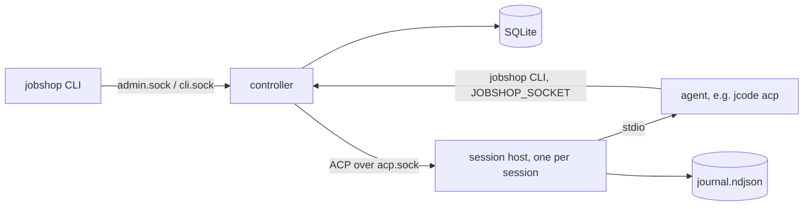

# Jobshop plan

How Jobshop is built, where it stands, and what comes next. Decisions are
dated. Where this file and the code disagree, the code wins; fix this file.
Companions: `docs/data-model.md` (tables and queries), `docs/layout.md`
(repo, build, deployment).

## 1. What and why

Jobshop is multi-agent orchestration on a SQLite ticket store: pools of ACP
agents claim tickets, work them, and close them, supervised by one
controller. It replaces our use of [Gas City](https://github.com/gastownhall/gascity).

Gas City worked, but its store is `bd` on Dolt (too slow and heavy for us),
our SQLite fork covers only part of the `bd` CLI that prompts call, about a
fifth of its Go references Dolt, and we use a small part of it. Jobshop is a
smaller system we own: the store interface lives here, everything is built
on it, SQLite first, Postgres later.

Approach: build from scratch and dogfood. Gas City is a reference for
design and edge cases, not a compatibility target. Since 2026-11-01 Jobshop
runs the agents that develop Jobshop.

## 2. Where we are

| Phase | Scope | State |
|---|---|---|
| 0 | Repo, CI, lint, data model | done |
| 1 | Store, controller sockets, CLI | done 2026-11-01 |
| 2 | Sessions, session host, self-hosting | done 2026-11-01 |
| 3 | Hardening, visibility, self-development loop | in progress, target issue #36 |
| 4 | Workflows and runs | not started |
| 5 | Batches, change subscriptions, API | not started |

Phase 3 is driven by the target issue (#36): a checklist the planner pool
works toward. Items built so far are listed in section 4.

## 3. How it works



**Tickets.** One generic graph: tickets with an engine-defined `kind`
(`task`, `session`, `message`), typed `fields` per kind, and a free-form
`meta` for pack data the engine never reads. Edges `blocks` and `waits_for`
gate readiness; `tracks` is informational; parent-child is `parent_id`.
Claims are atomic with a lease and a fence. Ready means open, unblocked and
not deferred. Details: `docs/data-model.md`.

**Controller** (`jobshop serve`). The only writer. Serves `admin.sock` for
humans and tooling, and a per-session `cli.sock` that fixes the caller's
project and holder. On each supervisor tick it fires triggers, heartbeats
claims held by driven sessions, sweeps expired leases, and starts sessions
for pools with ready work beyond their idle sessions, up to `max_sessions`.

**Session host** (`jobshop session-host`). One detached process per session
(setsid, no tmux or systemd). It runs the agent on stdio, proxies ACP to
the controller, journals every frame, caches `initialize`, holds agent
requests while no controller is connected, and survives controller
restarts. A restarted controller adopts live hosts and respawns dead ones
with `session/load`.

**Driver loop** (per session, in the controller). Deliver queued messages,
`claim --next`, prompt the ticket, check the session no longer holds it
(else one reminder turn, then release with a 10 minute defer). Two such
turns in a row end the session `stuck` so a fresh host replaces it
(2026-11-01: jcode hosts whose bash tool broke kept claiming and dropping
tickets for hours). Idle past
`idle_timeout` ends the session `idle`; more than 3 restarts in 10 minutes
ends it `crashed`; turns past `turn_timeout` get `session/cancel`.

**Agents and the CLI.** Agents call `jobshop` with `JOBSHOP_SOCKET` set, so
`jobshop close` closes their current ticket with no ids or flags. Exit
codes: 3 no work, 4 claim lost, 5 not found, 6 revision conflict, 1 other.

**Config.** `jobshop.yaml` holds projects, agents, pools, triggers and
packs. Packs are directories with `pack.yaml` (agents, pools, triggers) and
prompt files, filled from `vars`. `jobshop reload` or SIGHUP applies config
without a restart.

**Self-development** (`packs/selfdev`):
- Work specs are GitHub issues on elee1766/jobshop, filed by elee-agent. A
  ticket is a pointer ("Resolve elee1766/jobshop#N", `meta.github.issue`).
- `dev` pool: reads the issue, branches `issue-<n>`, builds and tests,
  opens a PR with `Closes #N`, waits for green CI, then hands the ticket to
  `refinery`. Out-of-scope findings become new issues.
- `refinery` pool (1 session): merges handed-off PRs one at a time with
  `--match-head-commit` on green CI and resolved review, checks master CI
  after, or routes findings back to `dev` on the same branch.
- `plan` pool (1 session): reads the `target` issue, ticks verified items,
  files the next issues and dev tickets with edges, files nothing while
  more than 6 issues are open, and sends scope changes to `needs-decision`.
- `replan` trigger: creates a plan ticket when `dev` has no ready work.

## 4. Built so far (phase 3)

Short list; behavior details are in section 7.

- Drain and undrain (#12), quarantine of crash-looping tickets and pools
  (#13), env refresh after deploys (#11), rate-limit backoff (#10).
- Prometheus metrics (#14), OTel traces and slog bridge (#15).
- Messages with queued and interrupt delivery (#16), read-only attach (#17).
- Triggers: store counts, cron, dedup and cooldown (#26), check commands
  and the selfdev `master-red` trigger (#34).
- Packs and `packs/selfdev` (#27), refinery handoff (#28).
- Config reload (#38), `session restart` (#37), host backpressure (#39).
- Per-signal OTLP URLs and headers, nix telemetry options, Grafana
  dashboard (#44).
- Conversation export with redaction (#45).
- `session/load` fallback from the journal (#43).
- `session list --state --since` and the gasserver runbook (#52).
- Meta pack name validation and `meta_packs:` (#29).
- `jobshop config show` with per-entry sources (#32).
- `jobshop_turns_total` and its dashboard panel, `deploy/verify-telemetry.sh`
  (#55).
- `jobshop ticket trace` for closed-loop evidence (#53).
- `jobshop_sessions_ended_total` by resolution, its dashboard panel, and
  the runbook counting `stuck` as a failure (#71).
- Recent comments in ticket prompts, for routed-back tickets (#70).
- Run model design note for phase 4, section 6 (#83).
- Orphaned ticket report: WARN, `jobshop_tickets_orphaned` and
  `ticket list --orphaned` (#84).
- `workflows:` in pack config, validated at load (#88).
- Runs: `run` and `step` kinds, `jobshop run start/show/list/cancel/resume`,
  key dedup, run closes done with its last step (#89).
- Multiple workspaces in the NixOS module, `workspaces.<name>` (#92).
- Step retry limits, `needs_human`, escalation ticket and
  `jobshop_runs_needs_human` (#90).
- selfdev `pr-work` workflow: the planner starts one run per issue,
  replacing pointer tickets and the prompt-only refinery handoff (#93).
- `run:` triggers start a workflow run, keyed by `${check_output}` (#98).
- selfdev `blocker-check` workflow, started by the planner on blocked
  claims (#100).
- selfdev `master-red` starts a `ci-repair` run per failing SHA (#99).
- Live sessions refresh their host when the spawn env changes, not only
  on adoption (#106), and the refresh stops the agent's detached
  daemons too (#111).
- Generic `packs/github`; `packs/selfdev` is an instance through pack
  `extends:` and `defaults:` (#107).
- Refinery merge policy vars in `packs/github`: `merge_method`,
  `required_approver`, `required_checks` (#108).
- `drill` workflow in `packs/github` to exercise escalation on demand
  (#114).
- Lowering `max_sessions` by reload never starts a session over the new
  cap (#102).
- `ci_branch` pack var and a CI repair drill runbook (#117).
- Admin API `session.send` and `session.subscribe`, and `type: chat`
  pools started by key (#121).
- `packs/operator`: the operator chat pool and prompt; selfdev extends
  it (#124).

## 5. What's next

**Phase 3** (remaining items on #36):
- Refinery dry run on real PRs, and one full planner cycle on gasserver
  (evidence: `deploy/verify-closed-loop.sh <plan ticket>`, #53, #76).
- Restart, env refresh and backoff verified on gasserver with no `crashed`
  or `stuck` sessions (runbook: `docs/gasserver-verify.md`, #52, #71).
  After the next self-deploy, `jobshop version` in a plan session must
  match `/var/lib/jobshop-deploy/deployed` (#106).
- gasserver scrapes `/metrics` and ships traces: wired and passing
  `deploy/verify-telemetry.sh` (#55); the turns panel ships with the
  next deploy.
- Done when every box on #36 is checked, master CI is green, and the pool
  runs 24h without a manual fix.

**Phase 4: workflows and runs** (target #82, started 2026-11-02). Port the
formula concepts we actually use (PR work, CI repair, blocker assessment),
create runs with graph apply, and build only the dispatcher features those
workflows need. Retry limits and one escalation path (`needs-human`) live
here. Decide scope from the workflows we run, not from Gas City. Phase 4
works on Jobshop itself only; no external repo is onboarded (decided
2026-11-02). The run model is designed (section 6, "Runs and
workflows", #83); next are its six follow-up issues listed there.
`workflows:` config (follow-up 3, first half, #88), runs (follow-up 1,
#89), failure counting with escalation (follow-up 2, #90) and the selfdev
`pr-work` workflow (follow-up 4, #93) and `run:` in triggers (follow-up 3,
second half, #98) are built. The pr-work box on #82 needs one issue
delivered through a run on gasserver. `blocker-check` (follow-up 6, #100)
is built; its box needs one run on gasserver (e.g. against #56) linked on
#82. `ci-repair` (follow-up 5, #99) is built; its box needs one red
master handled by a run on gasserver. The generic `github` pack (#107),
which `packs/selfdev` extends, and its merge policy vars (#108) are built
and stay, but are used only by selfdev. The retry limit and escalation
boxes get their live evidence from one `drill` run (#114,
`docs/gasserver-verify.md` section 8) linked on #82. The CI repair box
gets one ci-repair drill run on a red throwaway branch (#117, section 9).

**Phase 5.** Batches (Gas City convoys), admin-socket change subscriptions,
and an API if a dashboard needs one. Schedules are already covered by cron
triggers.

**Phase 4, chat track** (parallel, 2026-11-02): chat gateway for Matrix
(Discord later), read/write attach and the operator pack (section 8).
`session.send` and `session.subscribe` are built (#121); next are chat
pool idle TTL and `attach --rw` (#122), the gateway (#123), the pack (#124).

**Later.** Postgres backend against the same conformance suite.
Per-session isolation (section 7.9).

Rule for adding features: add what running the system shows is missing, in
the order it hurts. Bring over Gas City features only for a real need.

## 6. Decisions

All dated 2026-11-01 unless noted.

**Scope and principles**
- No role names in Go. Roles (planner, worker, refinery) are pool config
  and prompts. Go handles transport, not judgment.
- Work persists in tickets; sessions are disposable. Recovery re-reads
  state. No status files.
- The refinery merges without `--delete-branch`. gh (2.101+) then deletes
  the local branch and removes the linked worktree holding it, which was a
  live dev session's: its jcode bash tool failed every call ("could not
  load saved cloud environment", from canonicalizing the deleted cwd) and
  it claimed and dropped tickets for hours. The repo deletes merged head
  branches on GitHub instead.
- No observer agents shipped. Their Gas City duties (dead-session release,
  lease sweep, idle-kill, quarantine, alerts) are deterministic controller
  work. Observer-style pools stay possible as config.
- Plain names, no themed vocabulary (section 9 maps Gas City terms).
- `gx` stays a separate client of the CLI and admin socket.
- Copy Gas City code only where it is self-contained and readable;
  otherwise reference only. No vendoring.

**Store**
- One database per install; `project` is a column. No storage classes or
  split stores.
- Generic ticket graph with engine kinds, typed fields per kind, `meta`
  grouped by pack name. Packs declare no schemas.
- Driver `modernc.org/sqlite` (pure Go, no cgo). Queries via sqlc.
- Ticket ids: project prefix plus a Sonyflake id in 13-character Crockford
  base32, e.g. `js-0031w02j0r012`.
- The controller releases a dead session's claims as soon as it knows; the
  lease is a backstop and expiry returns the ticket to `open`.
- Comments have their own table; `history` is an audit log, not an event
  stream. No event bus.
- `defer_until` gates only automatic pickup. A claim by id ignores it.
  Clear a hold with `ticket update <id> --defer 0`.

**Controller, host and CLI**
- Every write goes through the controller; the CLI never opens the
  database.
- One host process per session, spawned from `/proc/self/exe` with setsid.
  No tmux, systemd units or double fork. Upgrading a running host in place
  is not planned.
- The CLI socket lives in the controller, not the host. Agent CLI calls
  fail during a controller restart and agents retry.
- JSON-RPC 2.0 with NDJSON framing on every socket, using
  `github.com/coder/acp-go-sdk` for both ACP and the CLI/admin sockets.
- Resume uses the agent's `session/load` (jcode supports it). A journal
  fallback is only for agents without it.
  (2026-11-01, #43) Built: when load is unsupported or fails, the session
  starts a new conversation seeded with a journal summary (7.1) instead of
  starting blank or crash-looping.
- Backpressure: when the host's buffer is full and no controller is
  connected, it stops reading the agent's stdout, pausing the agent. It
  never drops data.
- A message to an idle session wakes it at once. Interrupt is a pool
  permission: humans and coordinator pools may interrupt, workers only
  queue.
- Orphaned host lease: 30 minutes without a controller connection.
- Permission requests are auto-approved. fs and terminal client methods
  are not offered.
- `jcode acp --socket ${SESSION_DIR}/jcode.sock`: a private jcode daemon
  per session, because the shared user daemon does not inherit the
  session's env (`JOBSHOP_SOCKET`, `PATH`).
- Human attach is read-only: the CLI tails the journal file. Writing into
  a session is a later, config-gated addition.
- Tickets with no pool or a pool missing from the config are reported, not
  rejected or moved: create still accepts any pool (a pack may add it on
  the next reload) and the operator decides where the work goes. The
  controller warns once per ticket per reason, not every tick
  (2026-11-02, #84).
- Reload waits for the running supervisor tick and holds it off while it
  swaps, so after `config.reload` returns no tick uses the old pool limits.
  Supervise counts idle sessions before reading ready tickets, so a claim
  between the two reads cannot count one ticket as both ready and held and
  start a session over the cap (2026-11-02, #102).

**Delivery and self-hosting**
- Host: gasserver, as Linux user `jobshop` in `jobshop.slice` (6 cores,
  8 GB), next to the live Gas City. No bwrap or separate agent user yet.
- GitHub identity: the elee-agent GitHub App. agent-credd mints
  installation tokens for `jobshop` scoped to elee1766/jobshop; a `gh`
  wrapper and git credential helper use them over https.
- Work specs live in GitHub issues; tickets are pointers. No
  issue-to-ticket sync: agents follow prompt instructions, and
  dependencies stay as ticket edges.
- Workers hand green PRs to the refinery; only the refinery merges.
  Branch protection is unavailable on this plan, so "merge only on green
  CI" is enforced by prompts. (2026-11-02, #93) The handoff is now the
  `pr-work` run: closing `implement` makes `review-merge` ready for the
  refinery, instead of a dev agent moving its ticket to the refinery
  pool.
- Promotion (2026-11-01, replaces the manual flake bump): the NixOS module's
  `selfDeploy` timer rebuilds the host with `--override-input jobshop` at
  the newest master commit whose CI passed, checks that the controller
  serves and reports that rev, and otherwise switches back to the previous
  generation and skips that rev. The override is kept for the daily
  auto-upgrade; the host flake's lock is not edited. gasserver is a dev
  box and the user approved unattended promotion of agent-merged code.
- Prompts and pools live in `packs/selfdev`, read from the live checkout
  (`workspaces.<name>.livePacks`) instead of the Nix store. `jobshop-workspace-<name>-sync`
  fast-forwards the checkout to the deployed binary's commit and reloads
  the controller when a pack file changed, so prompt and binary versions
  still match.
- Generic host setup (tools on PATH, git identity and credential helper,
  workspace clone) is module options, so the host config holds only
  secrets, credentials and host values, and agents change the rest by PR.
- Triggers and the controller make no GitHub calls. GitHub state is read
  by agents through `gh`, or by a trigger's check command.
- 2026-11-01: master-red is a generic `when.check` shell command whose
  stdout is a dedup key, not a built-in GitHub poller, so the controller
  stays free of GitHub code (#34).
- OTLP export goes straight to the Victoria backends with no collector, so
  jobshop takes per-signal URLs and headers itself. Header secrets come
  from the environment via `${VAR}`, never from the YAML (#44).
- Crash evidence is a `session list` filter (`--state`, `--since`) rather
  than a separate script, so it reads the store the controller uses (#52).
- Meta pack names are checked by the controller on create and update,
  against built-ins (`github`, `trigger`) plus `meta_packs:` in
  jobshop.yaml. `packs:` was already taken by pack directories. The store
  stays shape-only (2026-11-01, #29).
- `config show` asks the controller for its live config instead of
  reading the file, so it shows what runs after the last good reload
  (2026-11-01, #32).
- Turns are counted by `jobshop.turn.stop_reason`, the key conversation
  export already uses, so a turn's logs and metrics share one label. The
  telemetry check is a shell script, not a CLI command: it reads
  VictoriaMetrics and VictoriaTraces, which the controller does not know
  about (2026-11-01, #55).
- Ticket prompts include the last 3 comments, each cut to 2000 chars. The
  refinery records findings as comments, and an agent prompted with only
  the title and body redid finished work or stalled. Comments are cheaper
  than a summary step and the agent can still run `ticket show`
  (2026-11-01, #70).
- A live session re-checks its env hash between turns and refreshes when
  it changed, rather than putting a stable `/run/jobshop/bin` symlink on
  PATH. The symlink would fix only PATH; the hash also catches changed
  credentials and agent env, and the refresh path already existed for
  adoption (2026-11-02, #106).
- Pack composition is `extends:` plus `defaults:` in pack.yaml
  (2026-11-02, #107), not a template language or Nix-side composition:
  `packs/selfdev` must stay loadable from a live checkout by the
  controller, and reusing the `packs:` merge order and per-file `sources`
  keeps `config show` honest. Base vars are templates over the extending
  pack's vars so an instance renames vars (`checkout: ${repo}`) without
  changing its host interface.

**Runs and workflows** (2026-11-02, #83, design for target #82; not built)

Derived from the three workflows we run (PR work, CI repair, blocker
assessment), not from Gas City formulas. Only what they need: a straight
line of steps, per-step retry limits, one escalation path. No branches,
loops, fan-out or step outputs; add them when a workflow needs them.

*Definition.* A pack declares `workflows:` next to `pools:` and
`triggers:`. A workflow has `vars` (required var names; pack vars
supply defaults), optional `issue` (a var holding a GitHub issue number, copied
into every ticket's `meta.github.issue`), `escalate_pool`, and ordered
`steps`. Each step has `id`, `pool`, `title`, `prompt` or `prompt_file`
(filled from pack vars plus run vars), and `retries` (default 2). A step
blocks on the previous one. Unknown pools or vars fail config load.

*Start.* `jobshop run start <workflow> --var k=v [--key k]` asks the
controller, which fills the templates and calls the existing
`CreateGraph` once:
- run ticket: kind `run`, no pool (never claimed), title from the
  workflow, `fields` `{workflow, pack, vars, key, state: "running"}`.
- one ticket per step: kind `step`, `parent_id` = run, the step's pool,
  `fields` `{run, step, index, retries, failures: 0}`, body = filled
  prompt.
- edges: step i+1 `blocks` on step i, so only the first step is ready.
- `meta.github.issue` on the run and every step when `issue` is set.

`--key` dedups: a second start with the same workflow and key while a
run with that key is open returns the open run. Triggers get
`run: {workflow, vars, key}` as an alternative to `ticket:`; master-red
uses the failing SHA as key.

*Progress.* Agents work a step like any ticket and `jobshop close` it.
When the last step closes `done`, the controller closes the run `done`.
`jobshop run show <id>` prints the run state and vars, then one line per
step: index, id, pool, status, resolution, holder, `failures/retries`.
`jobshop run list [--state needs_human]` lists runs.

*Retries.* The controller counts a failure on a step, in the same
transaction as the event, when the step is closed `failed`, released
unclosed (`jobshop release`, the driver's reminder release, dead-session
release) or its lease expires. Below the limit the step goes back to
`open` (a `failed` close reopens it) with a comment saying which attempt
failed. At the limit the step closes `failed` and the run becomes
`needs_human`. This counts across sessions, unlike quarantine, which
counts crashes per ticket and stays as is.

*needs-human.* The run's `fields.state` becomes `needs_human`; the run
stays open so later steps stay blocked. The controller makes no GitHub
calls (decision above), so it creates one task ticket in the workflow's
`escalate_pool` titled "Escalate run <id>", carrying the issue meta and
the step history (attempts, resolutions, last 3 comments). That agent
labels the issue `needs-human` and comments mentioning @elee1766 with the
blocker, evidence and what would unblock it. `jobshop run resume <id>
[--step s]` resets the step's failures and reopens it; `run cancel`
closes the run and its open steps `cancelled`.

*Store and sqlc.* No new tables. `KindRun` and `KindStep` with field
structs in `pkg/store/kinds.go`. New queries: `ListChildren` (by
`parent_id`, ordered by `fields.index`; `tickets_parent` exists) and
`FindOpenRunByKey`; a migration adds a partial index on
`json_extract(fields,'$.key')` for open runs and one on
`json_extract(fields,'$.state')` for kind `run`. The failure count is a
fields update inside the existing release, close and lease-sweep
transactions, guarded by `revision`. Then regenerate sqlc.

*Examples* (`packs/selfdev/pack.yaml`, later the generic `github` pack):

```yaml
workflows:
  pr-work:
    vars: [issue]
    issue: issue
    escalate_pool: plan
    steps:
      - {id: implement, pool: dev, retries: 3, prompt_file: prompts/implement.md,
         title: "Implement #${issue}"}
      - {id: review-merge, pool: refinery, retries: 2, prompt_file: prompts/merge.md,
         title: "Review and merge PR for #${issue}"}
      - {id: post-merge, pool: refinery, retries: 2, prompt_file: prompts/post-merge.md,
         title: "Check master CI and self-deploy for #${issue}"}
  ci-repair:
    vars: [sha]
    escalate_pool: plan
    steps:
      - {id: fix, pool: dev, retries: 2, prompt_file: prompts/ci-fix.md,
         title: "Fix red master CI at ${sha}"}
      - {id: merge, pool: refinery, retries: 2, prompt_file: prompts/merge.md,
         title: "Merge CI fix for ${sha}"}
  blocker-check:
    vars: [ticket, issue]
    issue: issue
    escalate_pool: plan
    steps:
      - {id: assess, pool: plan, retries: 1, prompt_file: prompts/blocker.md,
         title: "Re-check blocker on ${ticket}"}
```

PR work: review findings route back by the refinery closing
`review-merge` `failed`, which counts a failure and reopens it after a
comment; the refinery prompt reopens `implement` with the findings
(`run resume --step implement`). CI repair: trigger `master-red` starts
`ci-repair` with key = SHA, so at most `fix.retries` attempts per SHA.
Blocker check: the assess step re-reads the blocker against current state
(deploys, permissions, pools), routes a stale blocker's ticket back to a
pool and closes `done`, or closes `failed` for a real one, which
escalates at once with `retries: 1`. Who starts it (2026-11-02, #100):
the planner, from its prompt, for each open issue or ticket that says it
is blocked or waiting on an operator. Not a trigger: "says it is
blocked" is in free text (comments, release reasons), which store
counts and check commands cannot read reliably, and the planner already
reads every open issue each cycle.

*Follow-up issues:* (1) run and step kinds, `ListChildren`, run
start/show/list/cancel/resume over `CreateGraph`; (2) failure counting,
`needs_human` state and the escalation ticket; (3) `workflows:` in pack
config and `run:` in triggers; (4) selfdev `pr-work` replacing the prompt
handoff; (5) `master-red` starting `ci-repair`; (6) `blocker-check`
workflow and who starts it (planner or a trigger on blocked tickets).

**Build**
- Session events stream as notifications on the subscribing connection
  (2026-11-02, #121), not a second socket: the gateway and `attach --rw`
  already hold an admin connection. Events are read from the journal, so
  `since_seq` resumes without a controller-side buffer. `session.send`
  is a message ticket to the session id, reusing #16 delivery.
- Plain `go` for development and CI, Nix flake for the package and NixOS
  module. No Bazel. CI: build, vet, `go test -race`, sqlc diff, golangci-lint,
  shellcheck of `deploy/*.sh`, `nix build`.
- YAML config. Every new dependency has its reason recorded in
  `docs/layout.md`.

## 7. Reference: behavior as built

### 7.1 Session files and restart

Files in `sessions/<id>/`: `spec.json`, `host.lock` (flock; held means
alive), `host.pid`, `host.log`, `acp.sock`, `journal.ndjson`, `exit.json`,
and `work/` (git worktree when the pool sets `repo`).

- The host rewrites request ids so a new controller never collides with an
  old one, re-sends unanswered agent requests to a new controller, and
  reports a prompt that finished while detached as `_jobshop/turn_end`.
- Backpressure (decided 2026-11-01, #39): agent stdout is read and
  journaled without waiting on the controller. Frames are then queued per
  connection and one writer goroutine drains the queue, so a controller
  that stops reading blocks only that goroutine. The queue holds at most
  8 MiB or 4096 frames. Past that, agent notifications are dropped from
  memory only: the writer replays them from the journal in seq order
  before the next live frame and logs the count (`replayed frames from
  journal`; the host has no metrics). Responses, agent requests and host
  messages are never dropped. At most 256 agent requests wait for a
  controller answer; more get a JSON-RPC error back to the agent. With no
  controller nothing is queued. Optional `Hello.since` replays agent
  notifications after a seq on connect (protocol unchanged).
- Stopping a host: SIGTERM (forwarded to the agent's group, SIGKILL after
  5s); the controller SIGKILLs the host after 10s.
- Leak guards: the agent gets `Pdeathsig: SIGKILL` and its own process
  group; the host is a child subreaper; the host exits with its agent and
  after 30 minutes with no controller.
- Controller start: open session tickets are adopted (live host) or
  respawned (`session/load`); hosts with no open session are stopped.
- Load fallback (#43): if the agent lacks `LoadSession` or `session/load`
  fails, the controller calls `session/new` and builds a summary from
  `journal.ndjson` (`host.Summarize`: prompts, agent text, tool call titles,
  latest plan; at most 16 KiB, keeping the first prompt and the newest
  items). The summary is prepended to the next turn's prompt, ended by
  `[end of summary]`, with no extra turn; a later summary skips text
  before that marker so summaries do not nest. The log says which path
  (`load` or `new+summary`) was taken. The pending summary is memory only:
  a controller restart before the next turn loses it.
- Prompts use `context.WithoutCancel`, and stopping the controller closes
  the connection instead of cancelling requests, so turns keep running in
  the host.
- Git: `fetch` then `worktree add --detach <ref>` per session, removed when
  the session ends; git calls on one repo are serialized.
- A worktree deleted under a live session (seen on gasserver 2026-11-01:
  every tool call failed for five hours, tickets claimed and dropped) makes
  the runner respawn the host before its next claim. Spawning prunes stale
  worktree registrations and adds a fresh worktree at `ref`; the
  conversation and claims are kept, uncommitted work in the old one is lost.
- `${SESSION_DIR}` expands in agent args.

### 7.2 Env refresh and session restart (#11, #37)

`spec.json` carries `env_hash`, a sha256 of the agent's full env (inherited
controller env minus per-start systemd variables, then the spec env). When
adopting a live idle host whose hash differs, the controller stops it and
respawns it at once with `session/load`; a busy session refreshes after its
turn. `jobshop session restart <id>` does the same on demand, keeping
claims; `--now` cancels the running turn first. Neither counts as a crash.
A respawned host's stale `exit.json` is removed before spawn, and an
adopted host whose agent never initialized is treated as fresh, so the
conversation is always loaded. A live session also re-checks the hash
before each claim, after every turn and on every idle poll (#106,
2026-11-02), so a session that stays connected across a deploy or a
reload that changes agent env refreshes too. Stopping a host also stops
any process left with the session's `JOBSHOP_SOCKET` in its environ
(#111): jcode `acp --socket` runs tools in a detached `jcode serve`
daemon outside the host's process group, so without this the refreshed
agent reconnected to a daemon that still had the old PATH.

### 7.3 Rate limits, drain, quarantine (#10, #12, #13)

- A prompt error mentioning `429`, `rate_limit` or `is unavailable` is not
  a crash: the session keeps host and claims and retries the same prompt
  after 1m, doubling to 15m. While any session of a pool backs off, no new
  sessions start for it. `session list` shows `backoff_until`.
- `jobshop drain [--pool P]` / `undrain`: no new sessions or claims for the
  pool; running turns finish and sessions end `drained`. Controller
  memory only, so a restart undrains.
- A `crashed` session releases its tickets with reason `session crashed`.
  After 3 such releases a ticket is deferred 1h and labeled `quarantined`
  with a comment listing the exits. Undo: `ticket update <id> --defer 0`
  and `label rm <id> quarantined`. A pool with 3 crashed sessions in 10
  minutes starts none for 15 minutes; the pause is set before the release.

### 7.4 Messages (#16)

`jobshop send <to> <text> [--interrupt]` creates a `message` ticket; `to`
is a session id, a session key, or `pool:<name>`. The driver delivers
before each `claim --next`: it claims and closes each message (`delivered`,
at most once) and sends them as one prompt starting `Messages for you:`.
During a turn it polls for interrupt messages and on one sends
`session/cancel`, delivers, then continues. The pool-level interrupt
permission is not built.

### 7.5 Attach and session admin (#17)

- `jobshop session attach <id> [--since <seq>] [--json] [--no-follow]`
  renders the journal file and follows it; works while the controller is
  down.
- `session list` joins session tickets with their dirs: `alive`, pids,
  current ticket, last journal seq, `exit`, `crashes`, `backoff_until`,
  orphans. `--state <resolution>` and `--since <dur>` (#52) list only
  closed sessions matching both, without orphans:
  `session list --state crashed --since 24h` is the crash evidence.
- `session reap` stops hosts with no open session; `--closed` also deletes
  old closed session dirs.
- `shutdown` leaves sessions running; `shutdown --all` ends them first.

### 7.6 Triggers (#26)

`triggers:` entries have `when`, a `ticket` template and an optional
`cooldown`. Each tick the controller fires a trigger when all hold: no open
ticket it created (`meta.trigger.name`), cooldown passed since its last
ticket closed (a last ticket read with no `closed_at`, because it closed
mid-evaluation, waits for the next tick; #47, 2026-11-01), cron slot due, every count threshold met. Thresholds are
`{ready,open,in_progress}_{below,above}` over `when.pool`, `when.kind`
(default task) and `when.label`. State is read back from the store, so
restarts change nothing. Cron is 5-field, UTC unless `when.timezone`;
missed slots collapse into one fire, and a new trigger does not fire for
past slots. `jobshop trigger list` shows whether each would fire and why.
`when.check` (#34) is a `sh -c` command run in the root dir after the
store conditions hold; exit 0 holds. Non-empty trimmed stdout is a dedup
key (`meta.trigger.key`, prefixed with the trigger name): one ticket per
key, ever. `check_timeout` defaults to 1m; a timeout logs an error.
A trigger may start a workflow run instead of filing a ticket (7.19).

### 7.7 Packs and reload (#27, #38)

`packs:` lists `path` (relative to the root) and `vars`. `pack.yaml` holds
`agents`, `pools`, `triggers`, `workflows`, and `defaults`/`extends`
(7.22); other keys are rejected. Merge: packs in
order, then jobshop.yaml; later sources win per key and per field through
nested maps; lists and scalars replace whole. `${name}` comes from the
pack's vars (a bare `${name}` keeps the var's type, `$$` is a literal `$`,
unset is an error); jobshop.yaml is not substituted. `prompt_file` is read
relative to its declaring file. `jobshop reload`/SIGHUP swaps the config
atomically or keeps the old one on error: pool limits and triggers apply on
the next tick (reload waits for a running tick, #102), prompts and timeouts
on the next turn, agent command and env on the next host. Telemetry changes need a restart. `jobshop config show`
(admin) prints the live merged config with jobshop.yaml keys, and
`sources`: for each `agents.<name>`, `pools.<name>` and `triggers.<name>`,
the files that set it in merge order (packs, then jobshop.yaml). OTLP
header values print unexpanded.

### 7.8 Observability (#14, #15)

- `telemetry.metrics_listen` serves `/metrics`: `jobshop_sessions` (by
  pool and state idle/working/backoff), `jobshop_session_restarts_total`,
  `jobshop_tickets_ready`, `jobshop_claims_total`, `jobshop_closes_total`,
  `jobshop_lease_expiries_total`, `jobshop_rpc_duration_seconds`,
  `jobshop_turns_total` (by pool and `jobshop_turn_stop_reason`: the ACP
  stop reason, or `error` when the prompt failed; counted once per turn
  after rate-limit retries, not on shutdown),
  `jobshop_sessions_ended_total` (by pool and `jobshop_resolution`: idle,
  crashed, stuck, ...; counted in `runner.finish`, #71, 2026-11-01). No
  ticket or session ids on metrics.
- `telemetry.otlp_endpoint` sends traces and slog logs over OTLP/HTTP.
  Spans: `supervisor tick`, `rpc <method>`, session lifecycle. Each session
  has one trace; its traceparent is stored on the session and passed to
  the agent as `JOBSHOP_TRACEPARENT`, and the CLI propagates it.
- `otlp_traces_endpoint` and `otlp_logs_endpoint` (full URLs) override
  the base per signal, and either alone turns that signal on.
  `otlp_headers` go on both; `${VAR}` in values expands from the
  controller env at startup, never at parse, so `config show` prints the
  placeholder. The nix module exposes these as `services.jobshop.telemetry.*`
  plus `environmentFile` for the tokens (#44).
- Grafana dashboard: `deploy/grafana/jobshop.json` (sessions by pool and
  state, backoff, restarts, ready queue, claims and closes, rpc p95,
  turns by stop reason). A test scrapes `/metrics` and fails if a panel
  names a series or label that is not exported.
- `deploy/verify-telemetry.sh` (POSIX sh, curl and jq, `--help`) checks a
  deployment: `/metrics` serves `jobshop_*`, the VictoriaMetrics target is
  up, `jobshop_sessions` and `jobshop_tickets_ready` exist per pool, and
  VictoriaTraces has a `session` trace in the last hour. Counters that
  have not incremented yet are listed, not failed. CI shellchecks it
  (`shellcheck -s sh`, #65).
  Runbook: `docs/gasserver-verify.md` section 5 (#55).
- `deploy/verify-sessions.sh` (POSIX sh, jq) fails when any session closed
  `crashed` or `stuck` within `--since` (default 24h), printing id, pool
  and end reason. Used in runbook section 0 (#77).
- Planned: store transaction spans.
- Conversation export (decided 2026-11-01, #45): `conversation_export:
  true` on a pool (default off; needs a logs endpoint, checked at load)
  makes its hosts emit OTLP log records named
  `jobshop.conversation.<event>`: `prompt`, `agent_message`,
  `agent_thought` (chunks joined), `tool_call` (title, kind, input),
  `tool_result` (status changes, input, output), `turn_end`. Records carry
  session, pool, project, the ticket (sent in the prompt's
  `_meta["jobshop/ticket"]`) and the session traceparent. Redaction runs
  before a record is built: values under secret-named JSON keys,
  secret-named launch-env values (8+ bytes, exact match) and gitleaks
  default-rule findings become `[REDACTED]`. Each text field is capped at
  8 KiB with `jobshop.conversation.truncated=true`. Frames go to a queue
  of 1024 frames / 16 MiB; overflow drops and counts, the exporter has no
  retries and a 10s timeout, and the host gives the final flush 5s.
  Hosts report counts every 10s; the controller exports
  `jobshop_conversation_export_dropped_total` and
  `jobshop_conversation_export_truncated_total` by pool. Code:
  `pkg/telemetry/convexport.go`. The journal stays the record of truth.
- gasserver backends: VictoriaMetrics, VictoriaLogs, VictoriaTraces, all
  OTLP/HTTP, no collector.

### 7.9 Users and security

Controller, hosts and agents all run as `jobshop`. Accepted risk: an agent
can do anything the controller can; socket scoping guards against mistakes,
not hostile agents. Later options if needed: agents as a separate user via
a narrow sudoers rule, or per-session bubblewrap or Landlock applied by the
host (read-only system, writable worktree, own CLI socket).

### 7.10 Meta pack names (#29)

Top-level `meta` keys on `ticket create`/`update` must be `github`,
`trigger`, or listed in `meta_packs:` (a string list in jobshop.yaml,
picked up on reload). Unknown names fail with `invalid`. The store only
checks the `{"<pack>": {...}}` shape.

### 7.11 Ticket trace (#53)

`jobshop ticket trace [id] [-d depth]` prints a tree as JSON. Each node
shows the trigger that created the ticket (`meta.trigger.name`), its
creator, the sessions that claimed it (from history), its edges, and the
GitHub issue and PR URLs in its body and comments. Children are tickets
with `parent_id` set to the node, plus tickets that one of its holders
created while holding it (claim to close, release or lease expiry). The
second rule links a plan ticket to the dev tickets its planner filed. The
depth defaults to 5, and a ticket appears once. Store `Filter.CreatedBy`
backs the lookup.

`deploy/verify-closed-loop.sh <plan-ticket>` (#76) checks one cycle on that
tree: the plan ticket came from a trigger and is closed, its planner
session created a dev ticket, one of those reached `refinery`, and it links
a PR that `gh` reports as merged. It exits 1 naming the first missing link.
`--trace FILE` reads saved JSON. Tests in `deploy/` run it against
`deploy/testdata` with a fake `gh`.

### 7.12 Ticket prompt (#70)

The claim prompt is the pool prompt, the ticket id, title and body, then
`# Recent comments` when the ticket has any: the last 3 as
`[time] author:` and the body, each body capped at 2000 bytes with
`[truncated]`. A line tells the agent to address a refinery finding, push
and hand back to refinery. A ticket without comments gets the same
prompt as before.

### 7.13 Orphaned tickets (#84)

An orphaned ticket is open, unclaimed (no holder), claimable (`task`), and
has an empty pool or one not in the loaded config. Every supervisor tick
and every successful reload the controller queries them, logs WARN
`ticket has no claimable pool` with `reason=no_pool|unknown_pool` the first
time it sees a ticket with that reason, and sets the gauge
`jobshop_tickets_orphaned{reason}` (dashboard panel "Orphaned tickets").
A ticket that gets a configured pool, a holder, or is closed drops out;
if it is orphaned again later it warns again. `jobshop ticket list
--orphaned [--project p] [-n N]` lists them through the controller.

### 7.14 Workflow config (#88)

`workflows:` merges like `pools:` (per entry, then per field; `steps` is a
list and replaces whole). Fields: `vars`, `issue`, `escalate_pool`,
`steps` (`id`, `pool`, `title`, `prompt` or `prompt_file`, `retries`,
default 2). Pack var substitution skips step `title` and `prompt`, so
both stay templates for run start; the loader records the declaring
pack's vars as `pack_vars` (not user-settable) and `prompt_file` is read
relative to the declaring file. Load fails on: an unknown step pool or
`escalate_pool`, a missing or duplicate step id, no steps, a missing
title, both or neither of `prompt` and `prompt_file`, negative
`retries`, a `${var}` in a title or prompt that is neither a workflow
var nor a pack var, and `issue` not in `vars`. `config show` lists
workflows with `sources["workflows.<name>"]`; `config reload` reports
their count. `jobshop run start` (7.15) uses them.

### 7.15 Runs (#89)

`jobshop run start <workflow> -v k=v [--key k]` (admin, or a session in
the workflow's project) checks vars (every workflow var set, no others),
fills step titles and prompts from pack vars plus run vars, and calls
`CreateGraph` once: a `run` ticket (no pool, project of the first step's
pool, `fields {workflow, pack, vars, key, state: running}`), one `step`
ticket per step (`parent_id` = run, step pool, body = prompt, `fields
{run, step, index, retries, failures: 0}`), and `blocks` edges step i+1 on
step i. With `issue`, run and steps get `meta.github.issue` (a number when
numeric). Ids come from `Store.NewID` so edges are wired before insert.
With `--key`, an open run of the same workflow and key is returned
(`existing: true`); starts are serialized in the controller. `step` is a
claimable kind, so pool sessions claim steps like tasks; `ticket create`
rejects `run` and `step`.

When a step closes through `ticket close` the controller closes its run
`done` (state `done`) if every step is closed `done`; each tick also
sweeps running runs for this. `run show <id>` prints the run line, vars,
and one line per step (index, step, id, pool, status, resolution, holder,
failures/retries); `--json` prints the raw result. `run list [--state]`
lists runs newest first. `run cancel` closes open steps and the run
`cancelled`. `run resume [--step s]` reopens the step (default: the
first not closed `done`), resets its failures, comments on it, and sets
the run back to `running`. A step that is closed `failed` or still
unfinished keeps the next step blocked (7.16).

### 7.16 Step retries and escalation (#90)

The store counts a step failure in the same transaction as the event
that caused it: `close failed`, `release` of a claimed step (CLI, the
driver's reminder release, crash release), dead-session release of a
claimed step (a pre-assignment never claimed does not count) and lease
expiry. Each count bumps `fields.failures`, records `failures` in the
history diff and adds a controller comment naming the attempt and how it
failed. `retries: N` allows N failed attempts. Below N the step goes back
to `open` (a `failed` close is undone). At N it closes `failed`.
Readiness and `claim` treat a step closed with any resolution but `done`
as still blocking, so later steps wait.

After each of those calls, and every tick, the controller checks the run.
If a step is exhausted and the run is `running`, it sets
`fields.state=needs_human`, bumps `fields.escalations`, and creates one
task "Escalate run <id>" in the workflow's `escalate_pool`, priority 1,
label `needs-human`, with the run's `meta.github` and
`meta.run {id, workflow, escalation: "<run>/<n>"}`. The body lists each
step's resolution, `failures/retries` and its last 3 comments. The
escalation key makes a tick or a crash retry file at most one ticket per
`needs_human` episode, and closing the ticket does not file another.
`run resume` resets failures and returns the run to `running`, so a later
exhaustion is a new episode with a new ticket. The gauge
`jobshop_runs_needs_human{jobshop_project}` counts open `needs_human`
runs (dashboard panel "Runs needing a human"). The selfdev planner
prompt handles escalation tickets: it labels the issue `needs-human`,
comments mentioning @elee1766, and lists open escalations on the target.

### 7.17 Workspaces in the NixOS module (#92)

`services.jobshop.workspaces.<name>` has `url`, `dir` (default
`<dataDir>/workspaces/<name>`), `sshCommand`, `livePacks`,
`livePackVars`, `syncInterval` and `selfDeploy`. Each workspace with a
url gets `jobshop-workspace-<name>` (clone before the controller) and
`jobshop-workspace-<name>-sync` (fast-forward, reload on pack changes;
timer only with live packs). Live packs of all workspaces go into the
generated `packs:` with their own vars. At most one workspace sets
`selfDeploy` (assertion); `selfDeploy.enable` needs one. That workspace
gives the repo for the green-commit pick, and its packs follow the
deployed commit. The old `workspace` option still evaluates: it maps to
`workspaces.default` with the old dir (`<dataDir>/src/<repo>`) and
`selfDeploy = selfDeploy.enable`, so gasserver keeps its checkout; only
the unit names change (`jobshop-workspace-default[-sync]`). `checks.module`
in the flake evaluates a two-workspace config, the two-selfDeploy
assertion and the old option.

### 7.18 selfdev pr-work (#93)

`packs/github/pack.yaml` (selfdev since #107) declares `pr-work` (vars `[issue]`, `issue:
issue`, `escalate_pool: plan`): `implement` (dev, 3 retries,
`prompts/implement.md`), `review-merge` (refinery, 2,
`prompts/merge.md`) and `post-merge` (refinery, 2,
`prompts/post-merge.md`). The planner runs `jobshop run start pr-work
--var issue=<n> --key issue-<n>` per new issue, and a dependency is an
edge from the dependent run's `implement` to the dependency's
`post-merge`. Pool prompts now only frame the role; the step body is the
instruction. Review findings: the refinery comments, runs `run resume
<run> --step implement`, and closes `review-merge` `failed`, so the step
reopens behind implement and counts an attempt. `post-merge` checks
master CI on the merge commit and that `jobshop version` reports that
commit or a descendant (self-deploy picked it up). Because a release
counts as a failed attempt (7.16), the step prompts wait in-turn
(`gh run watch`, `sleep`) instead of deferring and releasing. A dev task
that is not a step (e.g. `master-red`) is turned into a run for its
issue. The refinery still handles older non-step hand-off tickets the
old way.

### 7.19 Run triggers (#98)

A trigger has exactly one of `ticket:` and `run: {workflow, vars, key}`.
Load fails on an unknown workflow, a var the workflow lacks, or a
workflow var set by neither the trigger nor pack vars. `vars` and `key`
are templates whose only var is `${check_output}`, the first line of the
check's trimmed stdout (allowed only with `when.check`); pack vars are
substituted at load as elsewhere. Firing calls the `run start` code path
as the controller, with the key, so an open run with that key is reused
instead of a second one. The run ticket carries `meta.trigger`, so the
open run holds the trigger, its close starts the cooldown, and the check
key dedups exactly as for ticket triggers. Steps do not carry the
trigger meta.

### 7.20 selfdev blocker-check (#100)

`blocker-check` (vars `[ticket, issue]`, `issue: issue`,
`escalate_pool: plan`) has one step, `assess` (plan, `retries: 1`,
`prompts/blocker.md`). The planner starts it with `--key blocker-<id>`
(`ticket=none`, `--key blocker-issue-<n>` when only the issue claims a
blocker). The step checks self-deploy (master vs `jobshop version`),
pools (`ticket list --orphaned`) and permissions or credentials, comments
the evidence on the issue, then either routes the work back (`ticket
update --pool`, `run resume`, drop `needs-human`) and closes `done`, or
closes `failed`, which escalates at once.

### 7.21 selfdev ci-repair (#99)

`master-red` is a `run:` trigger: `{workflow: ci-repair, vars: {sha:
${check_output}}, key: ${check_output}}`. `ci-repair` (vars `[sha]`,
`escalate_pool: plan`) has `fix` (dev, 2 retries, `prompts/ci-fix.md`:
find or file the fix issue, `gh run view --log-failed`, open a PR) and
`merge` (refinery, 2 retries, `prompts/ci-merge.md`). It does not reuse
`merge.md`, which needs an `issue` var and refuses to merge while master
is red. With the SHA as both run key and trigger key, a SHA gets one run
and at most two fix attempts, then `needs_human` and an escalation ticket
(7.16).

### 7.22 Generic github pack and pack extends (#107)

`packs/github` holds the plan, dev and refinery pools, the `replan` and
`master-red` triggers and the `pr-work`, `ci-repair` and `blocker-check`
workflows with their prompts. Pack vars: `repo` (owner/repo), `checkout`,
`agent`, `human`, `check_cmd`, and defaulted `ci_workflow`,
`dev_sessions`, `guide`, `deploy_check`. `pack.yaml` may set
`defaults:` (var values the including file did not set) and `extends:`
(a list like `packs:` whose `vars` are templates over the extending
pack's vars). Base layers merge before the extending pack, each recorded
in `sources` under its own file; nesting deeper than 8 fails as a cycle.
Pool `prompt_file` contents in a pack now get pack var substitution
(host prompt files stay literal). `packs/selfdev` is `extends: ../github`
with Jobshop's values; its own vars (`repo` = checkout path, `agent`,
`dev_sessions`) are unchanged, so hosts and the NixOS module need no
change. The merged selfdev config has the same pools, triggers,
workflows, steps and retries; prompt text differs only in wording that
named Jobshop or self-deploy directly.

### 7.23 Merge policy vars (#108)

`packs/github` defaults `merge_method: squash`, `required_approver: ""`
and `required_checks: ""`; selfdev keeps the defaults. `review-merge`
and ci-repair `merge` run `gh pr merge --${merge_method}
--match-head-commit <head>`. A set approver must have an `APPROVED`
review whose `commit_id` is the current head (`gh api
repos/<repo>/pulls/<n>/reviews`, filtered by login, state and commit);
without it the step comments and closes `failed`, so it reopens and
checks again until the retry limit escalates. ci-repair gets no waiver:
a fix for red master needs the same approval. Empty `required_checks`
means every check must pass, otherwise the listed names must be
`SUCCESS`. The rules are prompt text, not controller code, like the rest
of the refinery's judgment.

### 7.24 Escalation drill (#114)

Added 2026-11-02. `packs/github` has a `drill` workflow (var `issue`,
`escalate_pool: plan`) with one step `fail` in `dev`, `retries: 1`,
whose prompt only comments and closes `failed`. One run therefore ends
in `needs_human` with an "Escalate run <id>" ticket in `plan`, proving
the 7.16 path live without waiting for a real failure. Runbook:
`docs/gasserver-verify.md` section 8. Test: `TestSelfdevDrill`.

### 7.25 CI repair drill (#117)

Added 2026-11-02. `packs/github` var `ci_branch` (default `master`, kept
by selfdev) is the branch the `master-red` check passes to `gh run list
--branch`. The drill (`docs/gasserver-verify.md` section 9) starts a
`ci-repair` run by hand for a red SHA on a throwaway `drill/red-ci`
branch, so master never goes red. Test: `TestGithubPackLoads` overrides
`ci_branch`.

### 7.26 session.send and session.subscribe (#121)

Admin socket only.

- `session.send {id | pool+key, text, interrupt}` creates a message
  ticket to the session id (first line title, rest body; 7.4 delivery).
  With pool and key and no open session for the key, a `type: chat` pool
  starts one (`started: true`); a ticket pool is an error. A key open in
  another pool is a conflict. Message turns are interruptible too.
- Chat pools claim no tickets and the supervisor starts no sessions for
  them. Idle TTL and restart by key are #122.
- `session.subscribe {id, since_seq}` stays open and sends
  `session.event` notifications on the same connection: `turn_start`
  (prompt), `text` (message chunk), `tool` (id, title, status),
  `turn_end` (stop reason or error), each with its journal seq, and
  `state` (status, resolution; no seq) first and on change. It returns
  `{seq, closed, resolution}` when the session closes or the client
  hangs up. Reconnect with the last seq seen; `rpc.Client.Subscribe`
  tracks it. Test: `TestSessionSendSubscribe`.

### 7.27 Stale-blocker drill (#119)

Added 2026-11-02. Runbook `docs/gasserver-verify.md` section 10 proves
the blocker-check stale path live: a ticket waiting on an
already-deployed sha, parked in pool `drill-none`, plus a `needs-human`
issue. Expected: `assess` closes done, the ticket returns to `dev`, the
label is removed, no escalation. `prompts/blocker.md` now says how to
pick the pool to route back to: the pool from before parking (ticket
history), else `dev` for code and `plan` for decisions.

### 7.28 Operator pack (#124)

Added 2026-11-02. `packs/operator` has one pool, `operator`, with
`prompts/operator.md`: manage tickets, issues, messages, runs and reload
for the operator, short replies with links, and turn a correction into
an issue plus a prompt PR worked by a `pr-work` run. `packs/selfdev`
extends it, so gasserver gets the pool through its existing live pack.
Until chat pools (#122) land it has `max_sessions: 0`; a session is
started by hand with a key and a chat ticket, because message prompts
do not carry the pool prompt. `reload` and `session list` need the
admin socket, so from a session socket the prompt says to hand the
command to the operator. Tests: `TestOperatorPackLoads`,
`TestSelfdevPackLoads`.

## 8. Chat gateway

Scheduled 2026-11-02 as a parallel track of phase 4 (target #82), Matrix
only for now; Discord is a later adapter behind the same interface
(decided 2026-11-02). Kept small: the gateway is a translator, and sessions,
messages and prompts stay in the controller.

- Chat pools: `type: chat` pools are not ticket-driven. A session is keyed
  (`matrix:<room>:<thread>`, `discord:<channel>:<thread>`), started on the
  first message for its key, idle between messages, and resumed by key
  after a restart. One chat thread is one session.
- Admin API: `session.send` (by id or key; starts the keyed session if
  missing; queued, or interrupt when marked) and `session.subscribe`
  (stream of a session's turn output and state). Both are what read/write
  attach also uses.
- `jobshop session attach --rw`: a terminal is one more client of send and
  subscribe, allowed per pool by config.
- `jobshop gateway`: a separate process in the same binary, an ordinary
  admin-socket client. One adapter per network, behind a small interface
  (receive message with thread key and sender, post reply, edit or react
  for progress). Allowed senders and rooms are config; others are ignored.
  Matrix E2EE is out of the first cut.
- `packs/operator`: the prompts chat sessions run. They can create and
  comment on tickets and issues, message sessions and pools, start runs
  and reload, and turn a correction in the conversation into a PR to a
  pack prompt or an issue, so self-improvement goes through the refinery
  like other changes. This is how a Gas City mayor role returns as config.
- Escalation threads (2026-11-02): an escalation also opens a Matrix
  thread, created by the gateway from a controller
  event, with a keyed operator session already holding the escalation
  context. The operator's reply there unblocks the run.
- Testing: gasserver runs a loopback tuwunel homeserver as the jobshop
  user (`jobshop.localhost`, no federation, token registration), so
  agents register their own bot and test users and verify Matrix end to
  end.

## 9. Gas City mapping

| Gas City | Jobshop |
|---|---|
| Bead | Ticket |
| Controller loop, health patrol | Controller |
| Rig | Project |
| Agent, pool, session, pack | same |
| Formula / molecule | Workflow / run (phase 4) |
| Sling | Assign |
| Claim, holder (not assignee) | Claim, `holder` |
| Order | Trigger |
| Convoy | Batch (phase 5) |
| Mail | Message |
| Refinery | `refinery` pool in `packs/selfdev` |
| Gate (watched wake) | Defer polling for now |
| Event log | None: ticket `history` plus OTel |

Live city usage that shaped this (gasserver, 2026-11-01): jcode via ACP for
every agent; worker pools of 1-6 per rig, a single-session refinery per
rig, a coordinator on demand; formulas for PR work, CI repair and blocker
assessment; a few local orders (hourly blocked revalidation, main CI
repair as a condition check). Agents mostly call claim, heartbeat, update,
mail and session commands.

## 10. Risks

- Rebuilding supervision rediscovers edge cases Gas City already hit. Read
  its history (`engdocs/contributors/reconciler-debugging.md`,
  `health-patrol.md`) before changing the controller.
- Self-hosting: a bad controller change can stop the agents that would fix
  it. The pinned binary and NixOS rollback are the fallback.
- Prompt-only guarantees (merge on green CI, scope, issue caps) depend on
  agents following instructions.
- Scope creep toward Gas City parity.

## 11. Alternatives considered

- Keep extending `sqlite-work` in the Gas City fork: cheapest now, but
  merge drag grows and packs still assume the `bd` CLI.
- Hard-fork and prune Gas City: keeps its controller edge cases, medium
  one-time cost.
- Fork `bd` with a SQLite backend: its storage interface is about 100
  methods with Dolt-flavored SQL.
- `beads_rust`, Gas City's `file` provider: no molecules or the same CLI
  gap.

## 12. References

- Gas City fork: `~/repo/github.com/elee1766/gascity`. `AGENTS.md`,
  `engdocs/architecture/` (nine-concepts, controller, dispatch,
  health-patrol), `docs/reference/specs/formula-spec-v2.md`,
  `internal/beads/beads.go`.
- Live city: gasserver `/home/agent/gc` (`city.toml`, `prompts/`,
  `formulas/`, `orders/`), read via `/home/a/gfx/scripts/as-agent.sh`.
- ACP session prior art: hydra-acp, acpx/acpxd PRs (reconnect bugs),
  karet-agentd, ACP RFD #533 and the session-resume RFD.
