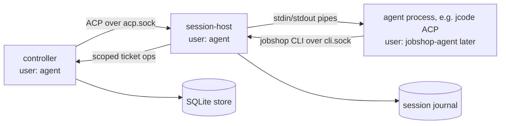

# Jobshop: draft implementation plan

Status: **draft for discussion.** This is a starting point, not a decision
record. Every section lists open questions, and estimates are rough. Challenge
anything here; where this plan and the evidence disagree, the evidence wins.

## 1. Why this exists

Jobshop is a multi-agent orchestration layer modeled on
[Gas City](https://github.com/gastownhall/gascity) (fork:
`~/repo/github.com/elee1766/gascity`, branch `feat/sqlite-work-provider`).
Gas City works for us, but:

- Its default store is `bd` (the beads CLI) on Dolt. Dolt was too slow and
  resource-heavy for our deployment, so we run a fork with a native SQLite
  store (`[beads] provider = "sqlite-work"`).
- Gas City's Go domain logic is written against a generic store interface
  (`internal/beads/beads.go`, `beads.Store`), and SQLite plugs in there.
  The friction is elsewhere: pack prompts and formulas call `gc bd ...`, which
  on Dolt cities shells out to the `bd` binary. On `sqlite-work`, `gc bd` is a
  hand-written native adapter (`cmd/gc/cmd_bd_sqlite_work.go`) that covers only
  part of the `bd` surface (no `mol wisp`/`burn`, `formula`, `gate`, `blocked`,
  `--include-infra`, ...).
- Roughly 18% of non-test Go files reference Dolt (server lifecycle, version
  gates, proxied transport, split-store guards, doctor checks). Each upstream
  merge adds more Dolt/`bd` assumptions to work around.
- We use a small subset of Gas City, and extending it feels at odds with
  upstream's direction.

The goal is a smaller system we fully control, where the ticket store is a
storage interface owned by this project, everything is built on it, and SQLite
is the first backend (Postgres later).

**Approach: build independently and dogfood.** Jobshop is not a migration
target for the live Gas City deployment. It is built from scratch, and as soon
as it can run agents, it runs the agents that work on Jobshop itself. Gas City
stays as a reference for design and edge cases, not as code we must stay
compatible with. Section 2 describes how we use Gas City today so readers know
which features have proven useful, not as a parity checklist.

### Open questions
- How much upstream Gas City progress do we expect to want later?
- At what point, if any, would the live city move onto Jobshop?

## 2. How we use Gas City today

Snapshot of the live city (`gasserver:/home/agent/gc`, read-only, 2026-11-01).
Treat as context, not spec; verify before relying on details.

**Storage**
- `[beads] provider = "sqlite-work"` for work tickets, per city and per rig.
- `[storage.classes]`: `graph`, `sessions`, `messaging`, `orders`, `nudges`
  all routed to binding `infra` (`provider = "sqlite-beads"`, `.gc/store`).
- `event_hooks = false`.

**Runtime**
- Single provider family: `jcode` via ACP (`session = "acp"`), with variants
  per model (opus for mayor/workers, sonnet for patrol/emulator, gpt-6.1-sol).
- `max_active_sessions = 20` city-wide, 14 per rig, pools of 1-6.

**Agents (from the imported `gastown` pack, all re-prompted locally)**
- `mayor`: coordinator (`prompts/coordinator.md`), on demand.
- `polecat`: worker pool per rig (`prompts/worker.md`), 1-6 sessions.
- `refinery`: PR delivery per rig (`prompts/refinery.md`), max 1.
- `deacon`, `boot`, `witness`: observers (`prompts/observer.md`, 9 lines).
  The observer prompt explicitly says the controller owns reconciliation; they
  only report blockers by mail.
- `dog`: suspended. Several implicit provider pools: suspended.
- Extra packs: `model-routing`, `android-emulator` (checker pool).

**Rigs**: account, retail, trade, gascity, sap, uniswapgo.

**Formulas in use**: `mol-gfx-pr-work` (default sling formula, one durable
source plus one step), `mol-gascity-delivery`, `mol-blocker-assess`,
`mol-main-ci-repair`, `mol-gfx-emulator-check`, `mol-gfx-pilot`, plus the
gastown patrol formulas.

**Orders**: most built-ins skipped (`jsonl-export`, `reaper`, `wisp-compact`,
`gate-sweep`, `cross-rig-deps`, ...). Local orders: `blocked-revalidator`
(hourly), `gascity-delivery`.

**Commands agents actually call** (from our prompts and formulas, approximate):
`gc hook --claim --json`, `gc bd update --claim`, `gc bd heartbeat`,
`gc bd show/update`, `gc mail send/reply/peek/archive`, `gc convoy status`,
`gc sling`, `gc session list/peek/wait`, `gc runtime drain-ack`,
`gc storage status`, plus our own `gx` CLI (`task context/finish`,
`pr state`, `mayor brief/record`, `linear sling`, `emulator request`).

**Implication**: our real surface is claim/heartbeat/finish on tickets,
routing work to pools, a small set of formulas, mail, and session supervision.
We do not use most of the gastown patrol machinery as designed.

### Open questions
- Which of these do we actually need on day one versus later?
- Do the observer agents (deacon/boot/witness) still earn their cost, or can
  the controller plus events cover them?
- Is `gx` part of Jobshop, or does it stay a separate client?

## 3. Glossary

Decided 2026-11-01: plain, descriptive names, no themed vocabulary. Prefer
the term that says what the thing is; keep Gas City's term only where it is
already plain. "Jobshop" stays as the project name.

| Gas City | Jobshop | Notes |
|---|---|---|
| Controller loop (incl. health patrol) | Controller | Reconcile, restart, quarantine, idle-kill |
| Control dispatcher | Dispatcher | Runs control tickets (retry, fan-out, ...) |
| Bead | Ticket | |
| Formula | Workflow | Template definition |
| Molecule | Run | Instantiated workflow (tickets + edges) |
| Wisp | Ephemeral run | A flag on run, not a separate concept |
| Agent | Agent | Configured kind of worker |
| Pool | Pool | |
| Session | Session | |
| Rig | Project | One repo / work area |
| Pack | Pack | Bundle of agents, prompts, workflows |
| Sling | Assign | Puts a ticket in a pool's queue; not a claim |
| Claim / release | Claim / release | Claimant field is `holder`, not `assignee` |
| Gate | Gate | Passive hold until closed |
| Check | Check | Condition evaluated by the dispatcher |
| Convoy | Batch | Group of tickets tracked together |
| Order | Schedule | Scheduled workflow trigger |
| Mail | Message | |
| Event log | (none) | No event bus. Controller sees every write and notifies over the admin socket; ticket `history` is an audit log. Observability is OTel (section 9) |

Roles (mayor, polecat, ...) are configuration, not engine concepts. Jobshop
keeps Gas City's "zero hardcoded roles" principle.

## 4. Design principles (proposed)

Carried over from Gas City's `AGENTS.md` where they still fit:

- No role names in Go. Behavior comes from config and prompts.
- Go handles transport, not judgment.
- Work persists in tickets; sessions are disposable. Recovery means re-reading
  state, not remembering it.
- No status files; query live state.

New for Jobshop:

- **The ticket store is the only persistence interface**, owned by this
  repo. No CLI passthrough to an external tracker.
- **One CLI, native on the store.** Agent-facing commands are designed for
  Jobshop, not for compatibility with `bd`'s flags or JSON.
- **Backend-neutral SQL** where practical, so Postgres is an implementation,
  not a rewrite.
- **YAML config** (decided 2026-11-01).

### Open questions
- Should the store expose a generic graph (nodes, typed edges, metadata), or
  first-class types (ticket, message, session, schedule)? Gas City stores
  everything as beads plus about 200 `gc.*` metadata keys
  (`internal/beadmeta`). That is flexible but implicit.
- How strict do we want the schema to be versus a metadata map?

## 5. Ticket store interface (sketch)

Starting point: Gas City's `beads.Store` (24 methods: create, get, update,
close, reopen, delete, list and filter, `Ready`, children, metadata, `Tx`,
`DepAdd`/`DepRemove`/`DepList`). Things Gas City grew later that seem worth
building in from the start:

- **Atomic claim** with a lease and a fence, plus heartbeat and release
  conditioned on the current holder. See `sqlite_store_claim.go`,
  `sqlite_store_fence.go`, `sqlite_store_conditional.go`.
- **Revision-guarded updates** (compare-and-swap).
- **Ready frontier query** (open, unblocked, not deferred).
- **Graph apply**: create a run's tickets and edges in one transaction
  (`sqlite_store_graph_apply.go`).
- **Ephemeral tier** for ephemeral runs.
- **Typed edges**: `blocks`, `parent-child`, `tracks`, `waits-for` cover nearly
  all of Gas City's usage.

A conformance test suite that every backend must pass, written before the
SQLite implementation.

### Open questions
- Should classes (work, graph, sessions, messaging, ...) be separate tables,
  separate stores, or a column?
- Do we need Gas City's "split city" (class bindings across stores) at all?
  It accounts for a lot of complexity (`cmd/gc/bd_split_*`).
- Multi-project: one database or one per project? We currently run one
  work store per rig plus a shared infra store.
- Is `modernc.org/sqlite` (pure Go, what Gas City uses) acceptable, or do we
  want cgo?

## 6. What could be reused from Gas City

Gas City is MIT-licensed. Dependency scan of `internal/` (non-test lines):

**No beads/Dolt dependency; likely portable:**
- `internal/formula` (~10k lines): workflow parsing and compile. Depends on
  `beadmeta`, `git`, `gitcred`, `remotesource`, `pathutil`, `gchome`.
- `internal/runtime` (~12k) and `internal/runtime/tmux` (~16k). We use ACP
  (`internal/runtime/acp`); check its dependencies before relying on it.
- `internal/events` (~8k), `internal/worktree`, `internal/shellquote`,
  `internal/fsys`, `internal/clock`.

**Logically store-neutral but import `internal/beads` (which pulls in the
upstream beads/Dolt library):**
- `internal/molecule` (~3.7k): instantiate a workflow into a run.
- `internal/dispatch` (~12k): control ticket execution.
- `internal/readywork`, `internal/convergence`, `internal/orders`.
- SQLite store code in `internal/beads/sqlite_*.go` (~4.8k).

**Probably better rewritten, using Gas City as reference:**
- `internal/session`, `internal/worker`, `internal/sling`, `cmd/gc`
  controller. They carry a lot of upstream policy and 45-60 internal
  dependencies each.

Estimates come from `go list -deps` and line counts on 2026-11-01. They do not
account for test code or hidden coupling.

### Open questions
- Copy and adapt, or vendor at a pinned commit? Copying loses history but
  allows trimming.
- How much of `internal/dispatch` do we use? Our formulas may not need
  fan-out, tally or drain at all.

## 7. Phases (rough)

Ordering is a proposal. Each phase ends with something runnable. The ordering
is driven by dogfooding: get to the smallest loop that can run an agent on a
Jobshop ticket in this repo, then let that loop do more of the remaining work.
Until then, development happens by hand (or with an outside agent).

**Phase 0: groundwork**
- Repo layout, CI, lint. Build is plain `go` (`go build`, `go test`), no
  Bazel (decided 2026-11-01). CI on GitHub Actions: build, `go vet`,
  `golangci-lint`, `go test -race`.
- Write down the ticket data model: fields, statuses, edge types, metadata
  conventions.

**Phase 1: ticket store**
- `store` package: interface, types, errors.
- Conformance suite.
- SQLite backend (adapt from Gas City `sqlite_*` where it fits).
- Minimal CLI: `jobshop ticket create/show/list/update/close`, `claim`,
  `heartbeat`, `release`, `ready`, with stable JSON output. The CLI talks
  to the controller over a socket, never to SQLite directly (section 8.5).

**Phase 2: workflows and runs**
- Port `internal/formula`. Decide which workflow features to keep.
- Run creation via graph apply.
- Port the subset of `internal/dispatch` our workflows need.

**Phase 3: controller and sessions**
- Config loader (project/agent/pool) in YAML.
- Runtime provider: ACP via a per-session host (section 8). No tmux.
- Controller tick: pool demand from queues, start and drain sessions,
  restart, quarantine, idle-kill.
- `jobshop assign`, and the hook: `jobshop claim --next` (three-tier query:
  my in-progress, my pre-assigned, pool queue).

**Phase 4: the rest of our surface**
- Messages (mail), batches (convoys), schedules (orders).
- Admin-socket subscriptions for change notifications, and an API if the
  dashboard is to be ported.

**Dogfood milestone (target, may land between phases 1 and 3)**
- Smallest loop that works on itself: one project (this repo), one pool of
  one agent, `assign`, `claim --next`, `heartbeat`, `close`, and a controller
  that starts a session when the queue is non-empty and restarts it if it
  dies.
- No workflows, dispatcher, messages or batches required. Agents close
  tickets directly.
- After this, new features are filed as Jobshop tickets and built by Jobshop
  agents, with a human reviewing.

**Self-hosting setup (proposed 2026-11-01)**
- Host: `gasserver`, next to the live Gas City. Work happens over SSH.
- GitHub identity: the `cog` user, with write access to this repo to push
  branches, open PRs and merge.
- Isolation from Gas City: own data dir and SQLite file, own controller
  process, own session cap so Jobshop cannot starve the live city's 20 slots.
  Runs as the existing `agent` user (decided 2026-11-01).
- Known-good binary: the controller runs a pinned build from a release path
  (e.g. `~/.local/share/jobshop/bin/jobshop-<sha>`), never the working tree.
  Promotion is an explicit step, and rollback is repointing a symlink.
- Agents work in git worktrees, one per ticket, and deliver via PR.
- Merge policy: branch protection requires CI. `cog` merges when CI passes,
  for all changes (decided 2026-11-01). The pinned binary is the safety net.

**Phase 5: hardening from use**
- Add what dogfooding shows is missing, in the order it hurts.
- Bring over Gas City features only when a real need appears.

**Later**: Postgres backend, against the same conformance suite.

### Open questions
- Is Phase 3 too large for one phase?
- Should the dogfood milestone come before workflows (phase 2)? Probably
  yes, since a flat ticket queue is enough to start.
- What safety rails does self-hosting need (agents editing the controller
  that runs them; review before merging; a way to roll back a broken build)?
- Runtime for the dogfood loop: ACP via jcode (decided 2026-11-01; see
  section 8).

## 8. Sessions: host process, hot restart, CLI socket (proposed)

Goal: restart or upgrade the controller without killing agent sessions or
losing in-flight turns, with no tmux or systemd dependency, and give agents
a CLI that knows which session it belongs to.

### 8.1 Shape

- One `session-host` process per session. A host bug or crash loses one
  session, and host upgrades roll out as sessions turn over. Cost is about
  10 MB per idle host. A single shared daemon would reintroduce a process
  whose restart kills every session.
- Prior art (none in Go): hydra-acp (TypeScript, one shared daemon),
  karet-agentd proposal (Rust, same proxy shape as this), acpx/acpxd
  (TypeScript/Swift; their PRs document reconnect bugs worth avoiding),
  aptove-bridge (Rust). ACP drafts: RFD #533 (multi-client attach,
  `session/detach`) and the session-resume RFD (proxy that journals
  messages and serves `session/load`). Read hydra-acp and the acpxd PRs
  before writing the host.

### 8.2 Spawning

- The controller runs `exec.Command("/proc/self/exe", "session-host",
  <id>)` with `Args[0] = "jobshop"`, `SysProcAttr{Setsid: true}`, stdin
  from `/dev/null`, stdout/stderr to `<data>/sessions/<id>/host.log`. It
  does not wait on the child, so the host outlives the controller. No
  tmux, no systemd, no hand-rolled double fork (decided 2026-11-01).
- New process, not a fork: Go cannot fork safely, and `os/exec` is
  fork+exec. The host inherits nothing except what is passed explicitly.
- `/proc/self/exe` is for correctness, not security: the host runs the
  exact build of the controller that spawned it, even if the release
  symlink moves. Security comes from users and file ownership (8.6).
- Before spawning, the controller writes a session spec to
  `<data>/sessions/<id>/spec.json`: agent command, args, env, working
  dir, socket paths, host protocol version, binary path.
- A host keeps running the build it started with. Keep each release
  binary until no live host references it; `session reap` reports which
  are still in use.

### 8.3 What the host does

1. Reads the spec, writes a pidfile and takes a lock in its session dir.
2. Starts the agent with pipes on stdin/stdout, `Pdeathsig: SIGKILL`,
   in its own process group. Marks itself a child subreaper.
3. Listens on `acp.sock` (controller) and `cli.sock` (agent CLI).
4. Proxies ACP between `acp.sock` and the agent's pipes. It is not a full
   ACP client and mostly forwards frames. It parses only:
   - `initialize`: caches the agent's response and replays it to a
     reconnecting controller instead of re-initializing the agent.
   - Agent-to-client requests (permission prompts, fs/terminal calls):
     held while no controller is connected.
   - Every agent frame gets a sequence number and is appended to a
     journal. A reconnecting controller sends its last seen sequence and
     the host replays the gap.
   - Optionally, `session/load` served from the journal, so resume works
     even if the agent does not advertise `loadSession` (karet's idea).
5. Serves `cli.sock` for the agent's `jobshop` commands (8.5).
6. Exits when the agent exits, after flushing the journal.

The host holds no ticket or policy logic, so it rarely needs to change.
Its protocol to the controller is versioned so a new controller can adopt
hosts started by an old one.

### 8.4 Hot restart and leaks

Controller restart sequence:
1. New binary starts, opens the store, takes the controller lock.
2. Scans `<data>/sessions/*/` and the sessions table. Reconnects to live
   hosts, renews their lease, replays missed output. Marks unreachable
   ones dead.
3. Resumes the normal tick. No sessions are started or stopped until
   reconciliation finishes.

None of the leak guards below fire on a controller restart: they tie the
agent to its host, not to the controller.

Leak prevention, layered:
1. Agent cannot outlive host: `Pdeathsig: SIGKILL`, and the host kills its
   process group on exit.
2. Agent's own children cannot escape: host is a child subreaper, so
   orphans reparent to it and die with the group.
3. Host cannot outlive its usefulness: exits when the agent exits; holds a
   lease and shuts down if no controller has connected for a configurable
   window (default around 30 minutes).
4. Controller reaps unknowns: each host is recorded with PID, process
   start time and socket. Reconciliation kills hosts with no record (start
   time checked against `/proc` to avoid PID reuse) and removes stale
   records and sockets. The pidfile written before the record covers the
   spawn-then-crash window.
5. Visible: `jobshop session list --all` shows store vs live processes;
   `jobshop session reap` cleans up.

Not planned: upgrading a running host in place (re-exec preserving fds).
Possible later; see the Pdeathsig thread caveat noted in discussion.

Recovery below the host:
- Agent or host died: start a new agent and resume with `session/load`
  (agent-native if advertised, else from the host journal). Recovers
  conversation, not in-flight tool calls.
- Everything lost: work state is in tickets; the replacement session
  re-claims via `claim --next`.

### 8.5 CLI over sockets

- Agent-facing `jobshop` commands never open the database. They talk to a
  socket.
- The host starts the agent with `JOBSHOP_SOCKET=<data>/sessions/<id>/cli.sock`.
  Every `jobshop` call from the agent and its subprocesses inherits it.
- The socket identifies the session, so calls inherit its holder,
  current ticket, project, pool and worktree. `jobshop close` with no
  arguments closes the session's current ticket. No `--holder` or
  `--session` flags in prompts.
- The host forwards requests to the controller tagged with the session;
  the controller enforces scope: only this session's tickets plus what the
  pool's config allows.
- Humans and the controller's own tooling use an admin socket
  (`<data>/admin.sock`, owned by `agent`, `0700`) with full access. The CLI
  uses it when `JOBSHOP_SOCKET` is unset.
- Build this in phase 1, since retrofitting direct-DB CLI calls is the
  expensive part.

### 8.6 Users and security

- Now: controller, hosts and agents all run as `agent`. Accepted risk: an
  agent can do anything the controller can (edit the store, replace
  binaries, signal processes, connect to other sessions' sockets). Socket
  scoping guards against mistakes, not hostile agents.
- Next (when self-hosting starts): agents run as a separate user,
  `jobshop-agent`. The host starts the agent via a narrow sudoers rule
  (`agent` may run only the agent command as `jobshop-agent`, NOPASSWD;
  on NixOS via `security.sudo.extraRules`). The data dir, store, binaries
  and admin socket stay `agent`-owned and `0700`, so agents cannot touch
  them and cannot ptrace or signal the controller or hosts.
  Needs: worktrees owned by or group-shared with `jobshop-agent`, and
  `cog` git credentials and model-provider auth readable by it.
- Later, if needed: per-session isolation (agents can still read each
  other's worktrees and sockets under one shared user). Options: Landlock
  applied by the host (no root), or a pool of agent users.

### 8.7 Libraries

- Default candidate: `github.com/coder/acp-go-sdk` (both sides,
  `AgentLoader` for `session/load`, HTTP transport). Alternative with
  minimal deps: `github.com/gopact-ai/acp`. The host may need only frame
  parsing; the controller benefits more from an SDK.
- Gas City's `internal/runtime/acp` is a hand-rolled JSON-RPC client;
  useful as reference for edge cases, not as a dependency.

### 8.8 Dogfood order

- The first loop can run with the controller spawning agents directly
  (restart = sessions restart, recovered via tickets), but the CLI socket
  must exist from the start.
- Add the host once controller restarts cost real work, which should be
  soon after self-hosting begins.

### Open questions
- Does jcode's ACP server advertise `loadSession`? If not, journal-backed
  `session/load` in the host matters more.
- Host buffer policy when disconnected and full: block the agent's stdout,
  or spill to the journal only?
- Lease length before an orphaned host shuts down.
- Human attach: read-only tail of the journal, or allow injecting input?
- Which socket protocol for the CLI: JSON-RPC (matches ACP), or plain
  JSON lines?

## 9. Observability (proposed)

Decided 2026-11-01: full OpenTelemetry tracing and logging, Prometheus
metrics, and opt-in export of ACP conversation content. This replaces Gas
City's `internal/events` JSONL bus for observability purposes.

**Operational telemetry (always available, configured in YAML)**
- Traces: OTel SDK, OTLP exporter. Spans for controller ticks, socket
  requests (CLI and admin), store transactions, session lifecycle (spawn,
  adopt, restart, reap), and claim/heartbeat/close. Trace context is
  propagated over the CLI socket, so an agent's `jobshop close` shows up
  under its session's trace.
- Logs: `log/slog` with an OTel bridge, so logs carry trace and span ids.
  JSON to stderr/file by default, OTLP when configured.
- Metrics: Prometheus `/metrics` on a configurable listen address (OTel
  metrics SDK with the Prometheus exporter, so OTLP push is also possible).
  Starting set: sessions by pool/state, session restarts, queue depth and
  ready count per pool, claim latency, lease expiries, ticket closes by
  resolution, store transaction latency, host reconnects and replay size,
  conversation export drops.
- Common attributes: `jobshop.project`, `jobshop.pool`,
  `jobshop.session.id`, `jobshop.ticket.id`, `jobshop.kind`.

**Conversation export (opt-in, off by default)**
Port of our Gas City branch's `internal/convtel`
(`docs/guides/conversation-telemetry.md` in the fork): ACP content as OTLP
logs and traces for later analysis in a log store.
- Emitted by the session host, which already sees every ACP frame. One
  trace per session, spans per turn and per tool call, log records for
  prompts, assistant messages, provider-exposed reasoning, tool calls and
  results, permission requests and replies, lifecycle.
- Records carry ticket, project, pool, agent, model and ACP session id, so
  a query can pull the full context of how a ticket was worked.
- Keep convtel's safety properties: separate explicit opt-in from
  operational telemetry, redaction before enqueue (secret-named keys,
  launch-env secret values, credential patterns), per-field size cap with a
  truncation marker, bounded non-blocking queues with drop counters, export
  failures never affect a session, stable event ids for dedupe.
- Destination: convtel restricts to loopback (local collector forwards).
  Keep that default; allow non-loopback only with explicit config.
- The host's journal remains the record of truth; export is best effort.

### Open questions
- Copy `internal/convtel` and adapt, or rewrite on the OTel Go SDK? convtel
  hand-rolls OTLP/HTTP JSON; the SDK would share exporters with operational
  telemetry.
- Per-pool opt-in for conversation export, or global only?
- Log store target (Loki, ClickHouse, Grafana Cloud) only affects the
  collector config, not Jobshop.

## 10. Chat gateway (future, design must not preclude)

**Not a priority and not scheduled in any phase** (decided 2026-11-01).
This section exists so the earlier design keeps it implementable. Only the
"What this requires now" items below affect current work; everything else
here is a sketch to revisit when the gateway is actually built.

A human-facing way into the system, modeled on Hermes Agent's messaging
gateway: one long-lived session per chat conversation (room, DM or thread).

- `jobshop gateway` is a separate process and an ordinary client of the
  controller's admin socket. No gateway code in the controller.
- Platform adapters (Matrix first, given existing encrypted relays) map a
  conversation to a session key, e.g. `matrix:<room>`.
- Chat sessions belong to a pool that is not ticket-driven: the controller
  keeps one session per active key, starts it on the first message,
  idle-kills it, and resumes it later via `session/load` / the host
  journal.
- The gateway sends "deliver message to session key X" and streams
  updates back. The controller stays the only ACP client of each host.
- Permission prompts are relayed to the chat; the host already holds them
  until answered.
- A chat session's agent uses the same `jobshop` CLI via its `cli.sock`,
  with scope from its pool config. A coordinator pool can assign tickets,
  read status, and send messages (mail) to worker sessions. This is how
  the mayor role comes back: as config, from chat.
- Per-adapter user allowlists; YAML maps rooms to pools/agents.

What this requires now, so it can be added later without redesign:
1. The admin socket API covers: list sessions, start a session by key,
   send input to a session, subscribe to its updates, answer permission
   prompts. The gateway, the CLI and any future dashboard all use it.
2. Pools have a type (ticket-driven vs keyed/on-demand) from the start.
3. Messages are store-backed and addressed to sessions, pools or keys, so
   a chat session can mail a worker and a worker's reply can surface in
   chat.

Message delivery to a busy session (decided 2026-11-01):
- Default: queue. The message is delivered at the start of the
  recipient's next turn (or by the host as a new prompt once the current
  turn ends).
- Course correction: a sender may mark a message `--interrupt`. The
  controller sends ACP `session/cancel` for the in-flight turn, waits for
  the turn to end (falling back to SIGINT after a timeout, as Gas City
  does), then sends a new prompt carrying the correction plus a short note
  that the previous turn was interrupted. Work state is unaffected: the
  ticket stays claimed, and the agent continues from the correction.
- Interrupt is a permission in pool config: humans and coordinator pools
  may interrupt; workers may only queue by default.
- Chat: a plain chat message to a busy session queues; a marked message
  (e.g. a `/steer` or `!` prefix) interrupts.

### Open questions
- Should queued messages to an idle ticket worker wake it immediately?
  (Probably yes, same as a new prompt.)

Decided 2026-11-01: one session per room or thread, shared by everyone in
it.

## 11. Risks

- Rebuilding session supervision and claim recovery means rediscovering edge
  cases Gas City already hit. Read its git history and incident notes
  (`engdocs/contributors/reconciler-debugging.md`, `health-patrol.md`) before
  writing the controller.
- Scope creep toward Gas City parity.
- Self-hosting failure: a bad change to the controller can stop the agents
  that would fix it. Needs a known-good binary to fall back to.

## 12. Alternatives considered

- **Keep extending `sqlite-work` in the Gas City fork.** Lowest short-term
  cost. Merge drag grows, and the packs still assume `bd`'s CLI.
- **Hard fork and prune Gas City.** Delete `bd`/Dolt, make sqlite the only
  store, make `gc bd` native. Keeps the controller's edge-case handling.
  Medium one-time cost.
- **Fork `bd` with a SQLite backend.** `bd` has a backend plug-in point
  (`internal/storage/backends`), but the `DoltStorage` interface is large
  (about 100 methods across 15 interfaces) and the SQL is Dolt-flavored.
- **`beads_rust` (`br`).** Maintained, SQLite + JSONL, but follows classic
  beads: no molecules, different JSON shapes.
- **Gas City `file` provider.** Same CLI gap as `sqlite-work`, and documented
  as for local trials only.

## 13. References

Gas City (fork checkout `~/repo/github.com/elee1766/gascity`):
- `AGENTS.md`: design principles, primitives, layering invariants.
- `engdocs/architecture/nine-concepts.md`, `controller.md`, `dispatch.md`,
  `health-patrol.md`, `glossary.md`.
- `docs/reference/specs/formula-spec-v2.md`: formulas, control tickets, gates.
- `docs/reference/sqlite-work-provider.md`: our SQLite provider.
- `internal/beads/beads.go`: `Store` interface and `Bead` type.
- `internal/beadmeta`: metadata key conventions.

Live city (gasserver, read via `/home/a/gfx/scripts/as-agent.sh`):
- `/home/agent/gc/city.toml`, `prompts/`, `formulas/`, `ops/`.
