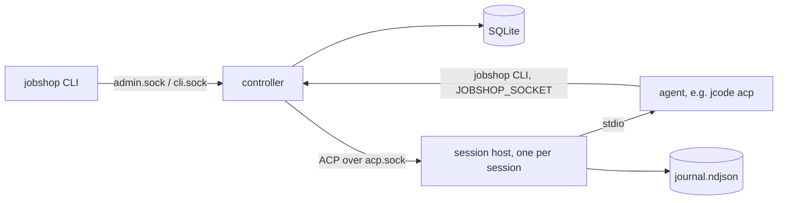

# Jobshop plan

How Jobshop is built, where it stands, and what comes next. Decisions are
dated. Where this file and the code disagree, the code wins; fix this file.
Companions: `docs/data-model.md` (tables and queries), `docs/layout.md`
(repo, build, deployment).

## 1. What and why

Jobshop is multi-agent orchestration on a SQLite ticket store: pools of ACP
agents claim tickets, work them, and close them, supervised by one
controller. It replaces our use of [Gas City](https://github.com/gastownhall/gascity).

Gas City worked, but its store is `bd` on Dolt (too slow and heavy for us),
our SQLite fork covers only part of the `bd` CLI that prompts call, about a
fifth of its Go references Dolt, and we use a small part of it. Jobshop is a
smaller system we own: the store interface lives here, everything is built
on it, SQLite first, Postgres later.

Approach: build from scratch and dogfood. Gas City is a reference for
design and edge cases, not a compatibility target. Since 2026-11-01 Jobshop
runs the agents that develop Jobshop.

## 2. Where we are

| Phase | Scope | State |
|---|---|---|
| 0 | Repo, CI, lint, data model | done |
| 1 | Store, controller sockets, CLI | done 2026-11-01 |
| 2 | Sessions, session host, self-hosting | done 2026-11-01 |
| 3 | Hardening, visibility, self-development loop | in progress, target issue #36 |
| 4 | Workflows and runs | not started |
| 5 | Batches, change subscriptions, API | not started |

Phase 3 is driven by the target issue (#36): a checklist the planner pool
works toward. Items built so far are listed in section 4.

## 3. How it works

**Tickets.** One generic graph: tickets with an engine-defined `kind`
(`task`, `session`, `message`), typed `fields` per kind, and a free-form
`meta` for pack data the engine never reads. Edges `blocks` and `waits_for`
gate readiness; `tracks` is informational; parent-child is `parent_id`.
Claims are atomic with a lease and a fence. Ready means open, unblocked and
not deferred. Details: `docs/data-model.md`.

**Controller** (`jobshop serve`). The only writer. Serves `admin.sock` for
humans and tooling, and a per-session `cli.sock` that fixes the caller's
project and holder. On each supervisor tick it fires triggers, heartbeats
claims held by driven sessions, sweeps expired leases, and starts sessions
for pools with ready work beyond their idle sessions, up to `max_sessions`.

**Session host** (`jobshop session-host`). One detached process per session
(setsid, no tmux or systemd). It runs the agent on stdio, proxies ACP to
the controller, journals every frame, caches `initialize`, holds agent
requests while no controller is connected, and survives controller
restarts. A restarted controller adopts live hosts and respawns dead ones
with `session/load`.

**Driver loop** (per session, in the controller). Deliver queued messages,
`claim --next`, prompt the ticket, check the session no longer holds it
(else one reminder turn, then release with a 10 minute defer). Idle past
`idle_timeout` ends the session `idle`; more than 3 restarts in 10 minutes
ends it `crashed`; turns past `turn_timeout` get `session/cancel`.

**Agents and the CLI.** Agents call `jobshop` with `JOBSHOP_SOCKET` set, so
`jobshop close` closes their current ticket with no ids or flags. Exit
codes: 3 no work, 4 claim lost, 5 not found, 6 revision conflict, 1 other.

**Config.** `jobshop.yaml` holds projects, agents, pools, triggers and
packs. Packs are directories with `pack.yaml` (agents, pools, triggers) and
prompt files, filled from `vars`. `jobshop reload` or SIGHUP applies config
without a restart.

**Self-development** (`packs/selfdev`):
- Work specs are GitHub issues on elee1766/jobshop, filed by elee-agent. A
  ticket is a pointer ("Resolve elee1766/jobshop#N", `meta.github.issue`).
- `dev` pool: reads the issue, branches `issue-<n>`, builds and tests,
  opens a PR with `Closes #N`, waits for green CI, then hands the ticket to
  `refinery`. Out-of-scope findings become new issues.
- `refinery` pool (1 session): merges handed-off PRs one at a time with
  `--match-head-commit` on green CI and resolved review, checks master CI
  after, or routes findings back to `dev` on the same branch.
- `plan` pool (1 session): reads the `target` issue, ticks verified items,
  files the next issues and dev tickets with edges, files nothing while
  more than 6 issues are open, and sends scope changes to `needs-decision`.
- `replan` trigger: creates a plan ticket when `dev` has no ready work.

## 4. Built so far (phase 3)

Short list; behavior details are in section 7.

- Drain and undrain (#12), quarantine of crash-looping tickets and pools
  (#13), env refresh after deploys (#11), rate-limit backoff (#10).
- Prometheus metrics (#14), OTel traces and slog bridge (#15).
- Messages with queued and interrupt delivery (#16), read-only attach (#17).
- Triggers: store counts, cron, dedup and cooldown (#26).
- Packs and `packs/selfdev` (#27), refinery handoff (#28).
- Config reload (#38), `session restart` (#37).

## 5. What's next

**Phase 3** (remaining items on #36):
- `master-red` check trigger: a command condition that files one fix
  ticket per failing master SHA (#34).
- Refinery dry run on real PRs, and one full planner cycle on gasserver.
- Restart, env refresh and backoff verified on gasserver with no `crashed`
  sessions.
- Host backpressure: a slow or absent controller never blocks the agent or
  grows host memory without bound.
- `session/load` fallback from the host journal for agents that cannot
  load a conversation.
- gasserver scrapes `/metrics` and ships traces; a Grafana dashboard.
- Conversation export (section 7.8).
- Validate meta pack names (#29), `jobshop config show` (#32).
- Done when every box on #36 is checked, master CI is green, and the pool
  runs 24h without a manual fix.

**Phase 4: workflows and runs.** Port the formula concepts we actually use
(PR work, CI repair, blocker assessment), create runs with graph apply, and
build only the dispatcher features those workflows need. Retry limits live
here. Decide scope from the workflows we run, not from Gas City.

**Phase 5.** Batches (Gas City convoys), admin-socket change subscriptions,
and an API if a dashboard needs one. Schedules are already covered by cron
triggers.

**Later.** Postgres backend against the same conformance suite. A chat
gateway (section 8). Per-session isolation (section 7.9).

Rule for adding features: add what running the system shows is missing, in
the order it hurts. Bring over Gas City features only for a real need.

## 6. Decisions

All dated 2026-11-01 unless noted.

**Scope and principles**
- No role names in Go. Roles (planner, worker, refinery) are pool config
  and prompts. Go handles transport, not judgment.
- Work persists in tickets; sessions are disposable. Recovery re-reads
  state. No status files.
- No observer agents shipped. Their Gas City duties (dead-session release,
  lease sweep, idle-kill, quarantine, alerts) are deterministic controller
  work. Observer-style pools stay possible as config.
- Plain names, no themed vocabulary (section 9 maps Gas City terms).
- `gx` stays a separate client of the CLI and admin socket.
- Copy Gas City code only where it is self-contained and readable;
  otherwise reference only. No vendoring.

**Store**
- One database per install; `project` is a column. No storage classes or
  split stores.
- Generic ticket graph with engine kinds, typed fields per kind, `meta`
  grouped by pack name. Packs declare no schemas.
- Driver `modernc.org/sqlite` (pure Go, no cgo). Queries via sqlc.
- Ticket ids: project prefix plus a Sonyflake id in 13-character Crockford
  base32, e.g. `js-0031w02j0r012`.
- The controller releases a dead session's claims as soon as it knows; the
  lease is a backstop and expiry returns the ticket to `open`.
- Comments have their own table; `history` is an audit log, not an event
  stream. No event bus.
- `defer_until` gates only automatic pickup. A claim by id ignores it.
  Clear a hold with `ticket update <id> --defer 0`.

**Controller, host and CLI**
- Every write goes through the controller; the CLI never opens the
  database.
- One host process per session, spawned from `/proc/self/exe` with setsid.
  No tmux, systemd units or double fork. Upgrading a running host in place
  is not planned.
- The CLI socket lives in the controller, not the host. Agent CLI calls
  fail during a controller restart and agents retry.
- JSON-RPC 2.0 with NDJSON framing on every socket, using
  `github.com/coder/acp-go-sdk` for both ACP and the CLI/admin sockets.
- Resume uses the agent's `session/load` (jcode supports it). A journal
  fallback is only for agents without it.
- Backpressure: when the host's buffer is full and no controller is
  connected, it stops reading the agent's stdout, pausing the agent. It
  never drops data.
- A message to an idle session wakes it at once. Interrupt is a pool
  permission: humans and coordinator pools may interrupt, workers only
  queue.
- Orphaned host lease: 30 minutes without a controller connection.
- Permission requests are auto-approved. fs and terminal client methods
  are not offered.
- `jcode acp --socket ${SESSION_DIR}/jcode.sock`: a private jcode daemon
  per session, because the shared user daemon does not inherit the
  session's env (`JOBSHOP_SOCKET`, `PATH`).
- Human attach is read-only: the CLI tails the journal file. Writing into
  a session is a later, config-gated addition.

**Delivery and self-hosting**
- Host: gasserver, as Linux user `jobshop` in `jobshop.slice` (6 cores,
  8 GB), next to the live Gas City. No bwrap or separate agent user yet.
- GitHub identity: the elee-agent GitHub App. agent-credd mints
  installation tokens for `jobshop` scoped to elee1766/jobshop; a `gh`
  wrapper and git credential helper use them over https.
- Work specs live in GitHub issues; tickets are pointers. No
  issue-to-ticket sync: agents follow prompt instructions, and
  dependencies stay as ticket edges.
- Workers hand green PRs to the refinery; only the refinery merges.
  Branch protection is unavailable on this plan, so "merge only on green
  CI" is enforced by prompts.
- Promotion: bump the `jobshop` flake input in gasserver.nix and switch.
  Rollback: the previous NixOS generation. Promotion is manual.
- Prompts ship in `packs/selfdev` inside the deployed source, so prompt
  and binary versions match.
- Triggers and the controller make no GitHub calls. GitHub state is read
  by agents through `gh`, or by a trigger's check command.

**Build**
- Plain `go` for development and CI, Nix flake for the package and NixOS
  module. No Bazel. CI: build, vet, `go test -race`, sqlc diff, `nix build`.
- YAML config. Every new dependency has its reason recorded in
  `docs/layout.md`.

## 7. Reference: behavior as built

### 7.1 Session files and restart

Files in `sessions/<id>/`: `spec.json`, `host.lock` (flock; held means
alive), `host.pid`, `host.log`, `acp.sock`, `journal.ndjson`, `exit.json`,
and `work/` (git worktree when the pool sets `repo`).

- The host rewrites request ids so a new controller never collides with an
  old one, re-sends unanswered agent requests to a new controller, and
  reports a prompt that finished while detached as `_jobshop/turn_end`.
- Stopping a host: SIGTERM (forwarded to the agent's group, SIGKILL after
  5s); the controller SIGKILLs the host after 10s.
- Leak guards: the agent gets `Pdeathsig: SIGKILL` and its own process
  group; the host is a child subreaper; the host exits with its agent and
  after 30 minutes with no controller.
- Controller start: open session tickets are adopted (live host) or
  respawned (`session/load`); hosts with no open session are stopped.
- Prompts use `context.WithoutCancel`, and stopping the controller closes
  the connection instead of cancelling requests, so turns keep running in
  the host.
- Git: `fetch` then `worktree add --detach <ref>` per session, removed when
  the session ends; git calls on one repo are serialized.
- `${SESSION_DIR}` expands in agent args.

### 7.2 Env refresh and session restart (#11, #37)

`spec.json` carries `env_hash`, a sha256 of the agent's full env (inherited
controller env minus per-start systemd variables, then the spec env). When
adopting a live idle host whose hash differs, the controller stops it and
respawns it at once with `session/load`; a busy session refreshes after its
turn. `jobshop session restart <id>` does the same on demand, keeping
claims; `--now` cancels the running turn first. Neither counts as a crash.
A respawned host's stale `exit.json` is removed before spawn, and an
adopted host whose agent never initialized is treated as fresh, so the
conversation is always loaded.

### 7.3 Rate limits, drain, quarantine (#10, #12, #13)

- A prompt error mentioning `429`, `rate_limit` or `is unavailable` is not
  a crash: the session keeps host and claims and retries the same prompt
  after 1m, doubling to 15m. While any session of a pool backs off, no new
  sessions start for it. `session list` shows `backoff_until`.
- `jobshop drain [--pool P]` / `undrain`: no new sessions or claims for the
  pool; running turns finish and sessions end `drained`. Controller
  memory only, so a restart undrains.
- A `crashed` session releases its tickets with reason `session crashed`.
  After 3 such releases a ticket is deferred 1h and labeled `quarantined`
  with a comment listing the exits. Undo: `ticket update <id> --defer 0`
  and `label rm <id> quarantined`. A pool with 3 crashed sessions in 10
  minutes starts none for 15 minutes; the pause is set before the release.

### 7.4 Messages (#16)

`jobshop send <to> <text> [--interrupt]` creates a `message` ticket; `to`
is a session id, a session key, or `pool:<name>`. The driver delivers
before each `claim --next`: it claims and closes each message (`delivered`,
at most once) and sends them as one prompt starting `Messages for you:`.
During a turn it polls for interrupt messages and on one sends
`session/cancel`, delivers, then continues. The pool-level interrupt
permission is not built.

### 7.5 Attach and session admin (#17)

- `jobshop session attach <id> [--since <seq>] [--json] [--no-follow]`
  renders the journal file and follows it; works while the controller is
  down.
- `session list` joins session tickets with their dirs: `alive`, pids,
  current ticket, last journal seq, `exit`, `crashes`, `backoff_until`,
  orphans.
- `session reap` stops hosts with no open session; `--closed` also deletes
  old closed session dirs.
- `shutdown` leaves sessions running; `shutdown --all` ends them first.

### 7.6 Triggers (#26)

`triggers:` entries have `when`, a `ticket` template and an optional
`cooldown`. Each tick the controller fires a trigger when all hold: no open
ticket it created (`meta.trigger.name`), cooldown passed since its last
ticket closed, cron slot due, every count threshold met. Thresholds are
`{ready,open,in_progress}_{below,above}` over `when.pool`, `when.kind`
(default task) and `when.label`. State is read back from the store, so
restarts change nothing. Cron is 5-field, UTC unless `when.timezone`;
missed slots collapse into one fire, and a new trigger does not fire for
past slots. `jobshop trigger list` shows whether each would fire and why.
Planned (#34): a `check` command condition with an optional dedup key.

### 7.7 Packs and reload (#27, #38)

`packs:` lists `path` (relative to the root) and `vars`. `pack.yaml` holds
`agents`, `pools`, `triggers`; other keys are rejected. Merge: packs in
order, then jobshop.yaml; later sources win per key and per field through
nested maps; lists and scalars replace whole. `${name}` comes from the
pack's vars (a bare `${name}` keeps the var's type, `$$` is a literal `$`,
unset is an error); jobshop.yaml is not substituted. `prompt_file` is read
relative to its declaring file. `jobshop reload`/SIGHUP swaps the config
atomically or keeps the old one on error: pool limits and triggers apply on
the next tick, prompts and timeouts on the next turn, agent command and env
on the next host. Telemetry changes need a restart.

### 7.8 Observability (#14, #15)

- `telemetry.metrics_listen` serves `/metrics`: `jobshop_sessions` (by
  pool and state idle/working/backoff), `jobshop_session_restarts_total`,
  `jobshop_tickets_ready`, `jobshop_claims_total`, `jobshop_closes_total`,
  `jobshop_lease_expiries_total`, `jobshop_rpc_duration_seconds`. No ticket
  or session ids on metrics.
- `telemetry.otlp_endpoint` sends traces and slog logs over OTLP/HTTP.
  Spans: `supervisor tick`, `rpc <method>`, session lifecycle. Each session
  has one trace; its traceparent is stored on the session and passed to
  the agent as `JOBSHOP_TRACEPARENT`, and the CLI propagates it.
- Planned: per-signal endpoint URLs and headers (VictoriaMetrics paths),
  store transaction spans, and conversation export: opt-in per pool,
  emitted by the host as OTLP logs, with redaction (secret-named keys,
  launch-env values, gitleaks rules), per-field caps, bounded queues with
  drop counters, and failures that never affect a session. Same scope as
  `internal/convtel` in our Gas City fork, rebuilt on the OTel SDK. The
  journal stays the record of truth.
- gasserver backends: VictoriaMetrics, VictoriaLogs, VictoriaTraces, all
  OTLP/HTTP, no collector.

### 7.9 Users and security

Controller, hosts and agents all run as `jobshop`. Accepted risk: an agent
can do anything the controller can; socket scoping guards against mistakes,
not hostile agents. Later options if needed: agents as a separate user via
a narrow sudoers rule, or per-session bubblewrap or Landlock applied by the
host (read-only system, writable worktree, own CLI socket).

## 8. Chat gateway (future)

Not scheduled. A separate `jobshop gateway` process, an ordinary
admin-socket client, maps chat conversations (Matrix first) to keyed
sessions in a pool that is not ticket-driven, one session per room or
thread. Messages to a busy session queue; a marked message interrupts. A
coordinator chat session can assign tickets and message workers, which is
how a Gas City mayor role would return as config.

To keep it possible: the admin API should cover list sessions, start by
key, send input, subscribe to updates and answer permission prompts; pools
gain a keyed type; messages stay store-backed and addressed to sessions,
pools or keys.

## 9. Gas City mapping

| Gas City | Jobshop |
|---|---|
| Bead | Ticket |
| Controller loop, health patrol | Controller |
| Rig | Project |
| Agent, pool, session, pack | same |
| Formula / molecule | Workflow / run (phase 4) |
| Sling | Assign |
| Claim, holder (not assignee) | Claim, `holder` |
| Order | Trigger |
| Convoy | Batch (phase 5) |
| Mail | Message |
| Refinery | `refinery` pool in `packs/selfdev` |
| Gate (watched wake) | Defer polling for now |
| Event log | None: ticket `history` plus OTel |

Live city usage that shaped this (gasserver, 2026-11-01): jcode via ACP for
every agent; worker pools of 1-6 per rig, a single-session refinery per
rig, a coordinator on demand; formulas for PR work, CI repair and blocker
assessment; a few local orders (hourly blocked revalidation, main CI
repair as a condition check). Agents mostly call claim, heartbeat, update,
mail and session commands.

## 10. Risks

- Rebuilding supervision rediscovers edge cases Gas City already hit. Read
  its history (`engdocs/contributors/reconciler-debugging.md`,
  `health-patrol.md`) before changing the controller.
- Self-hosting: a bad controller change can stop the agents that would fix
  it. The pinned binary and NixOS rollback are the fallback.
- Prompt-only guarantees (merge on green CI, scope, issue caps) depend on
  agents following instructions.
- Scope creep toward Gas City parity.

## 11. Alternatives considered

- Keep extending `sqlite-work` in the Gas City fork: cheapest now, but
  merge drag grows and packs still assume the `bd` CLI.
- Hard-fork and prune Gas City: keeps its controller edge cases, medium
  one-time cost.
- Fork `bd` with a SQLite backend: its storage interface is about 100
  methods with Dolt-flavored SQL.
- `beads_rust`, Gas City's `file` provider: no molecules or the same CLI
  gap.

## 12. References

- Gas City fork: `~/repo/github.com/elee1766/gascity`. `AGENTS.md`,
  `engdocs/architecture/` (nine-concepts, controller, dispatch,
  health-patrol), `docs/reference/specs/formula-spec-v2.md`,
  `internal/beads/beads.go`.
- Live city: gasserver `/home/agent/gc` (`city.toml`, `prompts/`,
  `formulas/`, `orders/`), read via `/home/a/gfx/scripts/as-agent.sh`.
- ACP session prior art: hydra-acp, acpx/acpxd PRs (reconnect bugs),
  karet-agentd, ACP RFD #533 and the session-resume RFD.
