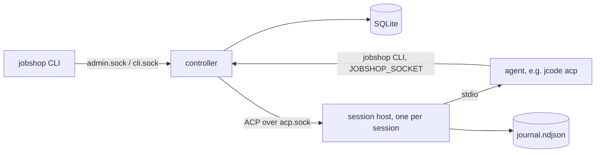

# Jobshop plan

How Jobshop is built, where it stands, and what comes next. Decisions are
dated. Where this file and the code disagree, the code wins; fix this file.
Companions: `docs/data-model.md` (tables and queries), `docs/layout.md`
(repo, build, deployment).

## 1. What and why

Jobshop is multi-agent orchestration on a SQLite ticket store: pools of ACP
agents claim tickets, work them, and close them, supervised by one
controller. It replaces our use of [Gas City](https://github.com/gastownhall/gascity).

Gas City worked, but its store is `bd` on Dolt (too slow and heavy for us),
our SQLite fork covers only part of the `bd` CLI that prompts call, about a
fifth of its Go references Dolt, and we use a small part of it. Jobshop is a
smaller system we own: the store interface lives here, everything is built
on it, SQLite first, Postgres later.

Approach: build from scratch and dogfood. Gas City is a reference for
design and edge cases, not a compatibility target. Since 2026-11-01 Jobshop
runs the agents that develop Jobshop.

## 2. Where we are

| Phase | Scope | State |
|---|---|---|
| 0 | Repo, CI, lint, data model | done |
| 1 | Store, controller sockets, CLI | done 2026-11-01 |
| 2 | Sessions, session host, self-hosting | done 2026-11-01 |
| 3 | Hardening, visibility, self-development loop | in progress, target issue #36 |
| 4 | Workflows and runs | not started |
| 5 | Batches, change subscriptions, API | not started |

Phase 3 is driven by the target issue (#36): a checklist the planner pool
works toward. Items built so far are listed in section 4.

## 3. How it works



**Tickets.** One generic graph: tickets with an engine-defined `kind`
(`task`, `session`, `message`), typed `fields` per kind, and a free-form
`meta` for pack data the engine never reads. Edges `blocks` and `waits_for`
gate readiness; `tracks` is informational; parent-child is `parent_id`.
Claims are atomic with a lease and a fence. Ready means open, unblocked and
not deferred. Details: `docs/data-model.md`.

**Controller** (`jobshop serve`). The only writer. Serves `admin.sock` for
humans and tooling, and a per-session `cli.sock` that fixes the caller's
project and holder. On each supervisor tick it fires triggers, heartbeats
claims held by driven sessions, sweeps expired leases, and starts sessions
for pools with ready work beyond their idle sessions, up to `max_sessions`.

**Session host** (`jobshop session-host`). One detached process per session
(setsid, no tmux or systemd). It runs the agent on stdio, proxies ACP to
the controller, journals every frame, caches `initialize`, holds agent
requests while no controller is connected, and survives controller
restarts. A restarted controller adopts live hosts and respawns dead ones
with `session/load`.

**Driver loop** (per session, in the controller). Deliver queued messages,
`claim --next`, prompt the ticket, check the session no longer holds it
(else one reminder turn, then release with a 10 minute defer). Two such
turns in a row end the session `stuck` so a fresh host replaces it
(2026-11-01: jcode hosts whose bash tool broke kept claiming and dropping
tickets for hours). Idle past
`idle_timeout` ends the session `idle`; more than 3 restarts in 10 minutes
ends it `crashed`; turns past `turn_timeout` get `session/cancel`.

**Agents and the CLI.** Agents call `jobshop` with `JOBSHOP_SOCKET` set, so
`jobshop close` closes their current ticket with no ids or flags. Exit
codes: 3 no work, 4 claim lost, 5 not found, 6 revision conflict, 1 other.

**Config.** `jobshop.yaml` holds projects, agents, pools, triggers and
packs. Packs are directories with `pack.yaml` (agents, pools, triggers) and
prompt files, filled from `vars`. `jobshop reload` or SIGHUP applies config
without a restart.

**Self-development** (`packs/selfdev`):
- Work specs are GitHub issues on elee1766/jobshop, filed by elee-agent. A
  ticket is a pointer ("Resolve elee1766/jobshop#N", `meta.github.issue`).
- `dev` pool: reads the issue, branches `issue-<n>`, builds and tests,
  opens a PR with `Closes #N`, waits for green CI, then hands the ticket to
  `refinery`. Out-of-scope findings become new issues.
- `refinery` pool (1 session): merges handed-off PRs one at a time with
  `--match-head-commit` on green CI and resolved review, checks master CI
  after, or routes findings back to `dev` on the same branch.
- `plan` pool (1 session): reads the `target` issue, ticks verified items,
  files the next issues and dev tickets with edges, files nothing while
  more than 6 issues are open, and sends scope changes to `needs-decision`.
- `replan` trigger: creates a plan ticket when `dev` has no ready work.

## 4. Built so far (phase 3)

Short list; behavior details are in `docs/notes/` (section 7).

- Drain and undrain (#12), quarantine of crash-looping tickets and pools
  (#13), env refresh after deploys (#11), rate-limit backoff (#10).
- Prometheus metrics (#14), OTel traces and slog bridge (#15).
- Messages with queued and interrupt delivery (#16), read-only attach (#17).
- Triggers: store counts, cron, dedup and cooldown (#26), check commands
  and the selfdev `master-red` trigger (#34).
- Packs and `packs/selfdev` (#27), refinery handoff (#28).
- Config reload (#38), `session restart` (#37), host backpressure (#39).
- Per-signal OTLP URLs and headers, nix telemetry options, Grafana
  dashboard (#44).
- Conversation export with redaction (#45).
- `session/load` fallback from the journal (#43).
- `session list --state --since` and the gasserver runbook (#52).
- Meta pack name validation and `meta_packs:` (#29).
- `jobshop config show` with per-entry sources (#32).
- `jobshop_turns_total` and its dashboard panel, `deploy/verify-telemetry.sh`
  (#55).
- `jobshop ticket trace` for closed-loop evidence (#53).
- `jobshop_sessions_ended_total` by resolution, its dashboard panel, and
  the runbook counting `stuck` as a failure (#71).
- Recent comments in ticket prompts, for routed-back tickets (#70).
- Run model design note for phase 4, section 6 (#83).
- Orphaned ticket report: WARN, `jobshop_tickets_orphaned` and
  `ticket list --orphaned` (#84).
- `workflows:` in pack config, validated at load (#88).
- Runs: `run` and `step` kinds, `jobshop run start/show/list/cancel/resume`,
  key dedup, run closes done with its last step (#89).
- Multiple workspaces in the NixOS module, `workspaces.<name>` (#92).
- Step retry limits, `needs_human`, escalation ticket and
  `jobshop_runs_needs_human` (#90).
- selfdev `pr-work` workflow: the planner starts one run per issue,
  replacing pointer tickets and the prompt-only refinery handoff (#93).
- `run:` triggers start a workflow run, keyed by `${check_output}` (#98).
- selfdev `blocker-check` workflow, started by the planner on blocked
  claims (#100).
- selfdev `master-red` starts a `ci-repair` run per failing SHA (#99).
- Live sessions refresh their host when the spawn env changes, not only
  on adoption (#106), and the refresh stops the agent's detached
  daemons too (#111).
- Generic `packs/github`; `packs/selfdev` is an instance through pack
  `extends:` and `defaults:` (#107).
- Refinery merge policy vars in `packs/github`: `merge_method`,
  `required_approver`, `required_checks` (#108).
- `drill` workflow in `packs/github` to exercise escalation on demand
  (#114).
- Lowering `max_sessions` by reload never starts a session over the new
  cap (#102).
- `ci_branch` pack var and a CI repair drill runbook (#117).
- Admin API `session.send` and `session.subscribe`, and `type: chat`
  pools started by key (#121).
- `packs/operator`: the operator chat pool and prompt; selfdev extends
  it (#124).
- Docs: one file per note in `docs/notes/` and per check in
  `docs/verify/`; refinery resolves docs-only conflicts (#131).
- The CI repair drill opens a draft PR so its branch gets CI (#132).
- Chat pool idle TTL (1h default, reset by messages), `attach: rw` and
  `session attach --rw` (#122).
- `jobshop gateway` with a Matrix adapter and
  `services.jobshop.gateway.<name>` (#123).
- `release --until` defers a ticket without counting a step failure
  (#139).
- Escalation threads: a gateway with `escalation_room` opens one thread
  per escalation ticket with an operator session ready (#125).
- Pool `admin` grants: operator sessions run `reload` and `session list`
  (#126).
- `run start --after <id>` creates outside blockers with the run; the
  planner uses it instead of `edge add` (#149).
- `when.stall` triggers and the `stall-check` workflow, replacing
  `blocker-check` (#143, `docs/notes/143-stall-check.md`).
- A permanent spawn error (missing repo or dir, agent not found)
  quarantines the pool at once with one escalation, until reload or
  `jobshop pool unquarantine` (#146).
- Batches designed: `docs/notes/148-batches.md` (#148). `batch start`
  with kind `batch` tickets and ordered cross-run edges in one
  transaction is built (#169, `docs/notes/169-batch-start.md`).
- Batch state derivation, close on last run, `batch show` and
  `batch list` (#170, `docs/notes/170-batch-state.md`).
- Planner prompt starts dependent issues with `batch start` and quotes
  `batch show` on the target (#171, `docs/notes/171-planner-batches.md`).
- `jobshop version --server` reports the controller's commit; the
  selfdev deploy check uses it (#180, `docs/notes/180-server-version.md`).
- Admin `events.subscribe` change stream from ticket history, `jobshop
  events`; the gateway's escalation threads follow it instead of a 10s
  poll (#147).
- Session worktrees are locked against outside `git worktree remove`;
  controller removals WARN with session and caller (#154,
  `docs/notes/154-worktree-deletion.md`).
- `post-merge` steps run in a `deploy-check` pool, so a deploy wait no
  longer queues reviews in the refinery (#167,
  `docs/notes/167-deploy-check-pool.md`).
- Self-deploy rollback drill marker and a stubbed test of the deploy
  script (#155, `docs/notes/155-rollback-drill.md`).
- `jobshop report incidents` and a planner step that files issues from
  it (#156, `docs/notes/156-incident-report.md`).
- Gateway replies put a blank line between text before and after a tool
  call (#164, `docs/notes/164-chat-reply-separator.md`).
- Gateway Discord adapter, unit-tested only (#182,
  `docs/notes/182-gateway-discord.md`).

## 5. What's next

**Phase 3** (remaining items on #36):
- Refinery dry run on real PRs, and one full planner cycle on gasserver
  (evidence: `deploy/verify-closed-loop.sh <plan ticket>`, #53, #76).
- Restart, env refresh and backoff verified on gasserver with no `crashed`
  or `stuck` sessions (runbook: `docs/gasserver-verify.md`, #52, #71).
  After the next self-deploy, `jobshop version` in a plan session must
  match `/var/lib/jobshop-deploy/deployed` (#106).
- gasserver scrapes `/metrics` and ships traces: wired and passing
  `deploy/verify-telemetry.sh` (#55); the turns panel ships with the
  next deploy.
- Done when every box on #36 is checked, master CI is green, and the pool
  runs 24h without a manual fix.

**Phase 4: workflows and runs** (target #82, started 2026-11-02). Port the
formula concepts we actually use (PR work, CI repair, blocker assessment),
create runs with graph apply, and build only the dispatcher features those
workflows need. Retry limits and one escalation path (`needs-human`) live
here. Decide scope from the workflows we run, not from Gas City. Phase 4
works on Jobshop itself only; no external repo is onboarded (decided
2026-11-02). The run model is designed (section 6, "Runs and
workflows", #83); next are its six follow-up issues listed there.
`workflows:` config (follow-up 3, first half, #88), runs (follow-up 1,
#89), failure counting with escalation (follow-up 2, #90) and the selfdev
`pr-work` workflow (follow-up 4, #93) and `run:` in triggers (follow-up 3,
second half, #98) are built. The pr-work box on #82 needs one issue
delivered through a run on gasserver. `blocker-check` (follow-up 6, #100)
is built; its box needs one run on gasserver (e.g. against #56) linked on
#82. `ci-repair` (follow-up 5, #99) is built; its box needs one red
master handled by a run on gasserver. The generic `github` pack (#107),
which `packs/selfdev` extends, and its merge policy vars (#108) are built
and stay, but are used only by selfdev. The retry limit and escalation
boxes get their live evidence from one `drill` run (#114,
`docs/verify/escalation-drill.md`) linked on #82. The CI repair box
gets one ci-repair drill run on a red throwaway branch (#117,
`docs/verify/ci-repair-drill.md`).
Stall detection (#143) is built: the `stall` trigger starts
`stall-check`, which replaces `blocker-check`; its box needs one
`docs/verify/stall-drill.md` run on gasserver linked on #82.

**Phase 5** (target #145, opened 2026-11-02 so the pool has real work
while #36 and #82 wait out their 24h windows). Reliability fixes from
the 2026-11-02 incidents (spawn errors quarantine at once, worktree
deletions, a self-deploy rollback drill, a planner that files issues
from the last day's warnings), an admin-socket change stream that
replaces gateway polling (#147, built; runbook
`docs/verify/events-subscribe.md`), batches (Gas City convoys), and the operator
using the Matrix room. Schedules are already covered by cron triggers.

**Phase 6** (target #192, decided 2026-11-03). Take as little operator
attention as possible, work across several GitHub repos at once, and let
humans and other tools steer work. Adapted from
deepseek-ai/dsh-superagent-prototype where it fits. Order: work references
carry the repo (#183) before anything else, so nothing assumes one repo;
then several repos on one host (#184), the attention view and rule (#185),
structured worker reports and questions (#186), subscriptions to issue and
PR threads in any repo (#187), guardrail hooks (allow, deny, ask-human; for
example a Jev decision, #188). Independent: recovery note on resume
(#189), a reserved human slot per pool (#190), and an outbox design note
only (#191), since whether to build side-effect retry in is still open.
Discord adapter: #182, unit tests only.

Phase 5 status: spawn-error quarantine is built (#146,
`docs/notes/146-spawn-quarantine.md`). Worktree locking is built (#154);
it needs a 24h `docs/verify/worktree-deletion.md` run on gasserver.
Batches are designed (#148); `batch start` (#169), state, show and list
(#170) and the planner prompt (#171) are built. Next are one planner
pass that starts a batch, and `docs/verify/batch-start.md` and `docs/verify/batches.md` runs on gasserver.
The rollback drill is built (#155); it needs one
`docs/verify/rollback-drill.md` run on gasserver linked on #145.
The incident report planner step
is built (#156); its evidence is one planner pass filing from it.

**Phase 4, chat track** (parallel, 2026-11-02): chat gateway for Matrix
(Discord later), read/write attach and the operator pack (section 8).
`session.send` and `session.subscribe` are built (#121); next are chat
pool idle TTL and `attach --rw` (#122, built), the gateway (#123, built), the pack (#124),
escalation threads (#125, built; runbook `docs/verify/escalation-thread.md`).
The Discord adapter is built (#182); it needs a live check with a bot token.

**Later.** Postgres backend against the same conformance suite.
Per-session isolation (`docs/notes/users-security.md`).

Rule for adding features: add what running the system shows is missing, in
the order it hurts. Bring over Gas City features only for a real need.

## 6. Decisions

All dated 2026-11-01 unless noted.

**Scope and principles**
- No role names in Go. Roles (planner, worker, refinery) are pool config
  and prompts. Go handles transport, not judgment.
- Work persists in tickets; sessions are disposable. Recovery re-reads
  state. No status files.
- The refinery merges without `--delete-branch`. gh (2.101+) then deletes
  the local branch and removes the linked worktree holding it, which was a
  live dev session's: its jcode bash tool failed every call ("could not
  load saved cloud environment", from canonicalizing the deleted cwd) and
  it claimed and dropped tickets for hours. The repo deletes merged head
  branches on GitHub instead.
- (2026-11-02) Session worktrees are added `--lock`, so gh or any agent
  running `git worktree remove` in the shared repo cannot delete a live
  one; only the controller removes them, after the session ended (#154).
- No observer agents shipped. Their Gas City duties (dead-session release,
  lease sweep, idle-kill, quarantine, alerts) are deterministic controller
  work. Observer-style pools stay possible as config.
- Plain names, no themed vocabulary (section 9 maps Gas City terms).
- `gx` stays a separate client of the CLI and admin socket.
- Copy Gas City code only where it is self-contained and readable;
  otherwise reference only. No vendoring.

**Store**
- One database per install; `project` is a column. No storage classes or
  split stores.
- Generic ticket graph with engine kinds, typed fields per kind, `meta`
  grouped by pack name. Packs declare no schemas.
- Driver `modernc.org/sqlite` (pure Go, no cgo). Queries via sqlc.
- Ticket ids: project prefix plus a Sonyflake id in 13-character Crockford
  base32, e.g. `js-0031w02j0r012`.
- The controller releases a dead session's claims as soon as it knows; the
  lease is a backstop and expiry returns the ticket to `open`.
- Comments have their own table; `history` is an audit log, not an event
  stream. No event bus.
- `defer_until` gates only automatic pickup. A claim by id ignores it.
  Clear a hold with `ticket update <id> --defer 0`.

**Controller, host and CLI**
- Every write goes through the controller; the CLI never opens the
  database.
- One host process per session, spawned from `/proc/self/exe` with setsid.
  No tmux, systemd units or double fork. Upgrading a running host in place
  is not planned.
- The CLI socket lives in the controller, not the host. Agent CLI calls
  fail during a controller restart and agents retry.
- JSON-RPC 2.0 with NDJSON framing on every socket, using
  `github.com/coder/acp-go-sdk` for both ACP and the CLI/admin sockets.
- Resume uses the agent's `session/load` (jcode supports it). A journal
  fallback is only for agents without it.
  (2026-11-01, #43) Built: when load is unsupported or fails, the session
  starts a new conversation seeded with a journal summary (`docs/notes/session-files.md`) instead of
  starting blank or crash-looping.
- Backpressure: when the host's buffer is full and no controller is
  connected, it stops reading the agent's stdout, pausing the agent. It
  never drops data.
- A message to an idle session wakes it at once. Interrupt is a pool
  permission: humans and coordinator pools may interrupt, workers only
  queue.
- Orphaned host lease: 30 minutes without a controller connection.
- Permission requests are auto-approved. fs and terminal client methods
  are not offered.
- `jcode acp --socket ${SESSION_DIR}/jcode.sock`: a private jcode daemon
  per session, because the shared user daemon does not inherit the
  session's env (`JOBSHOP_SOCKET`, `PATH`).
- Human attach is read-only: the CLI tails the journal file. Writing into
  a session is a later, config-gated addition.
- Tickets with no pool or a pool missing from the config are reported, not
  rejected or moved: create still accepts any pool (a pack may add it on
  the next reload) and the operator decides where the work goes. The
  controller warns once per ticket per reason, not every tick
  (2026-11-02, #84).
- Reload waits for the running supervisor tick and holds it off while it
  swaps, so after `config.reload` returns no tick uses the old pool limits.
  Supervise counts idle sessions before reading ready tickets, so a claim
  between the two reads cannot count one ticket as both ready and held and
  start a session over the cap (2026-11-02, #102).
- Docs layout (2026-11-02, #131): behavior notes are one file each in
  `docs/notes/<issue>-<slug>.md` and runbook checks one file each in
  `docs/verify/<slug>.md`, replacing the numbered lists in section 7 and
  `gasserver-verify.md`. Parallel PRs took the same next number and
  conflicted (PR #120 escalated over it). Moved text is unchanged; the
  directory is the index. The refinery resolves a docs-only conflict
  itself instead of failing its step. The section 4 and 5 lists still
  take one line per PR; such a conflict is docs-only.

**Delivery and self-hosting**
- Host: gasserver, as Linux user `jobshop` in `jobshop.slice` (6 cores,
  8 GB), next to the live Gas City. No bwrap or separate agent user yet.
- GitHub identity: the elee-agent GitHub App. agent-credd mints
  installation tokens for `jobshop` scoped to elee1766/jobshop; a `gh`
  wrapper and git credential helper use them over https.
- Work specs live in GitHub issues; tickets are pointers. No
  issue-to-ticket sync: agents follow prompt instructions, and
  dependencies stay as ticket edges.
- Workers hand green PRs to the refinery; only the refinery merges.
  Branch protection is unavailable on this plan, so "merge only on green
  CI" is enforced by prompts. (2026-11-02, #93) The handoff is now the
  `pr-work` run: closing `implement` makes `review-merge` ready for the
  refinery, instead of a dev agent moving its ticket to the refinery
  pool.
- Promotion (2026-11-01, replaces the manual flake bump): the NixOS module's
  `selfDeploy` timer rebuilds the host with `--override-input jobshop` at
  the newest master commit whose CI passed, checks that the controller
  serves and reports that rev, and otherwise switches back to the previous
  generation and skips that rev. The override is kept for the daily
  auto-upgrade; the host flake's lock is not edited. gasserver is a dev
  box and the user approved unattended promotion of agent-merged code.
- Prompts and pools live in `packs/selfdev`, read from the live checkout
  (`workspaces.<name>.livePacks`) instead of the Nix store. `jobshop-workspace-<name>-sync`
  fast-forwards the checkout to the deployed binary's commit and reloads
  the controller when the checkout moved (any change: live packs extend
  packs outside the list, 2026-11-03, #177), so prompt and binary versions
  still match.
- Generic host setup (tools on PATH, git identity and credential helper,
  workspace clone) is module options, so the host config holds only
  secrets, credentials and host values, and agents change the rest by PR.
- Triggers and the controller make no GitHub calls. GitHub state is read
  by agents through `gh`, or by a trigger's check command.
- 2026-11-01: master-red is a generic `when.check` shell command whose
  stdout is a dedup key, not a built-in GitHub poller, so the controller
  stays free of GitHub code (#34).
- OTLP export goes straight to the Victoria backends with no collector, so
  jobshop takes per-signal URLs and headers itself. Header secrets come
  from the environment via `${VAR}`, never from the YAML (#44).
- Crash evidence is a `session list` filter (`--state`, `--since`) rather
  than a separate script, so it reads the store the controller uses (#52).
- Meta pack names are checked by the controller on create and update,
  against built-ins (`github`, `trigger`) plus `meta_packs:` in
  jobshop.yaml. `packs:` was already taken by pack directories. The store
  stays shape-only (2026-11-01, #29).
- `config show` asks the controller for its live config instead of
  reading the file, so it shows what runs after the last good reload
  (2026-11-01, #32).
- Turns are counted by `jobshop.turn.stop_reason`, the key conversation
  export already uses, so a turn's logs and metrics share one label. The
  telemetry check is a shell script, not a CLI command: it reads
  VictoriaMetrics and VictoriaTraces, which the controller does not know
  about (2026-11-01, #55).
- Ticket prompts include the last 3 comments, each cut to 2000 chars. The
  refinery records findings as comments, and an agent prompted with only
  the title and body redid finished work or stalled. Comments are cheaper
  than a summary step and the agent can still run `ticket show`
  (2026-11-01, #70).
- A live session re-checks its env hash between turns and refreshes when
  it changed, rather than putting a stable `/run/jobshop/bin` symlink on
  PATH. The symlink would fix only PATH; the hash also catches changed
  credentials and agent env, and the refresh path already existed for
  adoption (2026-11-02, #106).
- Pack composition is `extends:` plus `defaults:` in pack.yaml
  (2026-11-02, #107), not a template language or Nix-side composition:
  `packs/selfdev` must stay loadable from a live checkout by the
  controller, and reusing the `packs:` merge order and per-file `sources`
  keeps `config show` honest. Base vars are templates over the extending
  pack's vars so an instance renames vars (`checkout: ${repo}`) without
  changing its host interface.

**Runs and workflows** (2026-11-02, #83, design for target #82; not built)

Derived from the three workflows we run (PR work, CI repair, blocker
assessment), not from Gas City formulas. Only what they need: a straight
line of steps, per-step retry limits, one escalation path. No branches,
loops, fan-out or step outputs; add them when a workflow needs them.

*Definition.* A pack declares `workflows:` next to `pools:` and
`triggers:`. A workflow has `vars` (required var names; pack vars
supply defaults), optional `issue` (a var holding a GitHub issue number, copied
into every ticket's `meta.github.issue`), `escalate_pool`, and ordered
`steps`. Each step has `id`, `pool`, `title`, `prompt` or `prompt_file`
(filled from pack vars plus run vars), and `retries` (default 2). A step
blocks on the previous one. Unknown pools or vars fail config load.

*Start.* `jobshop run start <workflow> --var k=v [--key k]` asks the
controller, which fills the templates and calls the existing
`CreateGraph` once:
- run ticket: kind `run`, no pool (never claimed), title from the
  workflow, `fields` `{workflow, pack, vars, key, state: "running"}`.
- one ticket per step: kind `step`, `parent_id` = run, the step's pool,
  `fields` `{run, step, index, retries, failures: 0}`, body = filled
  prompt.
- edges: step i+1 `blocks` on step i, so only the first step is ready.
- `meta.github.issue` on the run and every step when `issue` is set.

`--key` dedups: a second start with the same workflow and key while a
run with that key is open returns the open run. Triggers get
`run: {workflow, vars, key}` as an alternative to `ticket:`; master-red
uses the failing SHA as key.

*Progress.* Agents work a step like any ticket and `jobshop close` it.
When the last step closes `done`, the controller closes the run `done`.
`jobshop run show <id>` prints the run state and vars, then one line per
step: index, id, pool, status, resolution, holder, `failures/retries`.
`jobshop run list [--state needs_human]` lists runs.

*Retries.* The controller counts a failure on a step, in the same
transaction as the event, when the step is closed `failed`, released
unclosed (`jobshop release`, the driver's reminder release, dead-session
release) or its lease expires. Below the limit the step goes back to
`open` (a `failed` close reopens it) with a comment saying which attempt
failed. At the limit the step closes `failed` and the run becomes
`needs_human`. This counts across sessions, unlike quarantine, which
counts crashes per ticket and stays as is.

*needs-human.* The run's `fields.state` becomes `needs_human`; the run
stays open so later steps stay blocked. The controller makes no GitHub
calls (decision above), so it creates one task ticket in the workflow's
`escalate_pool` titled "Escalate run <id>", carrying the issue meta and
the step history (attempts, resolutions, last 3 comments). That agent
labels the issue `needs-human` and comments mentioning @elee1766 with the
blocker, evidence and what would unblock it. `jobshop run resume <id>
[--step s]` resets the step's failures and reopens it; `run cancel`
closes the run and its open steps `cancelled`.

*Store and sqlc.* No new tables. `KindRun` and `KindStep` with field
structs in `pkg/store/kinds.go`. New queries: `ListChildren` (by
`parent_id`, ordered by `fields.index`; `tickets_parent` exists) and
`FindOpenRunByKey`; a migration adds a partial index on
`json_extract(fields,'$.key')` for open runs and one on
`json_extract(fields,'$.state')` for kind `run`. The failure count is a
fields update inside the existing release, close and lease-sweep
transactions, guarded by `revision`. Then regenerate sqlc.

*Examples* (`packs/selfdev/pack.yaml`, later the generic `github` pack):

```yaml
workflows:
  pr-work:
    vars: [issue]
    issue: issue
    escalate_pool: plan
    steps:
      - {id: implement, pool: dev, retries: 3, prompt_file: prompts/implement.md,
         title: "Implement #${issue}"}
      - {id: review-merge, pool: refinery, retries: 2, prompt_file: prompts/merge.md,
         title: "Review and merge PR for #${issue}"}
      - {id: post-merge, pool: refinery, retries: 2, prompt_file: prompts/post-merge.md,
         title: "Check master CI and self-deploy for #${issue}"}
  ci-repair:
    vars: [sha]
    escalate_pool: plan
    steps:
      - {id: fix, pool: dev, retries: 2, prompt_file: prompts/ci-fix.md,
         title: "Fix red master CI at ${sha}"}
      - {id: merge, pool: refinery, retries: 2, prompt_file: prompts/merge.md,
         title: "Merge CI fix for ${sha}"}
  blocker-check:
    vars: [ticket, issue]
    issue: issue
    escalate_pool: plan
    steps:
      - {id: assess, pool: plan, retries: 1, prompt_file: prompts/blocker.md,
         title: "Re-check blocker on ${ticket}"}
```

PR work: review findings route back by the refinery closing
`review-merge` `failed`, which counts a failure and reopens it after a
comment; the refinery prompt reopens `implement` with the findings
(`run resume --step implement`). CI repair: trigger `master-red` starts
`ci-repair` with key = SHA, so at most `fix.retries` attempts per SHA.
Blocker check: the assess step re-reads the blocker against current state
(deploys, permissions, pools), routes a stale blocker's ticket back to a
pool and closes `done`, or closes `failed` for a real one, which
escalates at once with `retries: 1`. Who starts it (2026-11-02, #100):
the planner, from its prompt, for each open issue or ticket that says it
is blocked or waiting on an operator. Not a trigger: "says it is
blocked" is in free text (comments, release reasons), which store
counts and check commands cannot read reliably, and the planner already
reads every open issue each cycle.

*Follow-up issues:* (1) run and step kinds, `ListChildren`, run
start/show/list/cancel/resume over `CreateGraph`; (2) failure counting,
`needs_human` state and the escalation ticket; (3) `workflows:` in pack
config and `run:` in triggers; (4) selfdev `pr-work` replacing the prompt
handoff; (5) `master-red` starting `ci-repair`; (6) `blocker-check`
workflow and who starts it (planner or a trigger on blocked tickets).

- A release with `--until` is not a step failure (2026-11-02, #139): the
  agent says "not yet", not "cannot". It reuses `defer_until`.
- Stall detection is a trigger condition, not a new controller loop
  (2026-11-02, #143): store signals are computed in Go each tick, GitHub
  signals are check commands. Each stall is its own run keyed
  `stall:<signal>:<subject>`, so dedup, cooldown and the retry cap reuse
  run keys and trigger meta. A blocked claim is a `blocked` label, one
  signal among the rest, so `blocker-check` (follow-up 6) is folded in.
- A permanent spawn error quarantines a pool until reload, not for a
  time (2026-11-02, #146): the fix is a host config change, so a timer
  only retries into the same error. The quarantine is in memory like
  the crash-loop pause; a restart re-detects it on the first spawn.
- `post-merge` runs in its own `deploy-check` pool (2026-11-02, #167),
  not by deferring with `release --until`: the step's wait is short
  polling inside one turn, and a separate pool keeps the single
  refinery session free for merges with no prompt or controller change.

**Build**
- Session events stream as notifications on the subscribing connection
  (2026-11-02, #121), not a second socket: the gateway and `attach --rw`
  already hold an admin connection. Events are read from the journal, so
  `since_seq` resumes without a controller-side buffer. `session.send`
  is a message ticket to the session id, reusing #16 delivery.
- `attach --rw` is enforced by the controller (2026-11-02, #122): the
  CLI marks its sends `attach: true` and they are refused unless the
  session's pool sets `attach: rw`. Other admin sends are not limited.
- Gateway replies post once per turn at `turn_end`, not by editing a
  progress message (2026-11-02, #123): fewer Matrix events and no edit
  fallbacks; a 👀 reaction shows a message was queued.
- Escalation threads are driven by the escalation ticket itself
  (2026-11-02, #125): the gateway polls open `needs-human` tickets with
  `meta.run` and records its thread in `meta.gateway` with a
  compare-and-swap update, which is the dedup. No new controller event
  type or subscription method was needed.
- Batches are a ticket kind `batch` owning pr-work runs as children,
  created with their cross-run edges in one graph apply; no new store
  table (2026-11-02, #148, `docs/notes/148-batches.md`).
- A batch closes `failed` as soon as any member run closes without
  `done` (cancelled); a member in `needs_human` keeps the batch open in
  `needs_human` until resumed (2026-11-03, #170).
- Cross-run ordering is set at run start (`--after`), in the same graph
  apply as the steps; `edge add` on a claimed ticket does not release it
  (2026-11-02, #149).
- Session sockets get admin methods only by a per-pool allow list
  (2026-11-02, #126), not `admin: true`: a fixed set of read and
  reload methods is grantable, while reopen, session new/send/reap and
  shutdown stay admin-socket only.
- The change stream is the history table (2026-11-02, #147): every write
  already records a row with a global seq, so `since_seq` replay needs no
  new log. Slow subscribers are dropped with `lagged` and resync, so a
  write never waits on a client.
- The self-deploy rollback drill is a one-shot marker file in the deploy
  state dir, not a module option (2026-11-02, #155): no rebuild to set
  or clear it, and it cannot stay on by accident.
- Incident report log lines are an in-memory buffer of the last 5000
  WARN/ERROR records (2026-11-02, #156), not a table: a daily planner
  pass needs recent causes, and the journal keeps the rest.
- Discord escalations go to a forum channel when `escalation_room` is
  one (2026-11-03, #182): one post per escalation is easier to browse
  than threads in a text channel; text channels still work.
- Plain `go` for development and CI, Nix flake for the package and NixOS
  module. No Bazel. CI: build, vet, `go test -race`, sqlc diff, golangci-lint,
  shellcheck of `deploy/*.sh`, `nix build`.
- YAML config. Every new dependency has its reason recorded in
  `docs/layout.md`.

## 7. Reference: behavior as built

One file per feature in `docs/notes/`, named `<issue>-<slug>.md`, with
the date it was added (2026-11-02, #131). The directory listing is the
index: a new note is a new file, so parallel PRs do not collide on a
section number or the end of a list. Do not add sections here. Notes
moved from the old 7.x list, oldest first:

- [Session files and restart](notes/session-files.md)
- [Users and security](notes/users-security.md)
- [Rate limits, drain, quarantine](notes/10-rate-limits-drain-quarantine.md) (#10, #12, #13)
- [Env refresh and session restart](notes/11-env-refresh.md) (#11, #37)
- [Observability](notes/14-observability.md) (#14, #15)
- [Messages](notes/16-messages.md) (#16)
- [Attach and session admin](notes/17-attach-session-admin.md) (#17)
- [Triggers](notes/26-triggers.md) (#26)
- [Packs and reload](notes/27-packs-reload.md) (#27, #38)
- [Meta pack names](notes/29-meta-pack-names.md) (#29)
- [Ticket trace](notes/53-ticket-trace.md) (#53)
- [Ticket prompt](notes/70-ticket-prompt.md) (#70)
- [Orphaned tickets](notes/84-orphaned-tickets.md) (#84)
- [Workflow config](notes/88-workflow-config.md) (#88)
- [Runs](notes/89-runs.md) (#89)
- [Step retries and escalation](notes/90-step-retries-escalation.md) (#90)
- [Workspaces in the NixOS module](notes/92-nix-workspaces.md) (#92)
- [selfdev pr-work](notes/93-selfdev-pr-work.md) (#93)
- [Run triggers](notes/98-run-triggers.md) (#98)
- [selfdev ci-repair](notes/99-ci-repair.md) (#99)
- [selfdev blocker-check](notes/100-blocker-check.md) (#100)
- [Generic github pack and pack extends](notes/107-github-pack-extends.md) (#107)
- [Merge policy vars](notes/108-merge-policy-vars.md) (#108)
- [Escalation drill](notes/114-escalation-drill.md) (#114)
- [CI repair drill](notes/117-ci-repair-drill.md) (#117)
- [Stale-blocker drill](notes/119-stale-blocker-drill.md) (#119)
- [session.send and session.subscribe](notes/121-session-send-subscribe.md) (#121)
- [Chat pools keyed by thread, and rw attach](notes/122-chat-pools-rw-attach.md) (#122)
- [Operator pack](notes/124-operator-pack.md) (#124)
- [Gateway, Matrix adapter](notes/123-gateway-matrix.md) (#123)
- [Escalation threads](notes/125-escalation-threads.md) (#125)
- [Gateway, Discord adapter](notes/182-gateway-discord.md) (#182)
- [Stall trigger and stall-check](notes/143-stall-check.md) (#143)
- [Spawn-error pool quarantine](notes/146-spawn-quarantine.md) (#146)
- [events.subscribe change stream](notes/147-events-subscribe.md) (#147)
- [Session worktree deletion](notes/154-worktree-deletion.md) (#154)
- [Self-deploy rollback drill](notes/155-rollback-drill.md) (#155)

## 8. Chat gateway

Scheduled 2026-11-02 as a parallel track of phase 4 (target #82), Matrix
only for now; Discord is a later adapter behind the same interface
(decided 2026-11-02). Kept small: the gateway is a translator, and sessions,
messages and prompts stay in the controller.

- Chat pools: `type: chat` pools are not ticket-driven. A session is keyed
  (`matrix:<room>:<thread>`, `discord:<channel>:<thread>`), started on the
  first message for its key, idle between messages, and resumed by key
  after a restart. One chat thread is one session.
- Admin API: `session.send` (by id or key; starts the keyed session if
  missing; queued, or interrupt when marked) and `session.subscribe`
  (stream of a session's turn output and state). Both are what read/write
  attach also uses.
- `jobshop session attach --rw`: a terminal is one more client of send and
  subscribe, allowed per pool by config.
- `jobshop gateway`: a separate process in the same binary, an ordinary
  admin-socket client. One adapter per network, behind a small interface
  (receive message with thread key and sender, post reply, edit or react
  for progress). Allowed senders and rooms are config; others are ignored.
  Matrix E2EE is out of the first cut.
- `packs/operator`: the prompts chat sessions run. They can create and
  comment on tickets and issues, message sessions and pools, start runs
  and reload, and turn a correction in the conversation into a PR to a
  pack prompt or an issue, so self-improvement goes through the refinery
  like other changes. This is how a Gas City mayor role returns as config.
- Escalation threads (2026-11-02): an escalation also opens a Matrix
  thread, created by the gateway from a controller
  event, with a keyed operator session already holding the escalation
  context. The operator's reply there unblocks the run.
- Testing: gasserver runs a loopback tuwunel homeserver as the jobshop
  user (`jobshop.localhost`, no federation, token registration), so
  agents register their own bot and test users and verify Matrix end to
  end.

## 9. Gas City mapping

| Gas City | Jobshop |
|---|---|
| Bead | Ticket |
| Controller loop, health patrol | Controller |
| Rig | Project |
| Agent, pool, session, pack | same |
| Formula / molecule | Workflow / run (phase 4) |
| Sling | Assign |
| Claim, holder (not assignee) | Claim, `holder` |
| Order | Trigger |
| Convoy | Batch (phase 5) |
| Mail | Message |
| Refinery | `refinery` pool in `packs/selfdev` |
| Gate (watched wake) | Defer polling for now |
| Event log | None: ticket `history` plus OTel |

Live city usage that shaped this (gasserver, 2026-11-01): jcode via ACP for
every agent; worker pools of 1-6 per rig, a single-session refinery per
rig, a coordinator on demand; formulas for PR work, CI repair and blocker
assessment; a few local orders (hourly blocked revalidation, main CI
repair as a condition check). Agents mostly call claim, heartbeat, update,
mail and session commands.

## 10. Risks

- Rebuilding supervision rediscovers edge cases Gas City already hit. Read
  its history (`engdocs/contributors/reconciler-debugging.md`,
  `health-patrol.md`) before changing the controller.
- Self-hosting: a bad controller change can stop the agents that would fix
  it. The pinned binary and NixOS rollback are the fallback.
- Prompt-only guarantees (merge on green CI, scope, issue caps) depend on
  agents following instructions.
- Scope creep toward Gas City parity.

## 11. Alternatives considered

- Keep extending `sqlite-work` in the Gas City fork: cheapest now, but
  merge drag grows and packs still assume the `bd` CLI.
- Hard-fork and prune Gas City: keeps its controller edge cases, medium
  one-time cost.
- Fork `bd` with a SQLite backend: its storage interface is about 100
  methods with Dolt-flavored SQL.
- `beads_rust`, Gas City's `file` provider: no molecules or the same CLI
  gap.

## 12. References

- Gas City fork: `~/repo/github.com/elee1766/gascity`. `AGENTS.md`,
  `engdocs/architecture/` (nine-concepts, controller, dispatch,
  health-patrol), `docs/reference/specs/formula-spec-v2.md`,
  `internal/beads/beads.go`.
- Live city: gasserver `/home/agent/gc` (`city.toml`, `prompts/`,
  `formulas/`, `orders/`), read via `/home/a/gfx/scripts/as-agent.sh`.
- ACP session prior art: hydra-acp, acpx/acpxd PRs (reconnect bugs),
  karet-agentd, ACP RFD #533 and the session-resume RFD.
